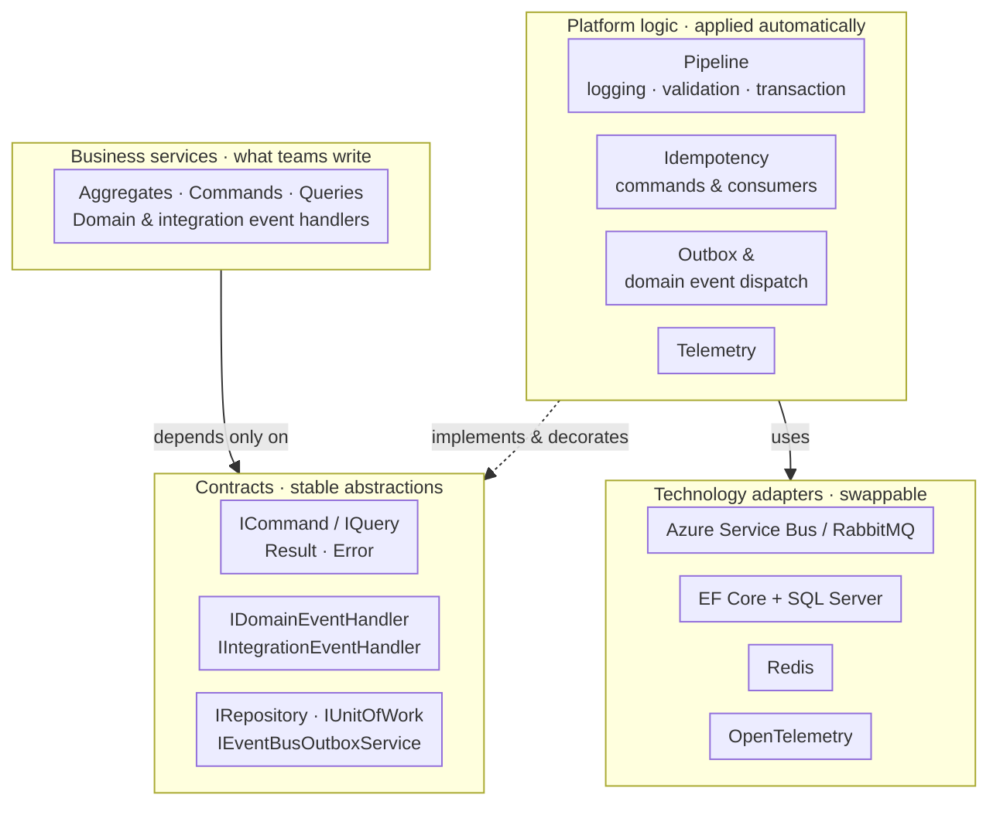
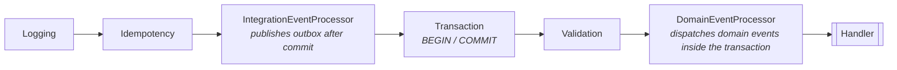
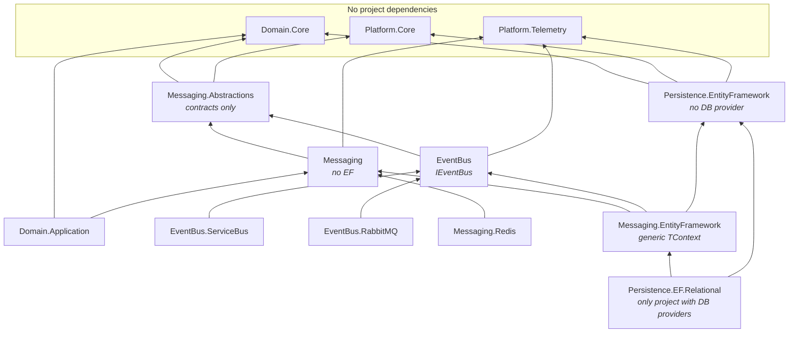
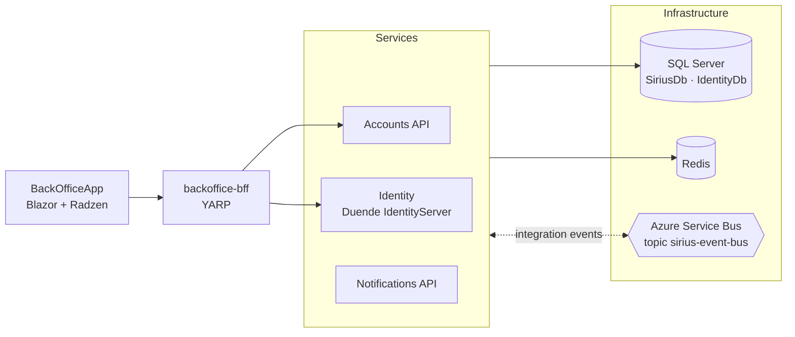

# Sirius · Building Blocks Reference Architecture


[](LICENSE)

A set of **reusable, isolated building blocks** for event-driven microservices on **.NET 10** and **Aspire**: a CQRS command pipeline, domain and integration events, transactional outbox, idempotent commands and consumers, a read model and built-in observability — each one behind its own abstraction, so the technology underneath can change without touching business code.

The blocks are exercised by a [sample B2B domain](docs/features/README.md) (customer onboarding and activation) that proves they work end to end across several services.

**Start here:** [Principle](#-design-principle) · [Building blocks](#-building-blocks) · [Isolation & abstractions](#-isolation-and-abstractions) · [Reference implementation](#-reference-implementation) · [AI-assisted development](#-ai-assisted-development) · [Run locally](#-running-the-project) · [Docs](#-documentation)

> [!NOTE]
> **Continuation of [Labs.Aspire.uSLearn](https://github.com/miquelalcaraz/Labs.Aspire.uSLearn).**
> uSLearn rebuilt the patterns of [dotnet/eShop](https://github.com/dotnet/eShop) step by step. This repository takes the next step: it **extracts those patterns into layered, reusable building blocks** with explicit dependency rules, and validates them with a multi-service sample, identity (Duende IdentityServer) and a Blazor + Radzen back office.
>
> **Educational reference** — not intended for direct production use. See [known limitations](#️-project-status-and-known-limitations).

*Sirius is the name of this lab project; it is not a company or a product.*

---

## 🧭 Design Principle



Business code talks only to contracts. The platform implements and decorates those contracts — pipeline, idempotency, outbox, telemetry — and is the only layer that touches concrete technology, which can be swapped underneath.

> **"Platform evolves, services sleep peacefully."**

The building blocks were designed before every technology decision was final (event bus transport, persistence backend, caching). Instead of betting on one, each concern sits behind an abstraction, and business services depend **only** on those abstractions:

| Strategy | How it shows up in the code |
|---|---|
| **Dependency inversion** | Handlers implement `ICommandHandler<,>`, `IDomainEventHandler<>`, `IIntegrationEventHandler<>`; they never see `DbContext` transactions, the bus client or Redis |
| **Layered contracts** | `*.Abstractions` projects hold contracts only; implementations live in separate projects that can be swapped |
| **Composition over inheritance** | Idempotency, telemetry and transactions are pipeline behaviors and decorators applied automatically, not base classes to inherit from |
| **One registration point** | `AddSiriusMediator(...)` wires the whole pipeline in a fixed order, so services cannot get it wrong |
| **Opt-in evolution** | New capabilities are added as new behaviors, decorators or implementations; existing services keep working unchanged |

The full rationale, decision framework and ADRs are in [PROJECT-CONTEXT.md](.github/PROJECT-CONTEXT.md).

---

## 🧱 Building Blocks

| Project | Responsibility |
|---|---|
| `Domain.Core` | DDD seed work: `Entity` (domain events, `CreatedAt`/`UpdatedAt`, `RowVersion`), `ValueObject`, `IAggregateRoot`, `IRepository`, `IUnitOfWork`, `IDomainEvent` |
| `Domain.Application` | Cross-cutting MediatR behaviors: `LoggingBehavior`, `ValidationBehavior` (FluentValidation) |
| `Platform.Core` | `Result` / `Result<T>` and `Error` (railway-oriented results) |
| `Platform.Messaging.Abstractions` | Contracts: `ICommand<T>`, `IQuery<T>`, `IDomainEventHandler<T>`, `IIntegrationEventHandler<T>`, `IIdempotencyService`, `IEventBusOutboxService`, `IntegrationEvent` |
| `Platform.Messaging` | Persistence-ignorant logic: `IdempotencyBehavior`, telemetry behaviors/decorators, `IdempotentCommand<T>`, outbox/idempotency POCOs |
| `Platform.Messaging.EntityFramework` | `AddSiriusMediator`, `TransactionBehavior`, `DomainEventProcessorBehavior`, `IntegrationEventProcessorBehavior`, EF idempotency, outbox services and `OutboxProcessor` — generic over any `DbContext` |
| `Platform.Messaging.Redis` | Redis fast path for idempotency checks, decorating the EF store |
| `Platform.Persistence.EntityFramework` | EF Core abstractions: `ITransactionalUnitOfWork`, `IDomainEntityChangeTracker`, fluent context configuration |
| `Platform.Persistence.EntityFramework.Relational` | `SiriusDBContext` (write) and `SiriusReadDbContext` (read-only), entity configurations, `Repository<T>`, `ResilientTransaction`, migrations |
| `Platform.EventBus` | `IEventBus` abstraction and subscription builder |
| `Platform.EventBus.ServiceBus` | Azure Service Bus implementation (default) |
| `Platform.EventBus.RabbitMQ` | RabbitMQ implementation (alternative, see limitations) |
| `Platform.Telemetry` | OpenTelemetry activity sources, meters and helpers |
| `Platform.ServiceDefaults` / `Platform.WebApi` / `Platform.Infrastructure` | Aspire service defaults, JWT authentication, OpenAPI + Scalar, `Result` → HTTP mapping, exception middleware, `IUserHttpContext` |

### The command pipeline

Every command flows through the same pipeline, configured with a single call:

```csharp
services.AddSiriusMediator(cfg =>
{
    cfg.RegisterServicesFromAssembly(AssemblyReference.Assembly);
    cfg.WithLogging(typeof(LoggingBehavior<,>));
    cfg.WithValidation(typeof(ValidationBehavior<,>));
});
```



Telemetry behaviors, the domain event publisher and the integration event decorators are registered by the same call. Consumers of integration events get the equivalent guarantees through decorators: telemetry → idempotency (inbox) + transaction → handler. See [Command pipeline](docs/architecture/02-command-pipeline.md) and [Idempotency](docs/architecture/04-idempotency.md).

---

## 🧩 Isolation and Abstractions

The building blocks are split so that **each project knows as little as possible**. Dependencies only point towards more stable, more abstract projects:



What each layer is **not allowed** to know — enforced by project references, not just by convention:

| Project | Does not know about |
|---|---|
| `Domain.Core` | Platform, MediatR pipeline, EF, any infrastructure |
| `Platform.Messaging.Abstractions` / `Platform.Messaging` | Entity Framework, database providers, transports |
| `Platform.Messaging.EntityFramework` | SQL Server / PostgreSQL providers, table names, entity configurations — works with any `DbContext` |
| `Platform.Persistence.EntityFramework` | Database providers |
| `Platform.EventBus.*` transports | Each other — every transport depends only on `Platform.EventBus` |
| `Platform.Persistence.EntityFramework.Relational` | — it is the **only** place for relational specifics (configurations, migrations, providers) |

### Swap points

| Concern | Abstraction | Implementations | What changes in a service when swapping |
|---|---|---|---|
| Event bus | `IEventBus`, `IIntegrationEventHandler<T>` | Azure Service Bus, RabbitMQ | One registration line (`AddServiceBusEventBus` → `AddRabbitMqEventBus`) and the project reference — handlers and events are untouched |
| Idempotency store | `IIdempotencyService` | EF Core (transactional), Redis (fast path decorating EF) | Builder calls only (`AddIdempotencyEntityFramework`, `AddRedisIdempotencyCache`) |
| Outbox | `IEventBusOutboxService` | EF Core outbox + `OutboxProcessor` | None — domain event handlers call `AddAndSaveEventAsync` |
| Persistence | `ITransactionalUnitOfWork`, `IRepository<T>` | `SiriusDBContext` / `SiriusReadDbContext` (relational) | The service's `DbContext` base class; a new backend would be a new `Platform.Persistence.*` project |
| Telemetry | Behaviors, decorators, `INotificationPublisher` | OpenTelemetry | None — registered by `AddSiriusMediator` |

### Isolation between services

Services never reference each other. They communicate only through **integration events** published in `Sirius.Contracts.{Service}` projects, which depend on nothing but `Platform.Messaging.Abstractions`. A producing service writes events to its outbox; consumers subscribe through the event bus and process them idempotently.

What a service actually writes, with no infrastructure in sight:

```csharp
// Domain event handler (Application layer) — runs inside the command's transaction
public async Task Handle(CompanyCreatedDomainEvent notification, CancellationToken ct)
    => await _outboxService.AddAndSaveEventAsync(new CompanyCreatedIntegrationEvent(...));

// Integration event handler (Infrastructure layer) — thin translator, idempotency and telemetry applied by decorators
public async Task Handle(CompanyCreatedIntegrationEvent @event)
    => await _mediator.Send(new SendCompanyWelcomeEmailsCommand(...));
```

Details: [Messaging & persistence layers](docs/architecture/01-messaging-persistence-layers.md) · [Event bus](docs/architecture/07-event-bus.md) · [CQRS read model](docs/architecture/08-cqrs-read-model.md).

---

## 🧪 Reference Implementation

The building blocks are validated by a sample B2B workflow — **customer onboarding and activation** — that spans three services and crosses the event bus several times. It is intentionally realistic enough to exercise process state machines, retries, idempotent consumers and read models, but it is a *proof* of the building blocks, not the goal of the repository.



- **Accounts API** — companies, tenants, subscriptions and the **onboarding** and **activation** processes (DDD aggregates and process state machines).
- **Identity** — Duende IdentityServer with ASP.NET Core Identity; provisions and activates tenant admin users. It also shows how the blocks adapt to a service with two `DbContext`s.
- **Notifications API** — welcome and activation emails, driven by integration events.
- **backoffice-bff** — YARP reverse proxy; the single public entry point for the browser.
- **BackOfficeApp** — Blazor Web App for back-office operators to start and follow the processes.

| Publisher | Integration event | Consumer |
|---|---|---|
| Accounts | `CompanyCreated` | Notifications |
| Accounts | `TenantCreated`, `CustomerAdminProvisioningRequested` | Identity |
| Accounts | `ActivationEmailRequested` | Notifications |
| Accounts | `CustomerGoLive`, `CustomerActivationCompleted` | — *(published for future consumers)* |
| Identity | `ExternalUserProvisioned`, `UserActivated` | Accounts |
| Notifications | `ActivationDelivered` | Accounts |

Every event is written to the publisher's **transactional outbox** in the same database transaction as the business change, published after commit, and processed by **idempotent consumers**. Walkthrough: [Sample domain](docs/features/01-sample-domain.md) · [Onboarding & activation workflow](docs/features/02-onboarding-activation-workflow.md) · [BackOffice API & UI](docs/features/03-backoffice-api-ui.md).

---

## 🤖 AI-Assisted Development

The repository ships with instructions that let AI assistants work within the architecture instead of around it:

| Asset | Purpose |
|---|---|
| [`sirius-platform-architect`](.claude/skills/sirius-platform-architect/SKILL.md) | Claude Code skill — **architect** role. Maintains the building blocks: classifies the change (fix, opt-in capability, new implementation, contract change), applies the decision framework, measures the impact on services, enforces layer rules and keeps architecture docs, known gaps and ADRs up to date |
| [`sirius-feature-developer`](.claude/skills/sirius-feature-developer/SKILL.md) | Claude Code skill — **developer** role. Implements features on top of the blocks: models aggregates, commands and events first, then builds Domain → Contracts → Application → Infrastructure → API → migrations → BackOffice, and flags anything that needs a platform change instead of working around it |
| [`.github/copilot-instructions.md`](.github/copilot-instructions.md) | GitHub Copilot instructions: layer responsibilities, forbidden dependencies, code style, idempotency API conventions |
| [Development rules](docs/developer-guide/06-copilot-development-rules.md) | The shared rulebook both skills and Copilot follow when writing service code |

In Claude Code the skills are picked up automatically from `.claude/skills/` when a request matches their scope, or can be invoked explicitly (`/sirius-platform-architect`, `/sirius-feature-developer`).

---

## 🏗️ Tech Stack

| Area | Technologies |
| --- | --- |
| Runtime | .NET 10, ASP.NET Core minimal APIs, API versioning, OpenAPI + Scalar |
| Orchestration | Aspire 13.6 (AppHost, service defaults, service discovery, health checks, dashboard) |
| Domain / application | DDD, CQRS with MediatR, pipeline behaviors, FluentValidation, Result pattern |
| Persistence | Entity Framework Core 10 + SQL Server, separate read context, Redis |
| Messaging | Azure Service Bus (emulator in development) or RabbitMQ, transactional outbox, idempotent consumers |
| Identity | Duende IdentityServer 8 + ASP.NET Core Identity, BFF with YARP |
| Front end | Blazor Web App + Radzen |
| Observability | Structured logging, OpenTelemetry traces and metrics (trace context propagated through the bus) |
| Testing | xUnit, Moq, FluentAssertions, EF InMemory, Testcontainers, Aspire hosting (in-process test fixtures), xUnit v3 for functional tests |

---

## 📁 Solution Structure

```
src/
 ├── Sirius.Domain/            → Domain.Core, Domain.Application (DDD seed work and behaviors)   ┐
 ├── Sirius.Platform/          → Platform.* building blocks                                    ┘ building blocks
 ├── Sirius.Contracts/         → Integration event contracts shared between services          ┐
 ├── Sirius.Services/                                                                          │
 │    ├── Accounts/            → Api, Application, Domain, Infrastructure                      │
 │    └── Notifications/       → Api, Application, Domain, Infrastructure                      │ reference
 ├── Sirius.Infrastructure/                                                                    │ implementation
 │    ├── AppHost              → Aspire orchestration                                          │
 │    ├── Identity             → Duende IdentityServer                                         │
 │    └── Bff.BackOffice       → YARP backend for frontend                                     │
 └── Sirius.WebApps/                                                                           │
      └── Sirius.BackOfficeApp → Blazor + Radzen back office                                   ┘
tests/
 ├── Platform/                 → UnitTests, IntegrationTests, FunctionalTests (+ TestWebApi host)
 └── Services/                 → UnitTests, FunctionalTests
docs/                          → Architecture, developer guide, sample feature, backlog
.claude/skills/                → Architect and developer skills for Claude Code
```

---

## 🚀 Running the Project

### Requirements

- [.NET 10 SDK](https://dotnet.microsoft.com/download)
- [Docker Desktop](https://www.docker.com/products/docker-desktop/) (or Podman) — **required**: Aspire runs SQL Server, Redis and the Service Bus emulator as containers

### Run with Aspire

```bash
git clone https://github.com/miquelalcaraz/Labs.CleanArchitecture.BuildingBlocks.git
cd Labs.CleanArchitecture.BuildingBlocks
dotnet build Sirius.slnx
dotnet run --project src/Sirius.Infrastructure/Sirius.Infrastructure.AppHost
```

The AppHost starts the containers (SQL Server, Redis, Azure Service Bus emulator), applies the EF Core migrations, seeds demo data and launches `identity`, `accounts`, `notifications`, `backoffice-bff` and `BackOfficeApp`. The **Aspire dashboard** URL is printed in the console; it shows resources, logs, traces and metrics. The SQL Server password is generated by Aspire and stored in the AppHost user secrets.

### Sign in to the back office

Open the `BackOfficeApp` endpoint from the dashboard and sign in with a demo user:

| User | Password | Roles |
|---|---|---|
| `admin@example.com` | `Pass123$` | `PlatformAdmin`, `SystemAdmin` |

> [!WARNING]
> Demo users, their password (`Seed:DemoUsersPassword` in `appsettings.Development.json`) and the IdentityServer client secrets are **development-only** values.

### Switching the event bus to RabbitMQ

Azure Service Bus (emulator) is the default. To use RabbitMQ:

1. In `AppHost.cs`, replace `#define USE_AZURE_SERVICE_BUS` with `#define USE_RABBITMQ`.
2. In the infrastructure projects of Accounts, Notifications and Identity, reference `Platform.EventBus.RabbitMQ` instead of `Platform.EventBus.ServiceBus`.
3. In their service registration (`Infrastructure/Extensions/Extensions.cs` in Accounts and Notifications, `Extensions/Extensions.cs` in Identity), replace `builder.AddServiceBusEventBus("eventbus")` with `builder.AddRabbitMqEventBus("eventbus")`.

Handlers and integration events do not change. Note the [delivery differences](#️-project-status-and-known-limitations) between both transports.

### Running the tests

```bash
# Unit tests (no Docker required)
dotnet test tests/Platform/Platform.UnitTests
dotnet test tests/Services/Services.UnitTests

# Integration tests (Docker required, Testcontainers)
dotnet test tests/Platform/Platform.IntegrationTests

# Functional tests (Docker required, Aspire) — run as executables on the .NET 10 SDK
dotnet run --project tests/Platform/Platform.FunctionalTests
dotnet run --project tests/Services/Services.FunctionalTests
```

---

## 📖 Documentation

The documentation is organized in four sections; each has an index:

| Section | What you will find |
|---|---|
| [Architecture](docs/architecture/README.md) | How each building block works internally: layers, pipeline, domain events, idempotency, outbox, telemetry, event bus, read model, BFF |
| [Developer guide](docs/developer-guide/README.md) | How to build a service on top of them: configuration, transactional pipeline, an end-to-end walkthrough, testing, known gaps, development rules |
| [Sample feature](docs/features/README.md) | The reference implementation (customer onboarding & activation): domain, cross-service workflow, API and UI |
| [Backlog](docs/backlog/README.md) | Designed but deliberately deferred improvements |

Suggested reading path:

| Step | Document |
|---|---|
| 1 | [Messaging & persistence layers](docs/architecture/01-messaging-persistence-layers.md) — the building blocks and their dependency rules |
| 2 | [Command pipeline](docs/architecture/02-command-pipeline.md) — Result pattern, CQRS and the behavior chain |
| 3 | [Transactional pipeline](docs/developer-guide/02-transactional-pipeline.md) — what runs inside and after the transaction |
| 4 | [End-to-end flow](docs/developer-guide/03-end-to-end-flow.md) — one request traced across two services |
| 5 | [Onboarding & activation workflow](docs/features/02-onboarding-activation-workflow.md) — a multi-step process built from these pieces |

---

## ⚠️ Project Status and Known Limitations

This is an evolving reference, not a finished product. Known limitations of the current code (full list in [Known gaps](docs/developer-guide/05-known-gaps.md)):

- **Failed results commit** — `TransactionBehavior` only rolls back on exceptions. A command that returns a failed `Result` (including validation errors) still commits, together with its idempotency entry, so a retry with the same `x-requestid` is treated as a duplicate.
- **Idempotency cache** — the Redis `processing` key is not removed when a command throws; a retry within its TTL (30 s by default) is answered as a duplicate.
- **Outbox recovery** — the `OutboxProcessor` retries events in `NotPublished` or `FailedToPublish` state at a fixed polling interval. Events left in `InProgress` (for example, if the process stops right after claiming them) are not retried.
- **RabbitMQ delivery** — the RabbitMQ consumer acknowledges messages even when a handler throws, and no dead-letter exchange is configured, so failed messages are lost. The Azure Service Bus implementation abandons the message, lets the broker retry it and dead-letters it after the maximum delivery count.
- **Event bus selection** — the transport is chosen in code (AppHost `#define` plus one registration per service), not through configuration.
- **Not packaged yet** — the building blocks are consumed as project references; the NuGet packaging and semantic versioning described in [PROJECT-CONTEXT.md](.github/PROJECT-CONTEXT.md) are design goals.
- **Audit log** — entities get automatic `CreatedAt`/`UpdatedAt` and an optimistic concurrency `RowVersion`. A full audit log (`AuditLog` entity) is designed but not wired yet; see the [backlog](docs/backlog/audit-log-proposal.md).
- **Authorization** — there is no generic authorization behavior in the pipeline; endpoints use ASP.NET Core authorization policies.
- **Delivery guarantees** — the outbox and idempotent consumers protect the implemented paths; they do not provide end-to-end exactly-once delivery.
- **Sample shortcuts** — emails are only logged, the activation link carries no confirmation token, and APIs disable audience validation. See [Simplifications in the sample](docs/features/02-onboarding-activation-workflow.md#simplifications-in-the-sample).
- **Development-only security settings** — IdentityServer clients use hard-coded secrets and `RequirePkce = false`, the Scalar UI clients use the implicit flow, JWT bearer validation runs with `RequireHttpsMetadata = false`, and the BackOffice client also allows a fixed `https://localhost:5001` redirect URI. They keep the local setup simple; a real deployment needs PKCE, secrets from a vault and HTTPS metadata.

---

## 🙏 Credits

- [dotnet/eShop](https://github.com/dotnet/eShop) — Microsoft's reference application whose patterns inspired the building blocks (MIT license).
- [Labs.Aspire.uSLearn](https://github.com/miquelalcaraz/Labs.Aspire.uSLearn) — the predecessor of this repository.
- [Aspire](https://learn.microsoft.com/dotnet/aspire/), [Duende IdentityServer](https://duendesoftware.com/products/identityserver), [Radzen Blazor](https://blazor.radzen.com/).

## 📄 License

Distributed under the [MIT](LICENSE) license. Some dependencies — notably **Duende IdentityServer**, **MediatR** and **FluentAssertions** — have their own commercial or dual licenses; see [THIRD-PARTY-NOTICES.md](THIRD-PARTY-NOTICES.md) before reusing this code.

## 🤝 Contributing

This is a personal, educational reference, but suggestions and improvements are welcome through issues or pull requests. If you use Claude Code, the [architect and developer skills](#-ai-assisted-development) describe the rules a change is expected to follow.

## 👤 Author

**Miquel Alcaraz** — [GitHub](https://github.com/miquelalcaraz)
