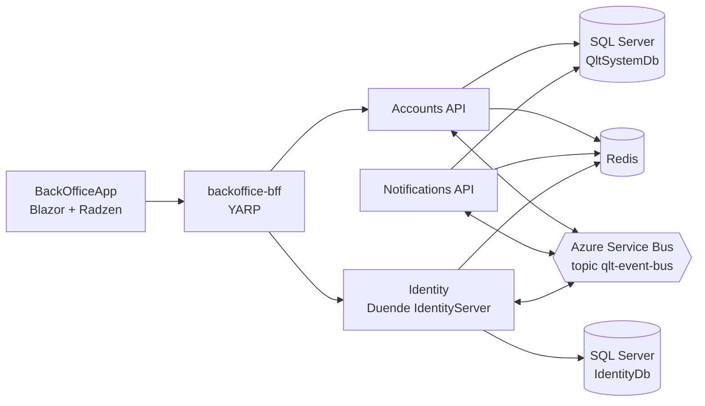

# Qlt · Building Blocks Reference Architecture


[](LICENSE)

A **reference architecture for event-driven microservices** on **.NET 10** and **Aspire**, organized around a set of reusable **building blocks**: CQRS pipeline, domain and integration events, transactional outbox, idempotent commands and consumers, read models and observability.

The building blocks are applied to a sample B2B domain — **customer onboarding and subscription lifecycle** — with three services, an IdentityServer, a BFF and a Blazor back office.

**Start here:** [Overview](#-overview) · [Building blocks](#-building-blocks) · [Run locally](#-running-the-project) · [Documentation](#-documentation) · [Known limitations](#️-project-status-and-known-limitations)

> [!NOTE]
> **Continuation of [Labs.Aspire.uSLearn](https://github.com/miquelalcaraz/Labs.Aspire.uSLearn).**
> uSLearn rebuilt the patterns of [dotnet/eShop](https://github.com/dotnet/eShop) step by step (domain events, integration events, idempotency, resilient transactions, telemetry). This repository takes the next step: it **extracts those patterns into layered, reusable building blocks** and adds the stages uSLearn had planned — identity with Duende IdentityServer and a Blazor + Radzen front end.
>
> **Educational reference** — not intended for direct production use. See [known limitations](#️-project-status-and-known-limitations).

*Qlt is the name of this lab project; it is not a company or a product.*

---

## 🧭 Overview

The guiding principle is **"Platform evolves, services sleep peacefully"**: business services depend on abstractions, so infrastructure (event bus, persistence, caching, telemetry) can change underneath them with minimal impact.



- **Accounts API** — companies, tenants, subscriptions, the customer **onboarding** process and the customer **activation** process (DDD aggregates and process state machines).
- **Identity** — Duende IdentityServer with ASP.NET Core Identity; provisions tenant admin users and activates them.
- **Notifications API** — welcome and activation emails, driven by integration events.
- **backoffice-bff** — YARP reverse proxy; the single public entry point for the browser, including IdentityServer routes.
- **BackOfficeApp** — Blazor Web App with Radzen components for the back-office operators.

### Integration events between services

| Publisher | Integration event | Consumer |
|---|---|---|
| Accounts | `CompanyCreated` | Notifications |
| Accounts | `TenantCreated` | Identity |
| Accounts | `CustomerAdminProvisioningRequested` | Identity |
| Accounts | `ActivationEmailRequested` | Notifications |
| Accounts | `CustomerGoLive`, `CustomerActivationCompleted` | — *(published for future consumers)* |
| Identity | `ExternalUserProvisioned` | Accounts |
| Identity | `UserActivated` | Accounts |
| Notifications | `ActivationDelivered` | Accounts |

Every event is written to the publisher's **transactional outbox** in the same database transaction as the business change, published after commit, and processed by **idempotent consumers**.

---

## 🧱 Building Blocks

| Project | Responsibility |
|---|---|
| `Domain.Core` | DDD seed work: `Entity` (domain events, `CreatedAt`/`UpdatedAt`, `RowVersion`), `ValueObject`, `IAggregateRoot`, `IRepository`, `IUnitOfWork`, `IDomainEvent` |
| `Domain.Application` | Cross-cutting MediatR behaviors: `LoggingBehavior`, `ValidationBehavior` (FluentValidation) |
| `Platform.Core` | `Result` / `Result<T>` and `Error` (railway-oriented results) |
| `Platform.Messaging.Abstractions` | Contracts: `ICommand<T>`, `IQuery<T>`, `IDomainEventHandler<T>`, `IIntegrationEventHandler<T>`, `IIdempotencyService`, `IEventBusOutboxService`, `IntegrationEvent` |
| `Platform.Messaging` | Persistence-ignorant logic: `IdempotencyBehavior`, telemetry behaviors/decorators, `AddQltMediator` |
| `Platform.Messaging.EntityFramework` | `TransactionBehavior`, `DomainEventProcessorBehavior`, `IntegrationEventProcessorBehavior`, EF idempotency, outbox services and `OutboxProcessor` |
| `Platform.Messaging.Redis` | Redis fast path for idempotency checks |
| `Platform.Persistence.EntityFramework` | EF Core abstractions: `ITransactionalUnitOfWork`, `IDomainEntityChangeTracker`, fluent context configuration |
| `Platform.Persistence.EntityFramework.Relational` | `QltDBContext` (write) and `QltReadDbContext` (read-only), entity configurations, `Repository<T>`, `ResilientTransaction`, migrations |
| `Platform.EventBus` | `IEventBus` abstraction and subscription builder |
| `Platform.EventBus.ServiceBus` | Azure Service Bus implementation (default) |
| `Platform.EventBus.RabbitMQ` | RabbitMQ implementation (alternative, see limitations) |
| `Platform.Telemetry` | OpenTelemetry activity sources, meters and helpers |
| `Platform.ServiceDefaults` / `Platform.WebApi` | Aspire service defaults, authentication, OpenAPI + Scalar, API error handling |

Every command flows through the same pipeline, configured with a single call:

```csharp
services.AddQltMediator(cfg =>
{
    cfg.RegisterServicesFromAssembly(AssemblyReference.Assembly);
    cfg.WithLogging(typeof(LoggingBehavior<,>));
    cfg.WithValidation(typeof(ValidationBehavior<,>));
});
```

```
Logging → Idempotency → IntegrationEventProcessor → Transaction → Validation → DomainEventProcessor → Handler
                        (publishes outbox           (BEGIN /                    (dispatches domain events
                         after commit)               COMMIT)                     inside the transaction)
```

---

## 🏗️ Tech Stack

| Area | Technologies |
| --- | --- |
| Runtime | .NET 10, ASP.NET Core minimal APIs, API versioning, OpenAPI + Scalar |
| Orchestration | Aspire 13.2 (AppHost, service defaults, service discovery, health checks, dashboard) |
| Domain / application | DDD, CQRS with MediatR, pipeline behaviors, FluentValidation, Result pattern |
| Persistence | Entity Framework Core 10 + SQL Server, separate read context, Redis |
| Messaging | Azure Service Bus (emulator in development) or RabbitMQ, transactional outbox, idempotent consumers |
| Identity | Duende IdentityServer 7 + ASP.NET Core Identity, BFF with YARP |
| Front end | Blazor Web App + Radzen |
| Observability | Structured logging, OpenTelemetry traces and metrics (trace context propagated through the bus) |
| Testing | xUnit, Moq, FluentAssertions, EF InMemory, Testcontainers, Aspire testing |

---

## 🧩 Solution Structure

```
src/
 ├── Qlt.Domain/            → Domain.Core, Domain.Application (DDD seed work and behaviors)
 ├── Qlt.Platform/          → Platform.* building blocks (messaging, persistence, event bus, telemetry, web)
 ├── Qlt.Contracts/         → Integration event contracts shared between services
 ├── Qlt.Services/
 │    ├── Accounts/         → Api, Application, Domain, Infrastructure
 │    └── Notifications/    → Api, Application, Domain, Infrastructure
 ├── Qlt.Infrastructure/
 │    ├── AppHost           → Aspire orchestration
 │    ├── Identity          → Duende IdentityServer
 │    └── Bff.BackOffice    → YARP backend for frontend
 └── Qlt.WebApps/
      └── Qlt.BackOfficeApp → Blazor + Radzen back office
tests/
 ├── Platform/              → UnitTests, IntegrationTests, FunctionalTests (+ TestWebApi host)
 └── Services/              → UnitTests, FunctionalTests
docs/                       → Architecture and developer documentation
```

---

## 🚀 Running the Project

### Requirements

- [.NET 10 SDK](https://dotnet.microsoft.com/download)
- [Docker Desktop](https://www.docker.com/products/docker-desktop/) (or Podman) — **required**: Aspire runs SQL Server, Redis and the Service Bus emulator as containers

### Run with Aspire

```bash
git clone https://github.com/miquelalcaraz/Labs.Aspire.BuildingBlocks.git
cd Labs.Aspire.BuildingBlocks
dotnet build QltSystem.slnx
dotnet run --project src/Qlt.Infrastructure/Qlt.Infrastructure.AppHost
```

The AppHost starts the containers (SQL Server, Redis, Azure Service Bus emulator), applies the EF Core migrations, seeds demo data and launches `identity`, `accounts`, `notifications`, `backoffice-bff` and `BackOfficeApp`. The **Aspire dashboard** URL is printed in the console; it shows resources, logs, traces and metrics. The SQL Server password is generated by Aspire and stored in the AppHost user secrets.

### Sign in to the back office

Open the `BackOfficeApp` endpoint from the dashboard and sign in with a demo user:

| User | Password | Roles |
|---|---|---|
| `admin@example.com` | `Pass123$` | `PlatformAdmin`, `SystemAdmin` |

> [!WARNING]
> Demo users, their password (`Seed:DemoUsersPassword` in `appsettings.Development.json`) and the IdentityServer client secrets are **development-only** values.

### Switching the event bus to RabbitMQ

Azure Service Bus (emulator) is the default. To use RabbitMQ:

1. In `AppHost.cs`, replace `#define USE_AZURE_SERVICE_BUS` with `#define USE_RABBITMQ`.
2. In the infrastructure projects of Accounts, Notifications and Identity, reference `Platform.EventBus.RabbitMQ` instead of `Platform.EventBus.ServiceBus`.
3. In their service registration (`Infrastructure/Extensions/Extensions.cs` in Accounts and Notifications, `Extensions/Extensions.cs` in Identity), replace `builder.AddServiceBusEventBus("eventbus")` with `builder.AddRabbitMqEventBus("eventbus")`.

Handlers and integration events do not change. Note the [delivery differences](#️-project-status-and-known-limitations) between both transports.

### Running the tests

```bash
# Unit tests (no Docker required)
dotnet test tests/Platform/Platform.UnitTests
dotnet test tests/Services/Services.UnitTests

# Integration tests (Docker required, Testcontainers)
dotnet test tests/Platform/Platform.IntegrationTests

# Functional tests (Docker required, Aspire) — run as executables on the .NET 10 SDK
dotnet run --project tests/Platform/Platform.FunctionalTests
dotnet run --project tests/Services/Services.FunctionalTests
```

---

## 📖 Documentation

| Document | Content |
|---|---|
| [Messaging & persistence layers](docs/architecture/01-messaging-persistence-layers.md) | The layered building blocks, their responsibilities and dependency rules |
| [Domain events & consistency](docs/architecture/03-domain-events-consistency.md) | Domain events inside the transaction, strong vs eventual consistency |
| [Telemetry](docs/architecture/06-telemetry.md) | OpenTelemetry for commands, domain events and integration events |
| [CQRS read model](docs/architecture/08-cqrs-read-model.md) | Read-only `DbContext` and query-side separation |
| [Identity & BFF URL configuration](docs/architecture/09-identity-bff-url-configuration.md) | The BFF as public identity facade, issuer and URL wiring |
| [Service configuration](docs/developer-guide/01-service-configuration.md) | How a service wires the building blocks (`AddQltMediator`, contexts, outbox, idempotency) |
| [Transactional pipeline](docs/developer-guide/02-transactional-pipeline.md) | What runs inside and after the transaction, and failure scenarios |
| [AI-assisted development rules](docs/developer-guide/06-copilot-development-rules.md) | Templates and rules used to build services with AI assistants |
| [Backlog](docs/backlog/README.md) | Designed but deliberately deferred improvements |

> [!NOTE]
> The documentation is being reviewed against the current implementation. Some examples still use the `Organization` sample from uSLearn; the equivalent in this codebase is the `Company` aggregate (`CreateCompanyCommand`, `CompanyCreatedDomainEvent`).

---

## ⚠️ Project Status and Known Limitations

This is an evolving reference, not a finished product. Known limitations of the current code:

- **Outbox recovery** — the `OutboxProcessor` retries events in `NotPublished` or `FailedToPublish` state at a fixed polling interval. Events left in `InProgress` (for example, if the process stops right after claiming them) are not retried.
- **RabbitMQ delivery** — the RabbitMQ consumer acknowledges messages even when a handler throws, and no dead-letter exchange is configured, so failed messages are lost. The Azure Service Bus implementation abandons the message, lets the broker retry it and dead-letters it after the maximum delivery count.
- **Event bus selection** — the transport is chosen in code (AppHost `#define` plus one registration per service), not through configuration.
- **Audit log** — entities get automatic `CreatedAt`/`UpdatedAt` and an optimistic concurrency `RowVersion`. A full audit log (`AuditLog` entity) is designed but not wired yet; see the [backlog](docs/backlog/audit-log-proposal.md).
- **Authorization** — there is no generic authorization behavior in the pipeline; endpoints use ASP.NET Core authorization policies.
- **Delivery guarantees** — the outbox and idempotent consumers protect the implemented paths; they do not provide end-to-end exactly-once delivery.

---

## 🙏 Credits

- [dotnet/eShop](https://github.com/dotnet/eShop) — Microsoft's reference application whose patterns inspired the building blocks (MIT license).
- [Labs.Aspire.uSLearn](https://github.com/miquelalcaraz/Labs.Aspire.uSLearn) — the predecessor of this repository.
- [Aspire](https://learn.microsoft.com/dotnet/aspire/), [Duende IdentityServer](https://duendesoftware.com/products/identityserver), [Radzen Blazor](https://blazor.radzen.com/).

## 📄 License

Distributed under the [MIT](LICENSE) license. Some dependencies — notably **Duende IdentityServer**, **MediatR** and **FluentAssertions** — have their own commercial or dual licenses; see [THIRD-PARTY-NOTICES.md](THIRD-PARTY-NOTICES.md) before reusing this code.

## 🤝 Contributing

This is a personal, educational reference, but suggestions and improvements are welcome through issues or pull requests.

## 👤 Author

**Miquel Alcaraz** — [GitHub](https://github.com/miquelalcaraz)
