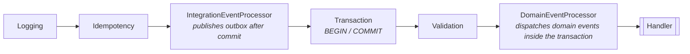
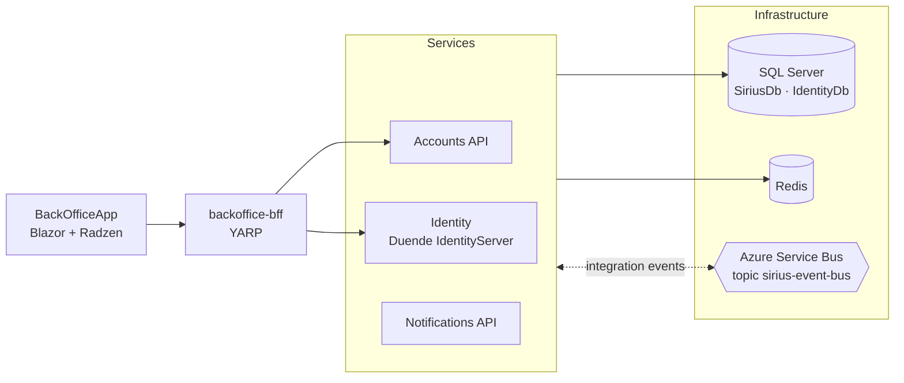

# Sirius · Service Platform


[](LICENSE)

A **reusable base architecture for event-driven .NET services** on **.NET 10** and **Aspire**. The platform is made of isolated building blocks — a CQRS command pipeline, domain and integration events, transactional outbox, idempotent commands and consumers, a read model and built-in observability — each one behind its own abstraction, so the technology underneath can change without touching business code.

The platform is exercised by a [sample B2B domain](docs/features/README.md) (customer onboarding and activation) that proves it works end to end across several services.

### ✨ Highlights

- **Reliable cross-service messaging** — transactional outbox, idempotent commands and consumers (EF Core as source of truth, Redis fast path), Azure Service Bus or RabbitMQ behind a single `IEventBus`.
- **Enforced layering** — business code depends only on contracts; switching the event bus transport is one registration line per service, with handlers and events untouched.
- **DDD and CQRS on one transactional pipeline** — aggregates, process state machines, domain events dispatched inside the transaction and a railway-oriented `Result`.
- **End-to-end observability** — OpenTelemetry traces and metrics, with trace context propagated through the bus and visible in the Aspire dashboard.
- **Three test levels** — unit, integration with Testcontainers and functional tests hosted by Aspire.
- **AI-assisted development with guardrails** — architect and developer skills that enforce the layer rules and verify changes through Aspire traces.

<!-- TODO: add a screenshot, e.g.  -->

**Start here:** [Design principle](#-design-principle) · [Reference implementation](#-reference-implementation) · [Quick start](#-quick-start) · [Documentation](#-documentation)

> [!NOTE]
> **Continuation of [Labs.Aspire.uSLearn](https://github.com/miquelalcaraz/Labs.Aspire.uSLearn).**
> uSLearn rebuilt the patterns of [dotnet/eShop](https://github.com/dotnet/eShop) step by step. This repository takes the next step: it **extracts those patterns into a reusable service platform** of layered building blocks with explicit dependency rules, and validates them with a multi-service sample, identity (Duende IdentityServer) and a Blazor + Radzen back office.
>
> **Educational reference** — not intended for direct production use. See [known limitations](#️-project-status-and-known-limitations).

*Sirius is the name of this lab project; it is not a company or a product.*

---

## 🧭 Design Principle

```mermaid
%%{init: {"themeVariables": {"fontSize": "12px"}, "flowchart": {"nodeSpacing": 15, "rankSpacing": 30, "padding": 6}}}%%
flowchart LR
    subgraph S["Business services · what teams write"]
        direction TB
        H["Aggregates · Commands · Queries<br/>Domain & integration event handlers"]
    end

    subgraph A["Contracts · stable abstractions"]
        direction TB
        A1["ICommand / IQuery<br/>Result · Error"]
        A2["IDomainEventHandler<br/>IIntegrationEventHandler"]
        A3["IRepository · IUnitOfWork<br/>IEventBusOutboxService"]
    end

    subgraph P["Platform logic · applied automatically"]
        direction TB
        P1["Pipeline<br/>logging · validation · transaction"]
        P2["Idempotency<br/>commands & consumers"]
        P3["Outbox &<br/>domain event dispatch"]
        P4["Telemetry"]
    end

    subgraph T["Technology adapters · swappable"]
        direction TB
        T1["Azure Service Bus / RabbitMQ"]
        T2["EF Core + SQL Server"]
        T3["Redis"]
        T4["OpenTelemetry"]
    end

    S -- "depends only on" --> A
    A <-. "implements & decorates" .- P
    P -- "uses" --> T
```

> **"Platform evolves, services sleep peacefully."**

The building blocks were designed before every technology decision was final (event bus transport, persistence backend, caching). Instead of betting on one, business code talks **only** to contracts; the platform implements and decorates them — pipeline, idempotency, outbox, telemetry — and is the only layer that touches concrete technology, which can be swapped underneath:

| Strategy | How it shows up in the code |
|---|---|
| **Dependency inversion** | Handlers implement `ICommandHandler<,>`, `IDomainEventHandler<>`, `IIntegrationEventHandler<>`; they never see `DbContext` transactions, the bus client or Redis |
| **Layered contracts** | `*.Abstractions` projects hold contracts only; implementations live in separate projects that can be swapped |
| **Composition over inheritance** | Idempotency, telemetry and transactions are pipeline behaviors and decorators applied automatically, not base classes to inherit from |
| **One registration point** | `AddSiriusMediator(...)` wires the whole pipeline in a fixed order, so services cannot get it wrong |
| **Opt-in evolution** | New capabilities are added as new behaviors, decorators or implementations; existing services keep working unchanged |

> **[Explore the architecture](docs/architecture/README.md)** — isolation diagram, the 16 building blocks, swap points, implementation status and the in-depth documents.

The full rationale, decision framework and ADRs are in [Principles & ADRs](docs/architecture/00-principles-and-adrs.md).

---

## 🧱 Building Blocks

The platform is split into 16 small projects, each with a single responsibility. The [project list, dependency tiers and swap points](docs/architecture/README.md#isolation-and-abstractions) are in the architecture overview.

### The command pipeline

Every command flows through the same pipeline, configured with a single call:

```csharp
services.AddSiriusMediator(cfg =>
{
    cfg.RegisterServicesFromAssembly(AssemblyReference.Assembly);
    cfg.WithLogging(typeof(LoggingBehavior<,>));
    cfg.WithValidation(typeof(ValidationBehavior<,>));
});
```



Telemetry behaviors, the domain event publisher and the integration event decorators are registered by the same call. Consumers of integration events get the equivalent guarantees through decorators: telemetry → idempotency (inbox) + transaction → handler. See [Command pipeline](docs/architecture/02-command-pipeline.md) and [Idempotency](docs/architecture/04-idempotency.md).

---

## 🧪 Reference Implementation

The building blocks are validated by a sample B2B workflow — **customer onboarding and activation** — that spans three services and crosses the event bus several times. It is intentionally realistic enough to exercise process state machines, retries, idempotent consumers and read models, but it is a *proof* of the building blocks, not the goal of the repository.



- **Accounts API** — companies, tenants, subscriptions and the **onboarding** and **activation** processes (DDD aggregates and process state machines).
- **Identity** — Duende IdentityServer with ASP.NET Core Identity; provisions and activates tenant admin users. It also shows how the blocks adapt to a service with two `DbContext`s.
- **Notifications API** — welcome and activation emails, driven by integration events.
- **backoffice-bff** — YARP reverse proxy; the single public entry point for the browser.
- **BackOfficeApp** — Blazor Web App for back-office operators to start and follow the processes.

| Publisher | Integration event | Consumer |
|---|---|---|
| Accounts | `CompanyCreated` | Notifications |
| Accounts | `TenantCreated`, `CustomerAdminProvisioningRequested` | Identity |
| Accounts | `ActivationEmailRequested` | Notifications |
| Accounts | `CustomerGoLive`, `CustomerActivationCompleted` | — *(published for future consumers)* |
| Identity | `ExternalUserProvisioned`, `UserActivated` | Accounts |
| Notifications | `ActivationDelivered` | Accounts |

Every event is written to the publisher's **transactional outbox** in the same database transaction as the business change, published after commit, and processed by **idempotent consumers**. Walkthrough: [Sample domain](docs/features/01-sample-domain.md) · [Onboarding & activation workflow](docs/features/02-onboarding-activation-workflow.md) · [BackOffice API & UI](docs/features/03-backoffice-api-ui.md).

---

## 🚀 Quick Start

### Requirements

- [.NET 10 SDK](https://dotnet.microsoft.com/download)
- [Docker Desktop](https://www.docker.com/products/docker-desktop/) (or Podman) — **required**: Aspire runs SQL Server, Redis and the Service Bus emulator as containers
- [Aspire CLI](https://aspire.dev) — optional for humans (`dotnet tool install -g Aspire.Cli`, then `aspire run` instead of `dotnet run`); required by the Aspire skills for AI agents

### Run with Aspire

```bash
git clone https://github.com/miquelalcaraz/Labs.ServicePlatform.git
cd Labs.ServicePlatform
dotnet build Sirius.slnx
dotnet run --project src/Sirius.Infrastructure/Sirius.Infrastructure.AppHost

# or, with the Aspire CLI installed
aspire run --apphost src/Sirius.Infrastructure/Sirius.Infrastructure.AppHost
```

The AppHost starts the containers (SQL Server, Redis, Azure Service Bus emulator), applies the EF Core migrations, seeds demo data and launches `identity`, `accounts`, `notifications`, `backoffice-bff` and `BackOfficeApp`. The **Aspire dashboard** URL is printed in the console; it shows resources, logs, traces and metrics. The SQL Server password is generated by Aspire and stored in the AppHost user secrets.

### Sign in to the back office

Open the `BackOfficeApp` endpoint from the dashboard and sign in with a demo user:

| User | Password | Roles |
|---|---|---|
| `admin@example.com` | `Pass123$` | `PlatformAdmin`, `SystemAdmin` |

> [!WARNING]
> Demo users, their password (`Seed:DemoUsersPassword` in `appsettings.Development.json`) and the IdentityServer client secrets are **development-only** values.

### Switching the event bus to RabbitMQ

Azure Service Bus (emulator) is the default. To use RabbitMQ:

1. In `AppHost.cs`, replace `#define USE_AZURE_SERVICE_BUS` with `#define USE_RABBITMQ`.
2. In the infrastructure projects of Accounts, Notifications and Identity, reference `Platform.EventBus.RabbitMQ` instead of `Platform.EventBus.ServiceBus`.
3. In their service registration (`Infrastructure/Extensions/Extensions.cs` in Accounts and Notifications, `Extensions/Extensions.cs` in Identity), replace `builder.AddServiceBusEventBus("eventbus")` with `builder.AddRabbitMqEventBus("eventbus")`.

Handlers and integration events do not change. Note the [delivery differences](docs/developer-guide/05-known-gaps.md#rabbitmq-transport-robustness) between both transports.

### Running the tests

```bash
# Unit tests (no Docker required)
dotnet test tests/Platform/Platform.UnitTests
dotnet test tests/Services/Services.UnitTests

# Integration tests (Docker required, Testcontainers)
dotnet test tests/Platform/Platform.IntegrationTests

# Functional tests (Docker required, Aspire) — run as executables on the .NET 10 SDK
dotnet run --project tests/Platform/Platform.FunctionalTests
dotnet run --project tests/Services/Services.FunctionalTests
```

---

## 📖 Documentation

The documentation is organized in four sections; each has an index:

| Section | What you will find |
|---|---|
| [Architecture](docs/architecture/README.md) | How each building block works internally: layers, pipeline, domain events, idempotency, outbox, telemetry, event bus, read model, BFF |
| [Developer guide](docs/developer-guide/README.md) | How to build a service on top of them: configuration, transactional pipeline, an end-to-end walkthrough, testing, known gaps, development rules |
| [Sample feature](docs/features/README.md) | The reference implementation (customer onboarding & activation): domain, cross-service workflow, API and UI |
| [Backlog](docs/backlog/README.md) | Designed but deliberately deferred improvements |

Suggested reading path:

| Step | Document |
|---|---|
| 1 | [Messaging & persistence layers](docs/architecture/01-messaging-persistence-layers.md) — the building blocks and their dependency rules |
| 2 | [Command pipeline](docs/architecture/02-command-pipeline.md) — Result pattern, CQRS and the behavior chain |
| 3 | [Transactional pipeline](docs/developer-guide/02-transactional-pipeline.md) — what runs inside and after the transaction |
| 4 | [End-to-end flow](docs/developer-guide/03-end-to-end-flow.md) — one request traced across two services |
| 5 | [Onboarding & activation workflow](docs/features/02-onboarding-activation-workflow.md) — a multi-step process built from these pieces |

---

## 🤖 AI-Assisted Development

The repository ships with instructions that let AI assistants work within the architecture instead of around it. Two Claude Code skills split the work the way a team would:

| Role | Responsibility |
|---|---|
| [`sirius-platform-architect`](.claude/skills/sirius-platform-architect/SKILL.md) | Evolves the building blocks: classifies each change, checks its impact on services against the layer rules and keeps ADRs and known gaps in sync with the code |
| [`sirius-feature-developer`](.claude/skills/sirius-feature-developer/SKILL.md) | Builds features on top of the contracts, from aggregates and events down to the BackOffice, and flags anything that needs a platform change instead of working around it |

Both roles verify their changes end to end with the tooling skills: [`aspire`](.claude/skills/aspire/SKILL.md), [`aspire-orchestration`](.claude/skills/aspire-orchestration/SKILL.md) and [`aspire-monitoring`](.claude/skills/aspire-monitoring/SKILL.md) run the AppHost and check idempotency, the outbox and cross-service events through traces; [`dotnet-inspect`](.claude/skills/dotnet-inspect/SKILL.md) diffs NuGet APIs before upgrades. The tooling skills are adapted from the dotnet/eShop agent skills. Shared rules live in [`CLAUDE.md`](CLAUDE.md) and the [development rules](docs/developer-guide/06-copilot-development-rules.md); [GitHub Copilot](.github/copilot-instructions.md) is pointed to the same guidance.

---

## 🏗️ Tech Stack & Solution Structure

| Area | Technologies |
| --- | --- |
| Runtime | .NET 10, ASP.NET Core minimal APIs, API versioning, OpenAPI + Scalar |
| Orchestration | Aspire 13.6 (AppHost, service defaults, service discovery, health checks, dashboard) |
| Domain / application | DDD, CQRS with MediatR, pipeline behaviors, FluentValidation, Result pattern |
| Persistence | Entity Framework Core 10 + SQL Server, separate read context, Redis |
| Messaging | Azure Service Bus (emulator in development) or RabbitMQ, transactional outbox, idempotent consumers |
| Identity | Duende IdentityServer 8 + ASP.NET Core Identity, BFF with YARP |
| Front end | Blazor Web App + Radzen |
| Observability | Structured logging, OpenTelemetry traces and metrics (trace context propagated through the bus) |
| Testing | xUnit, Moq, FluentAssertions, EF InMemory, Testcontainers, Aspire hosting (in-process test fixtures), xUnit v3 for functional tests |

<details>
<summary><b>Solution structure</b></summary>

```
src/
 ├── Sirius.Domain/            → Domain.Core, Domain.Application (DDD seed work and behaviors)   ┐
 ├── Sirius.Platform/          → Platform.* building blocks                                    ┘ platform
 ├── Sirius.Contracts/         → Integration event contracts shared between services          ┐
 ├── Sirius.Services/                                                                          │
 │    ├── Accounts/            → Api, Application, Domain, Infrastructure                      │
 │    └── Notifications/       → Api, Application, Domain, Infrastructure                      │ reference
 ├── Sirius.Infrastructure/                                                                    │ implementation
 │    ├── AppHost              → Aspire orchestration                                          │
 │    ├── Identity             → Duende IdentityServer                                         │
 │    └── Bff.BackOffice       → YARP backend for frontend                                     │
 └── Sirius.WebApps/                                                                           │
      └── Sirius.BackOfficeApp → Blazor + Radzen back office                                   ┘
tests/
 ├── Platform/                 → UnitTests, IntegrationTests, FunctionalTests (+ TestWebApi host)
 └── Services/                 → UnitTests, FunctionalTests
docs/                          → Architecture, developer guide, sample feature, backlog
.claude/skills/                → Architect and developer skills, plus Aspire and dotnet-inspect tooling skills
```

</details>

---

## ⚠️ Project Status and Known Limitations

This is an evolving reference, not a finished product. The main open gaps:

- **Failed results commit** — a command that returns a failed `Result` still commits its idempotency entry, so a retry with the same `x-requestid` is answered as a duplicate. ([details](docs/developer-guide/05-known-gaps.md#failed-result-is-committed))
- **Outbox recovery** — events left `InProgress` by a stopped process are not reclaimed. ([details](docs/developer-guide/05-known-gaps.md#stuck-inprogress-outbox-rows))
- **RabbitMQ delivery** — failed messages are acknowledged and lost; Azure Service Bus (the default) retries and dead-letters them. ([details](docs/developer-guide/05-known-gaps.md#rabbitmq-transport-robustness))
- **Development-only security** — hard-coded client secrets, no PKCE and no audience validation keep the local setup simple. ([details](docs/developer-guide/05-known-gaps.md#development-only-security-settings))
- **Not packaged yet** — the building blocks are consumed as project references, not NuGet packages. ([details](docs/developer-guide/05-known-gaps.md#building-blocks-not-packaged))

The complete list, with severity and planned fixes, is in [Known gaps](docs/developer-guide/05-known-gaps.md).

---

## 🙏 Credits

- [dotnet/eShop](https://github.com/dotnet/eShop) — Microsoft's reference application whose patterns inspired the building blocks (MIT license).
- [Labs.Aspire.uSLearn](https://github.com/miquelalcaraz/Labs.Aspire.uSLearn) — the predecessor of this repository.
- [Aspire](https://learn.microsoft.com/dotnet/aspire/), [Duende IdentityServer](https://duendesoftware.com/products/identityserver), [Radzen Blazor](https://blazor.radzen.com/).

---

## 📄 License

Distributed under the [MIT](LICENSE) license. Some dependencies — notably **Duende IdentityServer**, **MediatR** and **FluentAssertions** — have their own commercial or dual licenses; see [THIRD-PARTY-NOTICES.md](THIRD-PARTY-NOTICES.md) before reusing this code.

---

## 🤝 Contributing

This is a personal, educational reference, but suggestions and improvements are welcome through issues or pull requests. If you use Claude Code, the [architect and developer skills](#-ai-assisted-development) describe the rules a change is expected to follow.

---

## 👤 Author

**Miquel Alcaraz** — [GitHub](https://github.com/miquelalcaraz)
