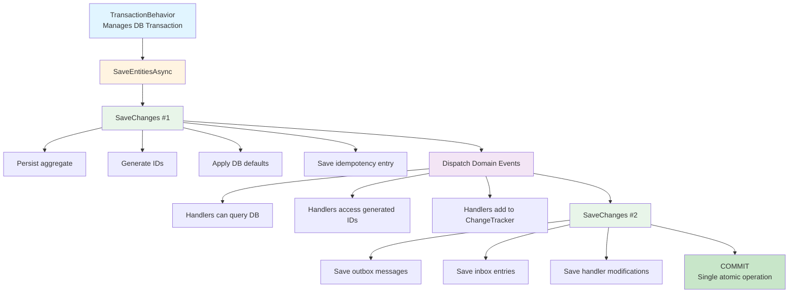
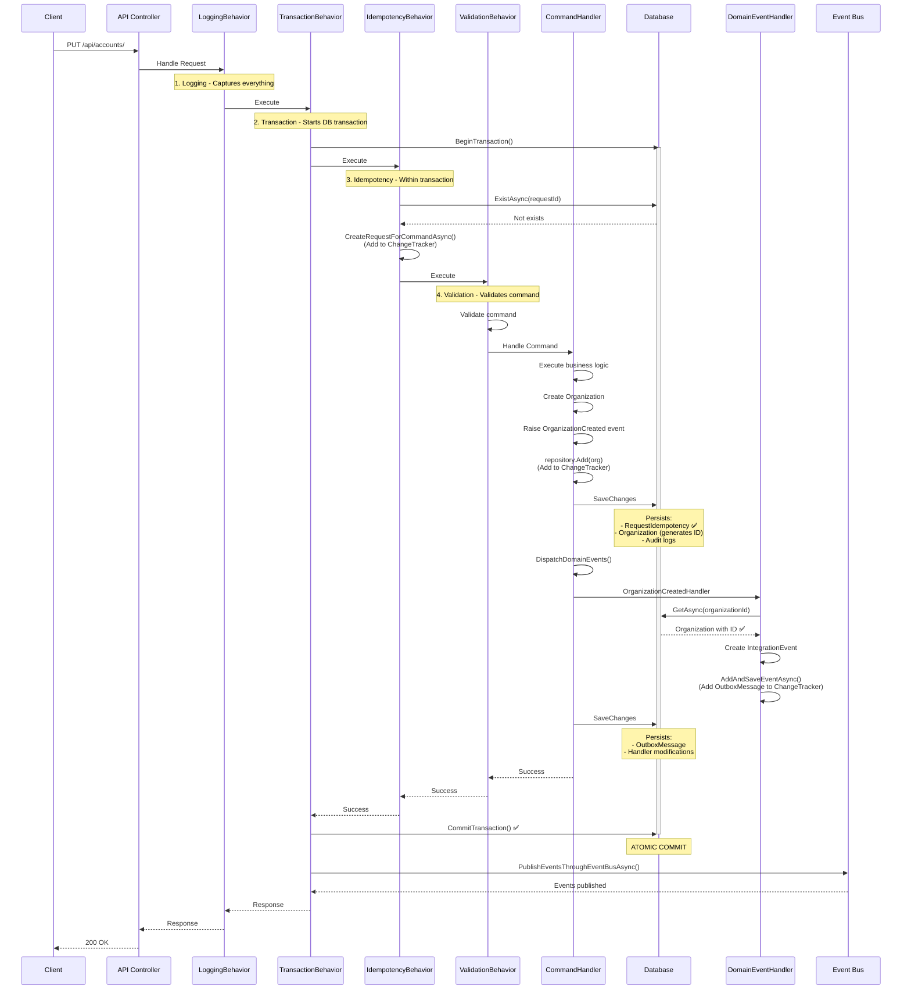
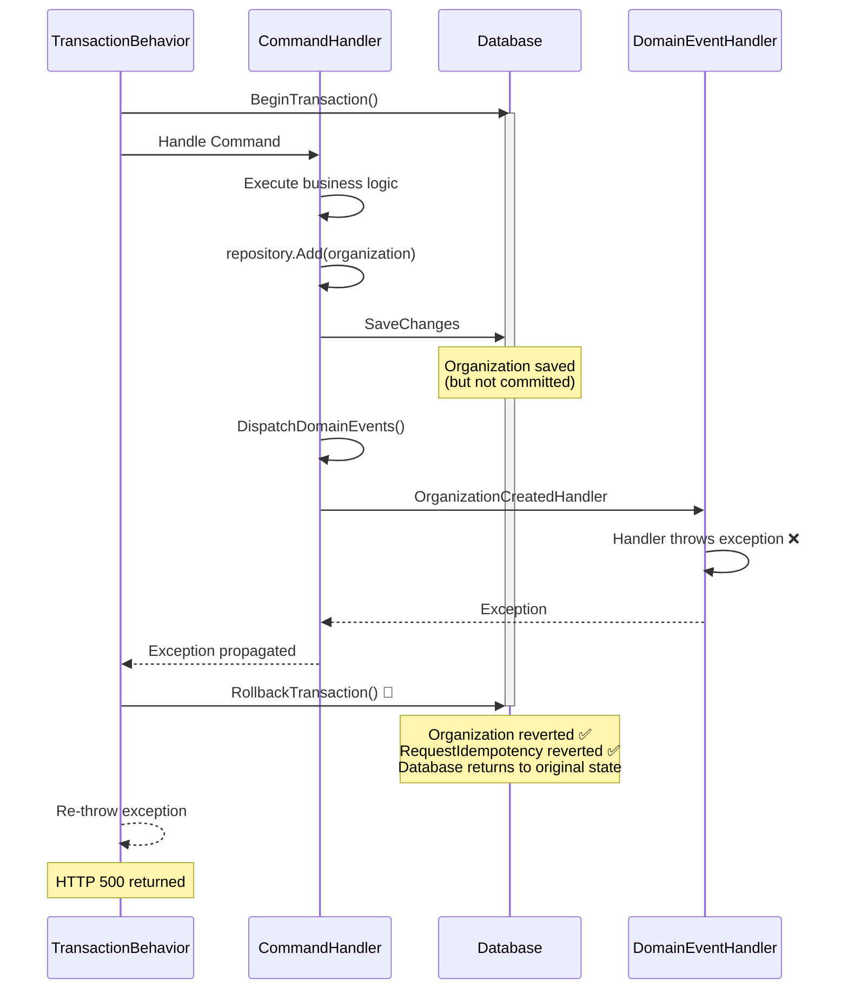

# Two-SaveChanges Pattern: Domain Events with Transactional Consistency

## 🎯 Executive Summary

This document describes the **Two-SaveChanges Pattern** implemented in QltS to achieve both **transactional atomicity** and **full domain event handler functionality**. This hybrid approach combines the best of both worlds: handlers can query persisted entities with generated IDs while maintaining ACID guarantees within a single database transaction.

---

## 📋 Table of Contents

- [Problem Statement](#-problem-statement)
- [Architecture Overview](#-architecture-overview)
- [Implementation Details](#-implementation-details)
- [Key Benefits](#-key-benefits)
- [Comparison with eShop](#-comparison-with-eshop)
- [Transaction Flow](#-transaction-flow)
- [Critical Components](#-critical-components)
- [FAQ](#-faq)

---

## ⚠️ Problem Statement

### Initial Challenge

Domain event handlers often need to:
- **Query the database** to retrieve the newly created entity
- **Access database-generated IDs** (identity columns, sequences)
- **Access computed values** (defaults, triggers)
- **Publish integration events** with complete entity data

### Classic Dilemma

Traditional approaches force a choice between atomicity and functionality:

| Approach | Atomicity | Queries Available | IDs Available |
|----------|-----------|-------------------|---------------|
| Events BEFORE SaveChanges | ✅ Yes | ❌ No | ❌ No |
| Events AFTER SaveChanges | ❌ No | ✅ Yes | ✅ Yes |

**Neither approach is ideal.**

---

## 🏗️ Architecture Overview

### The Solution: Two-SaveChanges Pattern

Execute **two SaveChanges** within the **same database transaction**:

#### Mermaid Diagram



#### ASCII Diagram (for text viewers)

```
┌──────────────────────────────────────────────────────────┐
│ TransactionBehavior (Manages DB Transaction)            │
│ ┌──────────────────────────────────────────────────────┐ │
│ │ SaveEntitiesAsync()                                  │ │
│ │                                                      │ │
│ │  ┌────────────────────────────────────────────────┐ │ │
│ │  │ SaveChanges #1                                 │ │ │
│ │  │  • Persist aggregate                           │ │ │
│ │  │  • Generate IDs                                │ │ │
│ │  │  • Apply DB defaults                           │ │ │
│ │  │  • Save idempotency entry                      │ │ │
│ │  └────────────────────────────────────────────────┘ │ │
│ │                                                      │ │
│ │  ┌────────────────────────────────────────────────┐ │ │
│ │  │ Dispatch Domain Events                         │ │ │
│ │  │  • Handlers can query DB                       │ │ │
│ │  │  • Handlers access generated IDs               │ │ │
│ │  │  • Handlers add to ChangeTracker               │ │ │
│ │  └────────────────────────────────────────────────┘ │ │
│ │                                                      │ │
│ │  ┌────────────────────────────────────────────────┐ │ │
│ │  │ SaveChanges #2                                 │ │ │
│ │  │  • Save outbox messages                        │ │ │
│ │  │  • Save inbox entries                          │ │ │
│ │  │  • Save handler modifications                  │ │ │
│ │  └────────────────────────────────────────────────┘ │ │
│ └──────────────────────────────────────────────────────┘ │
│                                                          │
│ COMMIT (Single atomic operation)                        │
└──────────────────────────────────────────────────────────┘
```

### Key Insight

**Both SaveChanges execute within the SAME `IDbContextTransaction`**, ensuring:
- ✅ Single atomic commit
- ✅ Automatic rollback on failure
- ✅ No eventual consistency issues
- ✅ Full ACID guarantees

---

## 🔧 Implementation Details

### 1. QltDBContext.SaveEntitiesAsync()

```csharp
public async Task<bool> SaveEntitiesAsync(CancellationToken cancellationToken = default)
{
    try
    {
        if (_configuration.UseAuditLogs)
        {
            await this.SaveAuditLogsAsync(cancellationToken);
        }

        // STEP 1: Persist aggregate and generate IDs
        await base.SaveChangesAsync(cancellationToken);

        // STEP 2: Dispatch events (handlers can query and use IDs)
        await _mediator.DispatchDomainEventsAsync(this, cancellationToken);

        // STEP 3: Save handler modifications
        if (ChangeTracker.HasChanges())
        {
            await base.SaveChangesAsync(cancellationToken);
        }

        return true;
    }
    catch (DbUpdateException ex)
    {
        if (IsUniqueConstraintViolation(ex))
        {
            throw new UniqueConstraintViolationException(...);
        }
        throw;
    }
}
```

### 2. Repository Pattern (Unit of Work)

```csharp
public class Repository<T> : IRepository<T> where T : Entity, IAggregateRoot
{
    public T Add(T entity)
    {
        // ✅ Only add to ChangeTracker, do NOT SaveChanges
        // The Unit of Work is responsible for persisting
        return Context.Add(entity).Entity;
    }
    
    public void Update(T entity)
    {
        // ✅ Only mark as modified, do NOT SaveChanges
        Context.Update(entity);
    }
}
```

### 3. Messaging Services

All messaging services follow the same pattern:

```csharp
// OutboxMessageService.SaveEventAsync()
public Task SaveEventAsync(IntegrationEvent @event, IDbContextTransaction transaction)
{
    // ✅ Add to ChangeTracker only
    _context.Set<OutboxMessage>().Add(eventLogEntry);
    return Task.CompletedTask; // No SaveChanges
}

// IntegrationEventInboxService.MarkAsProcessedAsync()
public Task MarkAsProcessedAsync(Guid eventId, string handlerName, string? eventType = null)
{
    // ✅ Add to ChangeTracker only
    _context.Set<IntegrationEventInbox>().Add(processedEvent);
    return Task.CompletedTask; // No SaveChanges
}

// RequestIdempotencyService.CreateRequestForCommandAsync()
public Task CreateRequestForCommandAsync<T>(Guid id)
{
    // ✅ Add to ChangeTracker only
    _context.Add(request);
    return Task.CompletedTask; // No SaveChanges
}
```

---

## ✨ Key Benefits

### 1. Transactional Consistency

| Aspect | Status |
|--------|--------|
| **Single Transaction** | ✅ All operations in one DB transaction |
| **Atomic Commit** | ✅ Everything persisted or nothing |
| **Automatic Rollback** | ✅ Any failure reverts ALL changes |
| **Eventual Consistency** | ❌ Not needed - immediate consistency |
| **Compensatory Actions** | ❌ Not needed - rollback handles failures |

### 2. Functional Completeness

| Capability | Available |
|------------|-----------|
| **Query Database** | ✅ Handlers can query persisted entities |
| **Access IDs** | ✅ Database-generated IDs available |
| **Computed Values** | ✅ DB defaults and triggers applied |
| **Navigation Properties** | ✅ Properly loaded from DB |
| **Complex Queries** | ✅ Full LINQ support |

### 3. Architectural Consistency

| Component | Follows Pattern |
|-----------|----------------|
| **Repository** | ✅ No SaveChanges (respects UoW) |
| **OutboxMessageService** | ✅ No SaveChanges |
| **InboxService** | ✅ No SaveChanges |
| **IdempotencyService** | ✅ No SaveChanges |
| **QltDBContext** | ✅ Centralized persistence (2x SaveChanges) |

### 4. Performance Characteristics

- **Database Round-trips**: 2 SaveChanges (minimal overhead)
- **Network Latency**: Within same transaction (no additional latency)
- **Lock Duration**: Slightly longer but still acceptable
- **Query Performance**: Handlers query already-committed data (fast)

---

## 📊 Comparison with eShop

### eShop Option A: Events BEFORE SaveChanges

```csharp
// eShop original approach
await _mediator.DispatchDomainEventsAsync(this);
await base.SaveChangesAsync(cancellationToken);
```

| Aspect | Status |
|--------|--------|
| Atomicity | ✅ Single transaction |
| Queries Available | ❌ No - entity not in DB |
| IDs Available | ❌ No - not generated yet |
| Eventual Consistency | ❌ Not needed |

### eShop Option B: Events AFTER SaveChanges

```csharp
// Events after commit
await base.SaveChangesAsync(cancellationToken);
await _mediator.DispatchDomainEventsAsync(this);
```

| Aspect | Status |
|--------|--------|
| Atomicity | ❌ Multiple transactions |
| Queries Available | ✅ Yes - entity in DB |
| IDs Available | ✅ Yes - generated |
| Eventual Consistency | ⚠️ Required |

### QltS Two-SaveChanges Pattern

```csharp
// Our hybrid approach
await base.SaveChangesAsync(cancellationToken);           // #1
await _mediator.DispatchDomainEventsAsync(this);
if (ChangeTracker.HasChanges())
    await base.SaveChangesAsync(cancellationToken);       // #2
```

| Aspect | Status |
|--------|--------|
| Atomicity | ✅ Single transaction (both saves) |
| Queries Available | ✅ Yes - entity in DB |
| IDs Available | ✅ Yes - generated |
| Eventual Consistency | ❌ Not needed |

### Summary Table

| Metric | eShop A | eShop B | QltS Pattern |
|--------|---------|---------|--------------|
| **Transactions** | 1 | N | 1 ✅ |
| **SaveChanges** | 1 | N+1 | 2 ✅ |
| **Queries** | ❌ | ✅ | ✅ |
| **IDs** | ❌ | ✅ | ✅ |
| **Atomicity** | ✅ | ❌ | ✅ |
| **Eventual Consistency** | ❌ | ⚠️ | ❌ ✅ |
| **Rollback** | ✅ | ❌ | ✅ |

**Conclusion**: QltS pattern provides the benefits of both approaches without the drawbacks.

---

## 🔄 Transaction Flow

### ⚠️ Critical: Pipeline Behavior Order

**The order of MediatR behaviors is CRITICAL for correct operation.**

#### Correct Order

```csharp
services.AddMediatR(cfg =>
{
    // 1. Logging - First, captures everything (success and failures)
    cfg.AddOpenBehavior(typeof(LoggingBehavior<,>));

    // 2. Transaction - Must be BEFORE Idempotency
    //    Starts the DB transaction so idempotency entry is saved atomically
    cfg.AddOpenBehavior(typeof(TransactionBehavior<,>));

    // 3. Idempotency - AFTER Transaction
    //    Executes within transaction, entry saved in SaveChanges #1
    cfg.AddOpenBehavior(typeof(IdempotencyBehavior<,>));

    // 4. Validation - Last before handler
    //    Validates command, fails fast if invalid
    cfg.AddOpenBehavior(typeof(ValidationBehavior<,>));
});
```

#### Why This Order?

| Order | Behavior | Reason |
|-------|----------|--------|
| **1** | `LoggingBehavior` | Wraps entire pipeline, logs all requests and errors |
| **2** | `TransactionBehavior` | **Must be before Idempotency** - starts DB transaction |
| **3** | `IdempotencyBehavior` | Executes **within transaction**, entry saved in SaveChanges #1 |
| **4** | `ValidationBehavior` | Validates before handler execution, fails fast |

#### ❌ Common Mistake

```csharp
// ❌ WRONG - Idempotency BEFORE Transaction
cfg.AddOpenBehavior(typeof(IdempotencyBehavior<,>));  // Adds to ChangeTracker
cfg.AddOpenBehavior(typeof(TransactionBehavior<,>));  // Starts transaction AFTER
```

**Problem**: The `RequestIdempotency` entry is added to ChangeTracker **before** the transaction starts, so it won't be saved in SaveChanges #1.

#### ✅ Pipeline Execution Flow

```
Request
  ↓
LoggingBehavior (wraps everything)
  ↓
TransactionBehavior (starts transaction)
  ↓
  ├─ BeginTransactionAsync() ← Transaction starts here
  ↓
IdempotencyBehavior (within transaction)
  ↓
  ├─ ExistAsync() → Reads within transaction
  ├─ CreateRequestForCommandAsync() → Adds to ChangeTracker
  ↓
ValidationBehavior (within transaction)
  ↓
  ├─ Validate() → Fails fast if invalid
  ↓
CommandHandler (within transaction)
  ↓
  ├─ SaveEntitiesAsync()
  │   ├─ SaveChanges #1 → Saves RequestIdempotency ✅
  │   ├─ DispatchDomainEvents()
  │   └─ SaveChanges #2 → Saves handler modifications
  ↓
TransactionBehavior
  ↓
  ├─ CommitTransactionAsync() → Atomic commit
  ↓
LoggingBehavior
  ↓
  ├─ Log completion
  ↓
Response
```

---

### Complete Request Lifecycle

#### Mermaid Sequence Diagram



#### ASCII Diagram (for text viewers)

```
┌─────────────────────────────────────────────────────────────────┐
│ 1. HTTP Request (PUT /api/accounts/)                           │
└─────────────────────────────────────────────────────────────────┘
                            ↓
┌─────────────────────────────────────────────────────────────────┐
│ 2. LoggingBehavior                                              │
│    └─ Start logging (captures everything including errors)      │
└─────────────────────────────────────────────────────────────────┘
                            ↓
┌─────────────────────────────────────────────────────────────────┐
│ 3. TransactionBehavior                                          │
│    └─ BeginTransactionAsync() ← START DB TRANSACTION            │
└─────────────────────────────────────────────────────────────────┘
                            ↓
┌─────────────────────────────────────────────────────────────────┐
│ 4. IdempotencyBehavior (WITHIN TRANSACTION)                     │
│    ├─ ExistAsync(requestId) → Check if already processed        │
│    └─ CreateRequestForCommandAsync() → Add to ChangeTracker    │
└─────────────────────────────────────────────────────────────────┘
                            ↓
┌─────────────────────────────────────────────────────────────────┐
│ 5. ValidationBehavior                                           │
│    └─ Validate command properties                               │
└─────────────────────────────────────────────────────────────────┘
                            ↓
┌─────────────────────────────────────────────────────────────────┐
│ 6. CommandHandler.Handle()                                      │
│    ├─ Execute business logic                                    │
│    ├─ Create aggregate (Organization)                           │
│    ├─ Raise domain events (OrganizationCreated)                │
│    └─ repository.Add(organization) → Add to ChangeTracker       │
└─────────────────────────────────────────────────────────────────┘
                            ↓
┌─────────────────────────────────────────────────────────────────┐
│ 7. CommandHandler.SaveEntitiesAsync()                          │
│    │                                                            │
│    ├─ [SaveChanges #1] ──────────────────────────────┐         │
│    │   Persists to DB:                                │         │
│    │   • RequestIdempotency entry ✅                  │         │
│    │   • Organization aggregate (generates ID)        │         │
│    │   • Audit logs                                   │         │
│    │   └──────────────────────────────────────────────┘         │
│    │                                                            │
│    ├─ DispatchDomainEvents()                                   │
│    │   └─ OrganizationCreatedDomainEventHandler               │
│    │       ├─ GetAsync(organizationId) ✅ Works!              │
│    │       ├─ Access organization.Id ✅ Available!             │
│    │       ├─ Create OrganizationCreatedIntegrationEvent      │
│    │       └─ AddAndSaveEventAsync()                          │
│    │          └─ Add OutboxMessage to ChangeTracker           │
│    │                                                            │
│    └─ [SaveChanges #2] ──────────────────────────────┐         │
│        Persists to DB:                                │         │
│        • OutboxMessage (from handler)                 │         │
│        • Any handler entity modifications             │         │
│        └──────────────────────────────────────────────┘         │
└─────────────────────────────────────────────────────────────────┘
                            ↓
┌─────────────────────────────────────────────────────────────────┐
│ 8. TransactionBehavior                                          │
│    └─ CommitTransactionAsync() ← COMMIT DB TRANSACTION         │
│       ✅ Everything persisted atomically                        │
└─────────────────────────────────────────────────────────────────┘
                            ↓
┌─────────────────────────────────────────────────────────────────┐
│ 9. TransactionBehavior                                          │
│    └─ PublishEventsThroughEventBusAsync()                      │
│       └─ Retrieve OutboxMessages and publish to RabbitMQ       │
└─────────────────────────────────────────────────────────────────┘
                            ↓
┌─────────────────────────────────────────────────────────────────┐
│ 10. LoggingBehavior                                             │
│     └─ Log completion and metrics                               │
└─────────────────────────────────────────────────────────────────┘
                            ↓
┌─────────────────────────────────────────────────────────────────┐
│ 11. HTTP Response (200 OK)                                      │
└─────────────────────────────────────────────────────────────────┘
```

### Failure Scenario

#### Mermaid Sequence Diagram



#### ASCII Diagram (for text viewers)

```
┌─────────────────────────────────────────────────────────────────┐
│ TransactionBehavior.BeginTransaction()                          │
└─────────────────────────────────────────────────────────────────┘
                            ↓
┌─────────────────────────────────────────────────────────────────┐
│ SaveEntitiesAsync()                                             │
│    ├─ SaveChanges #1 → Organization saved in DB                │
│    ├─ DispatchDomainEvents                                     │
│    │   └─ Handler throws exception ❌                           │
└─────────────────────────────────────────────────────────────────┘
                            ↓
┌─────────────────────────────────────────────────────────────────┐
│ TransactionBehavior.RollbackTransaction()                      │
│    └─ ✅ Organization reverted (not in DB)                     │
│    └─ ✅ RequestIdempotency reverted                           │
│    └─ ✅ Database returns to original state                     │
└─────────────────────────────────────────────────────────────────┘
                            ↓
┌─────────────────────────────────────────────────────────────────┐
│ HTTP Response (500 Internal Server Error)                       │
└─────────────────────────────────────────────────────────────────┘
```

**Key Point**: Even though SaveChanges #1 "saved" the Organization, it's NOT committed. The transaction rollback reverts everything.

---

## 🧩 Critical Components

### TransactionBehavior

**Responsibility**: Manage database transaction lifecycle

```csharp
public class TransactionBehavior<TRequest, TResponse> : IPipelineBehavior<TRequest, TResponse>
{
    public async Task<TResponse> Handle(TRequest request, RequestHandlerDelegate<TResponse> next, ...)
    {
        var strategy = _dbTransaction.CreateExecutionStrategy();
        
        await strategy.ExecuteAsync(async () =>
        {
            // Start transaction
            await using var transaction = await _dbTransaction.BeginTransactionAsync();
            
            // Execute handler (includes 2 SaveChanges)
            response = await next(cancellationToken);
            
            // Commit transaction (atomic)
            await _dbTransaction.CommitTransactionAsync(transaction);
            
            transactionId = transaction.TransactionId;
            
            // Publish events AFTER commit (Outbox Pattern)
            if (_integrationEventService != null)
            {
                await _integrationEventService.PublishEventsThroughEventBusAsync(transactionId);
            }
        });
        
        return response;
    }
}
```

### ITransactionalUnitOfWork

**Responsibility**: Extend IUnitOfWork with transaction management

```csharp
public interface ITransactionalUnitOfWork : IUnitOfWork
{
    bool HasActiveTransaction { get; }
    
    Task<IDbContextTransaction?> BeginTransactionAsync();
    Task CommitTransactionAsync(IDbContextTransaction transaction);
    void RollbackTransaction();
    
    IDbContextTransaction? GetCurrentTransaction();
    IDbContextTransaction? UseTransaction(IDbContextTransaction transaction);
    IExecutionStrategy CreateExecutionStrategy();
}
```

### DomainEventsDispatcherExtension

**Responsibility**: Clear and publish domain events

```csharp
public static async Task DispatchDomainEventsAsync(this IMediator mediator, DbContext ctx, CancellationToken cancellationToken)
{
    // Get entities with domain events
    var domainEntities = ctx.ChangeTracker
        .Entries<Entity>()
        .Where(x => x.Entity.DomainEvents != null && x.Entity.DomainEvents.Any());
    
    // Collect events
    var domainEvents = domainEntities
        .SelectMany(x => x.Entity.DomainEvents!)
        .ToList();
    
    // Clear events from entities
    domainEntities.ToList().ForEach(entity => entity.Entity.ClearDomainEvents());
    
    // Publish events
    foreach (var domainEvent in domainEvents)
    {
        await mediator.Publish(domainEvent, cancellationToken);
    }
}
```

---

## ❓ FAQ

### Q1: Why not just use one SaveChanges AFTER events?

**A**: That would create multiple independent transactions. If a handler fails, the aggregate is already committed and cannot be rolled back. You'd need eventual consistency and compensatory actions.

### Q2: Doesn't the first SaveChanges commit the transaction?

**A**: No. When you call `BeginTransactionAsync()`, EF Core associates that transaction with the DbContext. All subsequent `SaveChangesAsync()` calls use that same transaction until you explicitly call `CommitAsync()` or `RollbackAsync()`.

### Q3: What if no changes are made by handlers?

**A**: The `if (ChangeTracker.HasChanges())` check ensures the second SaveChanges is skipped if handlers didn't modify anything. It's a performance optimization.

### Q4: What about performance impact?

**A**: The overhead is minimal:
- **2 round-trips** to the database instead of 1
- **Same transaction** (no additional connection overhead)
- **Same lock duration** (slightly longer but acceptable)
- **Benefits outweigh costs**: Handlers can query and access IDs

### Q5: Can handlers make database queries?

**A**: Yes! After the first SaveChanges, the aggregate is in the database with its generated ID. Handlers can query it using repositories or LINQ.

### Q6: What if I want events BEFORE SaveChanges?

**A**: You can configure this per-context by adjusting `SaveEntitiesAsync()`. However, you'll lose the ability to query and access IDs in handlers.

### Q7: Does this work with SQL Server and PostgreSQL?

**A**: Yes. The pattern is database-agnostic and works with any EF Core provider that supports transactions.

### Q8: What about distributed transactions?

**A**: This pattern uses local database transactions. For distributed transactions across multiple databases or services, you'd need the Saga pattern or two-phase commit.

### Q9: How does idempotency fit in?

**A**: The `RequestIdempotency` entry is saved in the FIRST SaveChanges. If a duplicate request arrives concurrently and passes the `ExistAsync` check, the database's unique constraint will reject it during SaveChanges, causing a rollback.

### Q10: What happens if the commit fails?

**A**: The `TransactionBehavior` catches the exception, calls `RollbackTransaction()`, and re-throws the exception. The database returns to its original state.

---

## 🎓 Conclusion

The **Two-SaveChanges Pattern** provides:

1. ✅ **Transactional Atomicity** - Everything commits or rolls back together
2. ✅ **Full Handler Functionality** - Queries, IDs, computed values
3. ✅ **No Eventual Consistency** - Immediate consistency guaranteed
4. ✅ **Architectural Consistency** - Clean separation of concerns
5. ✅ **Unit of Work Respected** - Repository doesn't persist
6. ✅ **Performance Acceptable** - Minimal overhead for significant benefits

This pattern is production-ready and scales well for enterprise applications.

---

## 📚 References

- [eShopOnContainers - Microsoft Reference Architecture](https://github.com/dotnet-architecture/eShopOnContainers)
- [Domain-Driven Design by Eric Evans](https://www.domainlanguage.com/ddd/)
- [Entity Framework Core Transactions](https://learn.microsoft.com/en-us/ef/core/saving/transactions)
- [MediatR Pipeline Behaviors](https://github.com/jbogard/MediatR/wiki/Behaviors)

---

**Document Version**: 1.0  
**Last Updated**: 2025-01-19  
**Author**: QltS Architecture Team
