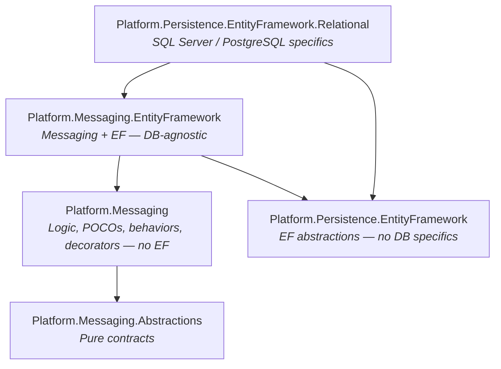
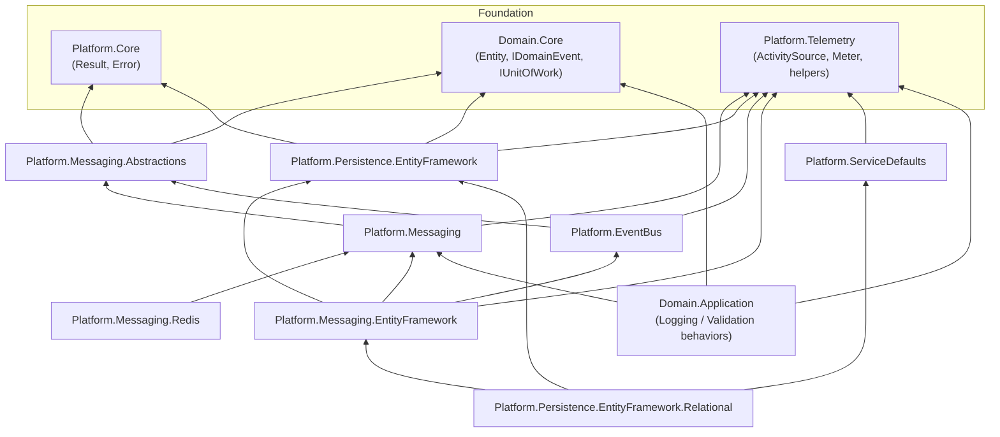
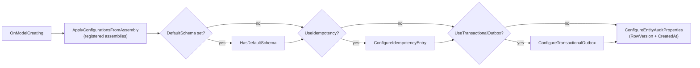

# Messaging & Persistence Layers

## Overview

The messaging and persistence infrastructure is organized in a **5-layer architecture** where each layer has a single responsibility and strict dependency rules. Messaging logic and EF Core abstractions evolve independently, and they only meet in `Platform.Messaging.EntityFramework`. Database-specific knowledge (SQL Server, PostgreSQL, table mappings) is isolated in the outermost layer, `Platform.Persistence.EntityFramework.Relational`.



> Arrows point from the referencing project to the referenced project. `Platform.Messaging` and `Platform.Persistence.EntityFramework` do **not** reference each other.

---

## Layer-by-Layer

### 1. Platform.Messaging.Abstractions

Pure contracts without infrastructure dependencies. Root namespace: `Sirius.Platform.Messaging`.

**Owns:**
- **Commands**: `ICommandRequest` (non-generic marker), `ICommand`, `ICommand<TResponse>`, `ICommandHandler<TCommand>`, `ICommandHandler<TCommand, TResponse>`
- **Idempotent commands**: `IIdempotentRequest` (`RequestId`, `CreateDuplicateResult()`), `IIdempotentCommand`, `IIdempotentCommand<TResponse>`
- **Queries**: `IQuery<TResponse>`, `IQueryHandler<TQuery, TResponse>`
- **Domain events**: `IDomainEventHandler<TEvent>` (MediatR adapter over `Domain.Core.IDomainEvent`)
- **Integration events**: `IntegrationEvent` (base record with `Id` and `CreationDate`), `IIntegrationEventHandler<TEvent>`, `IDecoratedHandler<TEvent>`
- **Idempotency model**: `IdempotencyKey` (`ForRequest`, `ForEvent`), `IdempotencyScope` (`Request`, `Event`)
- **Services**: `IIdempotencyService` (`ExistsAsync`, `MarkAsProcessingAsync`, `MarkAsCompletedAsync`), `IEventBusOutboxService` (`AddAndSaveEventAsync`, `PublishEventsThroughEventBusAsync`)

**Dependencies:** MediatR, Microsoft.Extensions.Options, Domain.Core, Platform.Core

**Must not reference:** Entity Framework, database providers, implementation logic.

---

### 2. Platform.Messaging

Messaging logic and persistence-ignorant models.

**Owns:**
- **POCOs** (no EF attributes): `IdempotencyEntry`, `OutboxMessage`, `OutboxMessageStatus`
- **Service contract**: `IOutboxMessageService` (outbox persistence operations)
- **Pipeline behaviors**: `IdempotencyBehavior<,>`, `TelemetryCommandBehavior<,>`, `TelemetryQueryBehavior<,>`
- **Domain event telemetry**: `TelemetryDomainEventBehavior` (custom `INotificationPublisher`)
- **Domain event dispatch**: `DomainEventsDispatcherExtension.DispatchDomainEventsAsync` (extension on `IMediator`)
- **Integration event decorators**: `TelemetryIntegrationEventHandlerDecorator<T>`, `IdempotencyIntegrationEventDecorator<T>` (cache-only, non-transactional)
- **Command base records**: `IdempotentCommand`, `IdempotentCommand<TResponse>` (auto-generated `RequestId`, overridable duplicate result)
- **DI extensions**: `AddIntegrationEventTelemetryDecorator`, `AddDomainEventTelemetryBehavior`, `AddCommandTelemetryBehavior`, `AddQueryTelemetryBehavior` (all idempotent via marker types)

**Dependencies:** Platform.Messaging.Abstractions, Platform.Telemetry, MediatR, Microsoft.Extensions.Options, Scrutor

**Must not reference:** Entity Framework, database providers. POCOs have no EF attributes.

---

### 3. Platform.Persistence.EntityFramework

EF Core abstractions without database-specific knowledge and without messaging knowledge.

**Owns:**
- `ITransactionalUnitOfWork` — extends `IUnitOfWork` with `BeginTransactionAsync`, `UseTransaction`, `CreateExecutionStrategy`, `GetCurrentTransaction`, `CommitTransactionAsync`, `RollbackTransaction`, `HasActiveTransaction`, `LastCommittedTransactionId`, `GetPendingChangesCount`
- `IDomainEntityChangeTracker` — exposes tracked entities for domain event dispatch
- `MigrationReadySignal` — singleton that signals when migrations have completed (awaited by the `OutboxProcessor`)
- `SiriusDbContextConfiguration`, `SiriusReadDbContextConfiguration` — fluent feature/model configuration
- `UniqueConstraintViolationException`

**Dependencies:** Microsoft.EntityFrameworkCore, Microsoft.Extensions.Hosting.Abstractions, MediatR, Domain.Core, Platform.Core, Platform.Telemetry

**Must not reference:** Database providers (SqlClient, Npgsql), entity configurations, messaging projects.

---

### 4. Platform.Messaging.EntityFramework

Messaging services that use EF Core through generic constraints — works with any `DbContext` that implements `ITransactionalUnitOfWork`.

**Owns:**
- **Services**: `IdempotencyEfService<TContext>`, `OutboxMessageService<TContext>`, `EventBusOutboxService<TContext>`
- **Background service**: `OutboxProcessor` (hosted service that retries unpublished/failed outbox events)
- **Decorator**: `IdempotencyIntegrationEventEfDecorator<T>` (transactional idempotent consumer)
- **Pipeline behaviors**: `TransactionBehavior<,>`, `DomainEventProcessorBehavior<,>`, `IntegrationEventProcessorBehavior<,>`
- **Builders**: `AddSiriusMediator` + `SiriusMediatorConfiguration`, `AddIdempotencyEntityFramework<TContext>` + `EfIdempotencyBuilder<TContext>`, `AddTransactionalOutbox<TContext>`
- **Options**: `OutboxMessageOptions` (event type registry), `OutboxProcessorOptions`

**Dependencies:** Platform.Messaging, Platform.Persistence.EntityFramework, Platform.EventBus, Platform.Telemetry

**Must not reference:** SQL Server, PostgreSQL, Cosmos, entity configurations, table names.

Services use `TContext where TContext : DbContext, ITransactionalUnitOfWork` (or only `ITransactionalUnitOfWork` for `EventBusOutboxService<TContext>`) — never a concrete context.

---

### 5. Platform.Persistence.EntityFramework.Relational

SQL Server and PostgreSQL specifics. This is the **only** layer that knows about relational databases. Root namespace: `Sirius.Platform.Persistence`.

**Owns:**
- `SiriusDBContext` — write-side base context; implements `ITransactionalUnitOfWork` and `IDomainEntityChangeTracker`, applies audit timestamps and translates unique-constraint violations (SQL Server 2627/2601, PostgreSQL 23505, generic message fallback) into `UniqueConstraintViolationException`
- `SiriusReadDbContext` — read-side abstract base context (see [08-cqrs-read-model.md](08-cqrs-read-model.md))
- **Entity configurations**: `IdempotencyEntryConfiguration` (internal), `OutboxMessageConfiguration` (public), `EntityAuditConfiguration` (internal — `RowVersion` + `CreatedAt` for every `Entity`), `AuditLogConfiguration` (internal, not applied yet — `AuditLog` is a placeholder)
- `ResilientTransaction` — runs an action inside a transaction under the EF execution strategy
- `Repository<T>` — abstract generic repository for aggregate roots
- `MigrateDbContextExtensions` — `AddMigration<TContext>()` / `AddMigration<TContext, TSeeder>()` hosted service + `IDbSeeder<TContext>`; signals `MigrationReadySignal` when done
- Registration: `AddSiriusSDBContext<TContext>()`, `AddSiriusReadDbContext<TContext>()`

**Dependencies:** Platform.Persistence.EntityFramework, Platform.Messaging.EntityFramework, Platform.ServiceDefaults, Microsoft.EntityFrameworkCore.Relational, Microsoft.Data.SqlClient, Npgsql

---

## Dependency Flow

Full project graph of the building blocks involved, including the supporting projects:



Transport implementations (`Platform.EventBus.ServiceBus`, `Platform.EventBus.RabbitMQ`) only reference `Platform.EventBus` — see [07-event-bus.md](07-event-bus.md).

---

## Key Design Principles

### Persistence Ignorance

POCOs in `Platform.Messaging` have no EF attributes:

```csharp
// Platform.Messaging/Models/IdempotencyEntry.cs
public class IdempotencyEntry
{
    public Guid Id { get; set; }
    public IdempotencyScope Scope { get; set; }
    public string Qualifier { get; set; } = string.Empty;
    public string? TypeName { get; set; }
    public DateTime ProcessedAt { get; set; }
}
```

Mapping is handled in `Platform.Persistence.EntityFramework.Relational`:

```csharp
// Configurations/IdempotencyEntryConfiguration.cs (internal)
public static void Configure(this EntityTypeBuilder<IdempotencyEntry> entity)
{
    entity.ToTable("IdempotencyEntry");          // uses the context default schema
    entity.HasKey(e => new { e.Id, e.Scope, e.Qualifier });
    entity.Property(e => e.Scope).IsRequired().HasConversion<string>().HasMaxLength(20);
    // ...
}
```

`SiriusDBContext.OnModelCreating` applies the infrastructure mappings only when the corresponding feature is enabled:



### Generic Constraints Over Concrete Types

```csharp
// ✅ Any DbContext implementing ITransactionalUnitOfWork works
public class IdempotencyEfService<TContext> : IIdempotencyService
    where TContext : DbContext, ITransactionalUnitOfWork
{
    private readonly TContext _context;
    private readonly IIdempotencyService? _inner;   // optional cache (Redis)
}
```

### Fluent DbContext Configuration

Real registration from the Accounts service (`Accounts.Infrastructure/Extensions/Extensions.cs`):

```csharp
services.AddSiriusSDBContext<AccountContext>(
    conf => conf
        .SetDefaultSchema("Accounts")
        .WithIdempotency()
        .RegisterModelsFromAssembly(typeof(AssemblyReference).Assembly),
    options => options.UseSqlServer(connectionString, sqlOptions =>
    {
        sqlOptions.MigrationsAssembly(typeof(AssemblyReference).Assembly.FullName);
    })
);

services.AddMigration<AccountContext, SiriusDBContextSeed>();

services.AddIdempotencyEntityFramework<AccountContext>()   // also calls WithIdempotency()
    .ForApiRequests()
    .ForIntegrationEventHandlers();

services.AddTransactionalOutbox<AccountContext>(options =>   // also calls WithTransactionalOutbox()
{
    options.RegisterEventTypes(
        typeof(Sirius.Contracts.Accounts.AssemblyReference).Assembly,
        typeof(Sirius.Contracts.Identity.AssemblyReference).Assembly,
        typeof(Sirius.Contracts.Notifications.AssemblyReference).Assembly);
});
```

`AddSiriusSDBContext<TContext>` registers the concrete context and forwards `SiriusDBContext`, `ITransactionalUnitOfWork` and `IDomainEntityChangeTracker` (all scoped) to the same instance.

> `SiriusDbContextConfiguration` is a **process-wide singleton** obtained through `GetOrCreateSiriusDbContextConfiguration()`. Every builder (`AddSiriusSDBContext`, `AddIdempotencyEntityFramework`, `AddTransactionalOutbox`) mutates the same instance, so all `SiriusDBContext` types registered in one host share schema, assemblies and feature toggles.

---

## Extensibility

### Adding Cosmos DB

Create `Platform.Persistence.EntityFramework.Cosmos` with Cosmos-specific entity configurations and a Cosmos-flavoured base context. **No changes** to `Platform.Messaging` (POCOs reused), `Platform.Messaging.EntityFramework` (generic services reused), or existing services.

### Adding Dapper

Create `Platform.Messaging.Dapper` implementing `IIdempotencyService`, `IOutboxMessageService` and `IEventBusOutboxService`. **No changes** to abstractions or existing handlers.

### Redis Idempotency

Already implemented in `Platform.Messaging.Redis` (`IdempotencyRedisService`, `RedisIdempotencyBuilder`). When `AddRedisIdempotencyCache` is registered **before** `AddIdempotencyEntityFramework<TContext>`, the EF builder decorates the Redis service, producing the hybrid cache + database model described in [04-idempotency.md](04-idempotency.md).

---

## Validation Rules

Before modifying these layers:

- `Platform.Messaging` must NOT reference `EntityFrameworkCore`
- `Platform.Messaging` and `Platform.Persistence.EntityFramework` must NOT reference each other
- `Platform.Messaging.EntityFramework` must NOT reference SQL Server / PostgreSQL providers
- POCOs in `Platform.Messaging` must have NO EF attributes
- Entity configurations must live ONLY in `Platform.Persistence.EntityFramework.Relational`
- Services in `Platform.Messaging.EntityFramework` must use generic `TContext` constraints, never a concrete context
