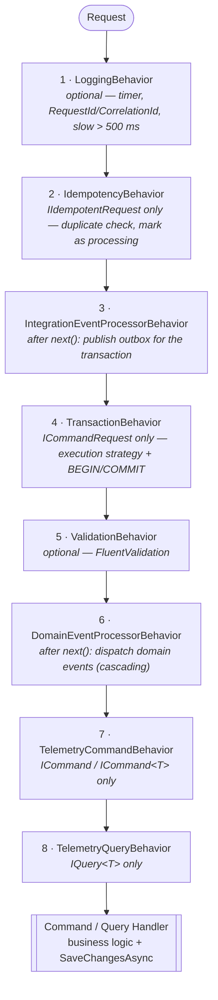
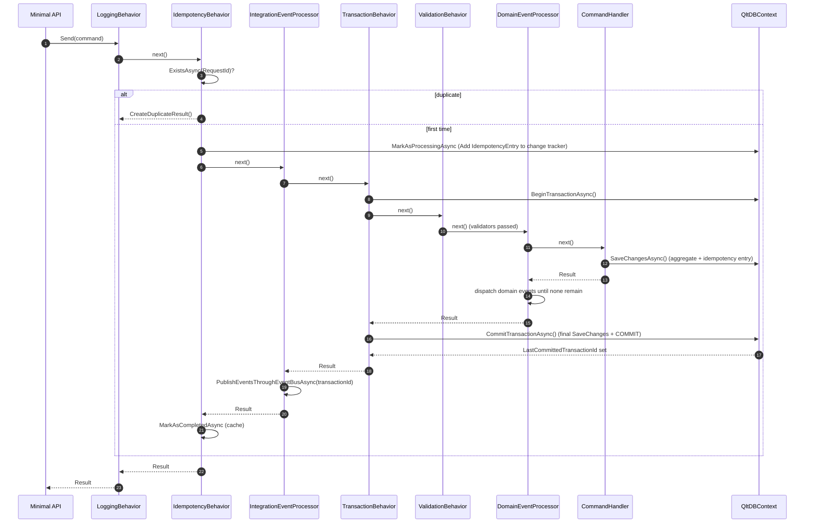

# Command Pipeline

Covers the Result Pattern, CQRS, Pipeline Behaviors, and Unit of Work — the core request processing infrastructure.

---

## Result Pattern

All commands and queries return `Result` or `Result<T>` (Railway-Oriented Programming). Located in `Platform.Core` (namespace `Qlt.Platform`).

```csharp
// Success track
return Result.Success(true);

// Failure track
return Result.Failure<bool>(Error.BadRequest.WithMessage("Failed to create company"));

// Validation failure (structured, per property)
return Result.ValidationFailure<bool>("TaxId", "TaxId is required");
```

**Key types:**

| Type | Description |
|---|---|
| `Result` | `IsSuccess`, `IsFailure`, `Error`; factories `Success`, `Failure`, `Create`, `ValidationFailure`; composition `Bind`, `Match` |
| `Result<T>` | Adds `Value` (throws on failure), `Map`, `Bind`, `Match`, and an implicit conversion from `T` (`null` → `Error.NullValue`) |
| `Error` | Immutable record `(Code, Message, PropertyName)` with `WithMessage` / `WithPropertyName` extensions |
| `ValidationError` | `sealed record : Error` carrying `IDictionary<string, string[]> Errors` (RFC 9110 compatible) |

Pre-defined errors: `Error.None`, `Error.NullValue`, `Error.ConditionNotMet`, `Error.NotFound`, `Error.Conflict`, `Error.BadRequest`, `Error.Unauthorized`, `Error.Validation`.

### HTTP Mapping

`Platform.WebApi` converts results with `ResultApiExtensions.ToHttpResult()`:

| Result | HTTP response |
|---|---|
| Success | `200 OK` with `result.Value` |
| Any failure | `400 Bad Request` with `ApiErrorResponse` (code, message, traceId, errors) |

Unhandled exceptions are converted by `ExceptionHandlingMiddleware`: `DomainValidationException` → `400`, anything else → `500` (details only in Development).

---

## CQRS with MediatR

Commands mutate state and return `Result`/`Result<T>`. Queries retrieve data without side effects and return `Result<T>`. Both flow through MediatR's pipeline; behaviors decide whether to act based on marker interfaces.

### Command Abstractions

```csharp
// Marker for pipeline filtering (zero-reflection pattern matching)
public interface ICommandRequest { }

public interface ICommand : IRequest<Result>, ICommandRequest { }
public interface ICommand<TResponse> : IRequest<Result<TResponse>>, ICommandRequest { }

public interface ICommandHandler<TCommand> : IRequestHandler<TCommand, Result>
    where TCommand : ICommand { }

public interface ICommandHandler<TCommand, TResponse> : IRequestHandler<TCommand, Result<TResponse>>
    where TCommand : ICommand<TResponse> { }
```

Idempotent commands add `IIdempotentRequest` (see [04-idempotency.md](04-idempotency.md)):

```csharp
public record CreateCompanyCommand : IdempotentCommand<bool> { /* ... */ }
```

### Query Abstractions

```csharp
public interface IQuery<TResponse> : IRequest<Result<TResponse>> { }

public interface IQueryHandler<TQuery, TResponse> : IRequestHandler<TQuery, Result<TResponse>>
    where TQuery : IQuery<TResponse> { }
```

### Domain Event Abstractions

```csharp
// Domain.Core (pure DDD, no dependencies)
public interface IDomainEvent { }

// Platform.Messaging.Abstractions (MediatR adapter)
public interface IDomainEventHandler<TEvent> : INotificationHandler<TEvent>
    where TEvent : IDomainEvent, INotification { }
```

### Read/Write DbContext Separation

```csharp
// Write: transactions, audit timestamps, idempotency, outbox
public class QltDBContext : DbContext, ITransactionalUnitOfWork, IDomainEntityChangeTracker { }

// Read: NoTrackingWithIdentityResolution, SaveChanges sealed to throw, read-replica ready
public abstract class QltReadDbContext : DbContext { }
```

Query handlers live in Infrastructure and inject the read context (e.g. `AccountReadContext`); command handlers use the write context through repositories. See [08-cqrs-read-model.md](08-cqrs-read-model.md).

---

## Pipeline Behaviors

Behaviors wrap command/query execution using MediatR's Chain of Responsibility. Each behavior has a single responsibility.

### Registration

Services do not register platform behaviors by hand. `AddQltMediator` (in `Platform.Messaging.EntityFramework`) registers the standard pipeline; services only provide assemblies plus their optional logging and validation behaviors:

```csharp
// Accounts.API/Extensions/Extensions.cs
services.AddQltMediator(cfg =>
{
    cfg.RegisterServicesFromAssembly(AssemblyReference.Assembly);
    cfg.RegisterServicesFromAssembly(typeof(Infrastructure.AssemblyReference).Assembly);
    cfg.WithLogging(typeof(LoggingBehavior<,>));        // optional, outermost
    cfg.WithValidation(typeof(ValidationBehavior<,>));  // optional, inside the transaction
});
```

Internally:

```csharp
services.AddMediatR(cfg =>
{
    // assemblies ...
    if (config.LoggingBehaviorType is not null) cfg.AddOpenBehavior(config.LoggingBehaviorType);
    cfg.AddOpenBehavior(typeof(IdempotencyBehavior<,>));
    cfg.AddOpenBehavior(typeof(IntegrationEventProcessorBehavior<,>));
    cfg.AddOpenBehavior(typeof(TransactionBehavior<,>));
    if (config.ValidationBehaviorType is not null) cfg.AddOpenBehavior(config.ValidationBehaviorType);
    cfg.AddOpenBehavior(typeof(DomainEventProcessorBehavior<,>));
});

services.AddIntegrationEventTelemetryDecorator();   // Scrutor decorator
services.AddDomainEventTelemetryBehavior();         // INotificationPublisher
services.AddCommandTelemetryBehavior();             // IPipelineBehavior<,> (registered after AddMediatR)
services.AddQueryTelemetryBehavior();               // IPipelineBehavior<,> (registered after AddMediatR)
```

`AddQltMediator` is idempotent (marker type), and `WithLogging` / `WithValidation` validate that the type is an open generic with two type parameters.

### Effective Order

MediatR executes `IPipelineBehavior<,>` in registration order (first registered = outermost). Because the telemetry behaviors are registered **after** `AddMediatR`, they are the innermost behaviors and wrap the handler directly.



### Command Execution Sequence



### How Behaviors Filter Commands vs Queries

| Behavior | Filter | Queries |
|---|---|---|
| LoggingBehavior | No filter | Active |
| IdempotencyBehavior | `request is not IIdempotentRequest` or no `IIdempotencyService` → pass through | Skipped |
| IntegrationEventProcessorBehavior | No current transaction **and** no `LastCommittedTransactionId` → skip; no `IEventBusOutboxService` → no-op | No-op |
| TransactionBehavior | `request is not ICommandRequest` → pass through; active transaction → nested (pass through) | Skipped |
| ValidationBehavior | No validators registered for the request → pass through | Active |
| DomainEventProcessorBehavior | Same transaction-id check as above; no `IDomainEntityChangeTracker` → no-op | No-op |
| TelemetryCommandBehavior | Static cached check for `ICommand` / `ICommand<>` | Skipped |
| TelemetryQueryBehavior | Static cached check for `IQuery<>` | Active |

### Behavior Locations

| Behavior | Project | Why |
|---|---|---|
| LoggingBehavior, ValidationBehavior | Domain.Application | Service-level concerns (FluentValidation, `IUserHttpContext`), plugged in via `WithLogging` / `WithValidation` |
| IdempotencyBehavior | Platform.Messaging | Uses the `IIdempotencyService` abstraction, no EF |
| TelemetryCommandBehavior, TelemetryQueryBehavior | Platform.Messaging | OpenTelemetry, no EF |
| TransactionBehavior | Platform.Messaging.EntityFramework | Needs `ICommandRequest` (messaging) + `ITransactionalUnitOfWork` (persistence) |
| DomainEventProcessorBehavior | Platform.Messaging.EntityFramework | Needs `IDomainEntityChangeTracker` + `IMediator` |
| IntegrationEventProcessorBehavior | Platform.Messaging.EntityFramework | Needs `ITransactionalUnitOfWork` + `IEventBusOutboxService` |

---

## Unit of Work

EF Core's `DbContext` serves as the Unit of Work. The interface is layered:

```csharp
// Domain.Core — minimal contract for repositories
public interface IUnitOfWork : IDisposable
{
    Task<int> SaveChangesAsync(CancellationToken cancellationToken = default);
}

// Platform.Persistence.EntityFramework — full transaction support
public interface ITransactionalUnitOfWork : IUnitOfWork
{
    Task<IDbContextTransaction?> BeginTransactionAsync();               // null if one is already active
    IDbContextTransaction? UseTransaction(IDbContextTransaction transaction);
    IExecutionStrategy CreateExecutionStrategy();
    IDbContextTransaction? GetCurrentTransaction();
    Task CommitTransactionAsync(IDbContextTransaction transaction, CancellationToken cancellationToken = default);
    void RollbackTransaction();
    bool HasActiveTransaction { get; }
    Guid? LastCommittedTransactionId { get; }
    int GetPendingChangesCount();
}
```

`QltDBContext` also implements `IDomainEntityChangeTracker` for domain event dispatch:

```csharp
public interface IDomainEntityChangeTracker
{
    // Returns all tracked Entity instances; callers filter those with pending domain events
    IReadOnlyList<Entity> GetEntitiesWithChanges();
}
```

### Transaction Lifecycle

1. `TransactionBehavior` returns immediately for non-commands. If a transaction is already active it tags the activity as nested and just calls `next()`.
2. Otherwise it runs inside `CreateExecutionStrategy().ExecuteAsync(...)` and calls `BeginTransactionAsync()`.
3. Inner pipeline runs: validation → command handler → `SaveChangesAsync()` → domain event dispatch.
4. `TransactionBehavior` records `GetPendingChangesCount()` and calls `CommitTransactionAsync()`, which applies audit timestamps, performs a final `SaveChangesAsync()`, commits, and sets `LastCommittedTransactionId`. Any failure rolls back and rethrows.
5. `IntegrationEventProcessorBehavior` reads the transaction ID and publishes the outbox events for that transaction.

`QltDBContext.SaveChangesAsync` also sets `CreatedAt` (added) / `UpdatedAt` (modified) on every `Entity` and converts unique-constraint violations into `UniqueConstraintViolationException`.

---

## Design Decisions

**Why `ICommandRequest` marker?** C# lacks open generic pattern matching. The marker enables `request is not ICommandRequest` for zero-reflection filtering. `IIdempotentRequest` follows the same idea for idempotency.

**Why `AddQltMediator` instead of raw `AddMediatR`?** The order of platform behaviors is load-bearing (idempotency outside the transaction, outbox publishing after commit, domain events inside the transaction). Centralizing it prevents services from getting it wrong.

**Why separate telemetry behaviors for commands and queries?** Distinct counters (`application.command_handlers.processed` vs `application.query_handlers.processed`) and histograms for independent read vs write monitoring.

**Why query handlers in Infrastructure?** They depend on the concrete read `DbContext`, an infrastructure concern. Query records (`IQuery<T>`) and view models live in Application as pure contracts.

**Why `TransactionBehavior` in `Platform.Messaging.EntityFramework`?** It needs both `ICommandRequest` (messaging concept) and `ITransactionalUnitOfWork` (persistence concept). This layer has access to both.

---

## Known Gaps

| Area | Details |
|---|---|
| Failed `Result` is committed | `TransactionBehavior` commits whenever no exception is thrown. A validation or business failure returned as `Result.Failure` still commits the transaction — including the `IdempotencyEntry` added by `IdempotencyBehavior` — so a retry with the same `RequestId` is treated as a duplicate. |
| Telemetry scope | Command/query telemetry behaviors are innermost; their duration covers the handler only (not validation, transaction or domain event dispatch). |
| HTTP status mapping | `ToHttpResult()` maps every failure (including `Error.NotFound`, `Error.Conflict`, `Error.Unauthorized`) to `400 Bad Request`. |
| Authorization behavior | No authorization behavior in the pipeline; authorization is enforced at endpoint level (policies). |
