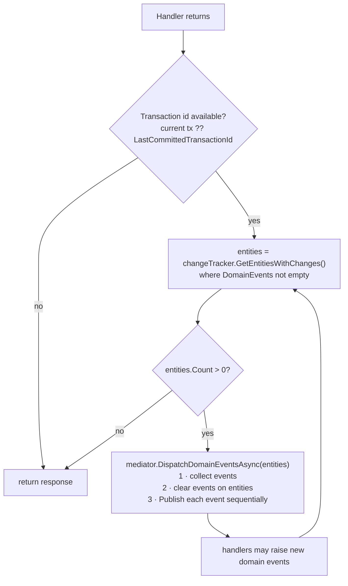
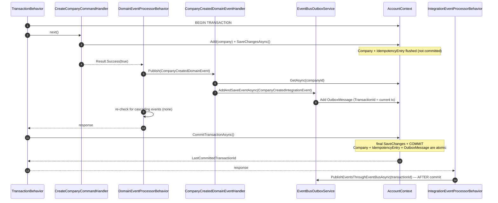
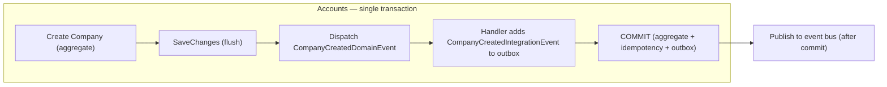
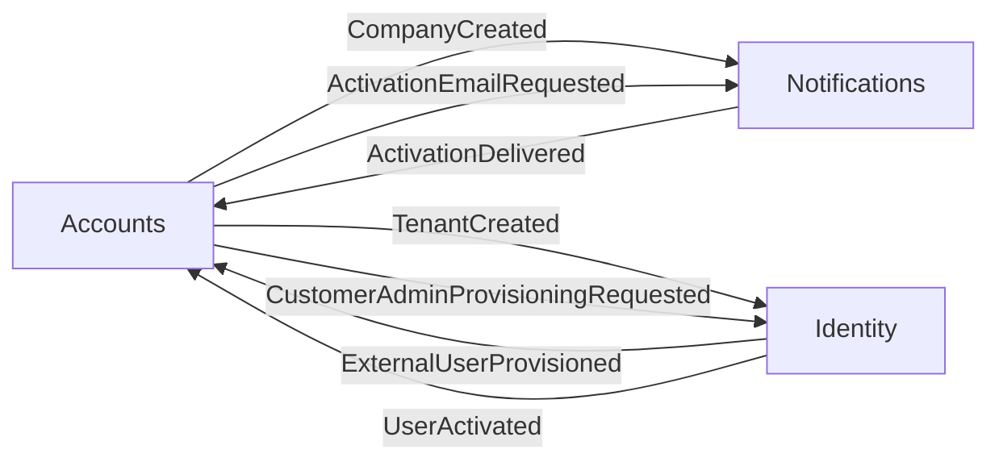
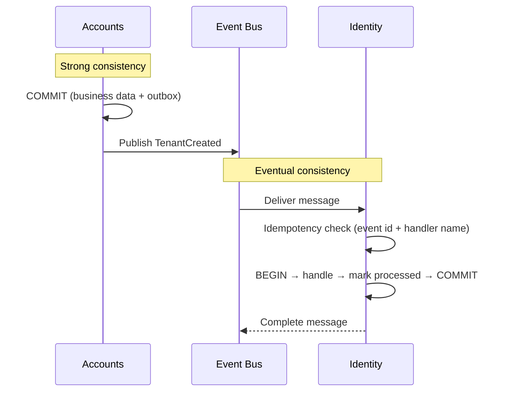
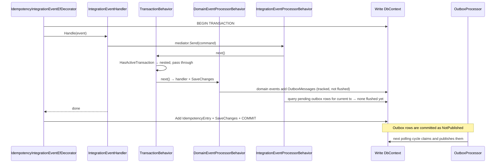

# Domain Events & Consistency

Covers domain events, the single-transaction model, and the consistency boundaries between bounded contexts.

---

## Domain Events

Domain events represent state changes within a bounded context. They enable loose coupling between aggregates while maintaining transactional consistency.

### Definition

```csharp
// Domain.Core — pure DDD, no infrastructure dependencies
public interface IDomainEvent { }

// Platform.Messaging.Abstractions — MediatR adapter
public interface IDomainEventHandler<TEvent> : INotificationHandler<TEvent>
    where TEvent : IDomainEvent, INotification { }
```

Events implement both `IDomainEvent` (domain concept) and `INotification` (MediatR transport):

```csharp
// Accounts.Domain/Events/CompanyCreatedDomainEvent.cs
public record CompanyCreatedDomainEvent(
    Guid TenantId,
    Guid CompanyId,
    string LegalName,
    string TradeName,
    string TaxId,
    string CountryCode) : IDomainEvent, INotification;
```

### Raising Events

Entities raise domain events through the `Entity` base class (`AddDomainEvent`, `RemoveDomainEvent`, `ClearDomainEvents`):

```csharp
// Accounts.Domain/Models/CompanyAggregate/Company.cs
public static Company Create(Guid tenantId, string legalName, /* ... */)
{
    var company = new Company { /* ... */ Status = CompanyStatus.Pending };
    company.AddCompanyCreatedDomainEvent();
    return company;
}

private void AddCompanyCreatedDomainEvent()
{
    AddDomainEvent(new CompanyCreatedDomainEvent(
        TenantId, Id, LegalName, TradeName, TaxId, Address?.CountryCode!));
}
```

Events are stored in-memory on the entity (`[NotMapped]`, `[JsonIgnore]`) until dispatched. Because `Entity` generates its `Guid` identity in the constructor, events can carry the aggregate ID before anything is persisted.

### Dispatching Events

`DomainEventProcessorBehavior` dispatches domain events **within the active transaction**, after the handler returns (and after its `SaveChangesAsync()`), but before `TransactionBehavior` commits. This means handlers can:

- Query persisted entities through repositories
- Modify aggregates (changes are part of the same transaction)
- Add integration events to the outbox



The behavior uses `IDomainEntityChangeTracker` to find entities with pending events and `DomainEventsDispatcherExtension` (in `Platform.Messaging`) to publish them via MediatR. Events are cleared **before** publishing, so a handler that raises new events on the same entity starts a new cycle instead of re-dispatching old ones.

**Cascading support:** After each cycle, the behavior re-reads the change tracker. The loop continues until no entity has pending events. The number of cycles and entities is recorded on the `DomainEventProcessor {Command}` activity.

### Telemetry

`TelemetryDomainEventBehavior` is a custom `INotificationPublisher` that executes handlers **sequentially** and wraps each `IDomainEventHandler<>` invocation with an OpenTelemetry activity and metrics. It replaces MediatR's default publisher (see [06-telemetry.md](06-telemetry.md)).

---

## Single-Transaction Model

All changes within a command are atomic: aggregate state, domain event side-effects, idempotency entry, and outbox messages are committed in a single database transaction.

### Transaction Flow



### Why Two SaveChanges Within One Transaction

The command handler calls `SaveChangesAsync()` to flush the aggregate to the database. This is useful so that domain event handlers can:

1. **Query the persisted entity** through repositories
2. **Access computed values** (database defaults, `RowVersion`, audit timestamps)
3. **Add outbox messages** that reference the entity

The domain event handlers add their changes to the EF change tracker. `CommitTransactionAsync()` applies audit timestamps and performs a final `SaveChangesAsync()` before committing — persisting outbox messages and any handler modifications atomically.

---

## Consistency Boundaries

### Strong Consistency (Within Bounded Context)

Everything within a single command runs in **one database transaction**:



### Eventual Consistency (Across Bounded Contexts)

Integration events are published asynchronously through the event bus (Azure Service Bus topic `sirius-event-bus` by default). Each receiving service processes the event in its own transaction behind the idempotent consumer decorator.

Real integration event flows between services:



`CustomerActivationCompletedIntegrationEvent` and `CustomerGoLiveIntegrationEvent` are published by Accounts but currently have no subscribers.



### Integration Event → Command (Nested Transaction)

Integration event handlers are thin translators that send an application command through MediatR:

```csharp
// Accounts.Infrastructure/IntegrationEvents/EventHandling/UserActivatedIntegrationEventHandler.cs
public async Task Handle(UserActivatedIntegrationEvent @event)
{
    var result = await _mediator.Send(new CompleteActivationOnUserActivatedCommand(@event.UserId));

    if (result.IsFailure)
        _logger.LogWarning("CompleteActivationOnUserActivated failed for UserId={UserId}: {Error}",
            @event.UserId, result.Error.Message);
}
```

`IdempotencyIntegrationEventEfDecorator` opens the transaction before calling the handler, so the command runs **nested**:



In this flow the outbox events are committed atomically with the business data and the idempotency entry, but they are published by the `OutboxProcessor` on its next polling cycle (default every 30 s) rather than inline.

### Identity: Two Contexts

Identity keeps ASP.NET Identity / Duende data in `IdentityContext` and the platform infrastructure (idempotency + outbox) in `IdentityLogsContext : SiriusDBContext`. Command handlers such as `ProvisionCustomerAdminCommandHandler` write users and tenants through `ResilientTransaction.New(_identityContext)` and then add the integration event to the outbox of `IdentityLogsContext`. These are **two separate database transactions**, so Identity relies on idempotent "create if not exists" logic instead of a single atomic commit.

### Domain Event Handler Example

```csharp
// Accounts.Application/DomainEventHandlers/CompanyCreatedDomainEventHandler.cs
public async Task Handle(CompanyCreatedDomainEvent notification, CancellationToken cancellationToken)
{
    var company = await _companyRepository.GetAsync(notification.CompanyId);

    if (company != null)
    {
        var integrationEvent = new CompanyCreatedIntegrationEvent(
            company.TenantId, company.Id, company.LegalName,
            company.TradeName, company.TaxId, company.Address?.CountryCode!);

        await _outboxService.AddAndSaveEventAsync(integrationEvent);
    }
    else
    {
        _logger.LogWarning("Company {CompanyId} not found ... Integration event not published.", notification.CompanyId);
    }
}
```

The handler loads the persisted company and adds an integration event to the outbox, committed with the same transaction. `AddAndSaveEventAsync` throws `InvalidOperationException` if no transaction is active.

---

## Design Decisions

**Why dispatch domain events WITHIN the transaction (not after)?** Handlers need access to persisted data and must be able to modify the database atomically. If dispatch happened after commit, handler failures would leave the system in an inconsistent state.

**Why a separate DomainEventProcessorBehavior instead of dispatching in SaveChanges?** Separating dispatch from persistence follows SRP. The behavior is configurable independently and keeps `SiriusDBContext` focused on persistence.

**Why cascading re-check?** Domain event handlers may raise additional domain events. The re-check loop ensures all cascading events are processed within the same transaction.

**Why IDomainEntityChangeTracker separate from ITransactionalUnitOfWork?** SRP — transaction management and entity tracking are distinct responsibilities. `ITransactionalUnitOfWork` handles transactions; `IDomainEntityChangeTracker` exposes tracked entities for event dispatch.

**Why do integration event handlers send commands?** The handler stays a thin adapter; business rules, validation, idempotency and domain events live in the application command, reusing the same pipeline as API requests.
