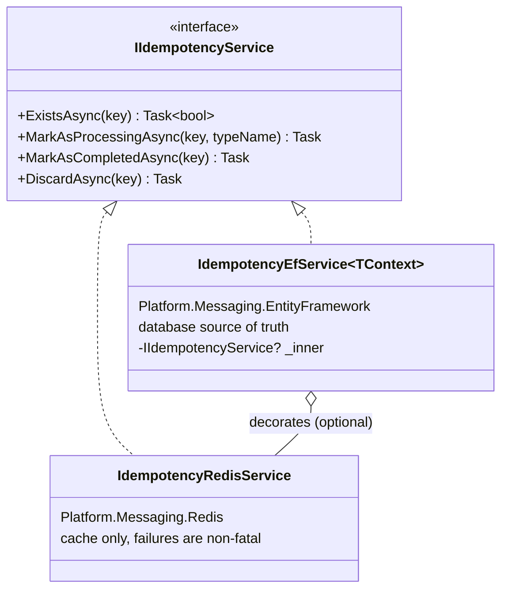
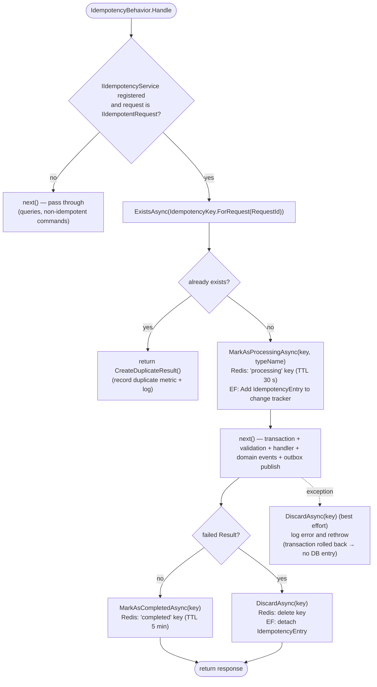
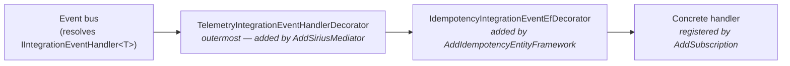
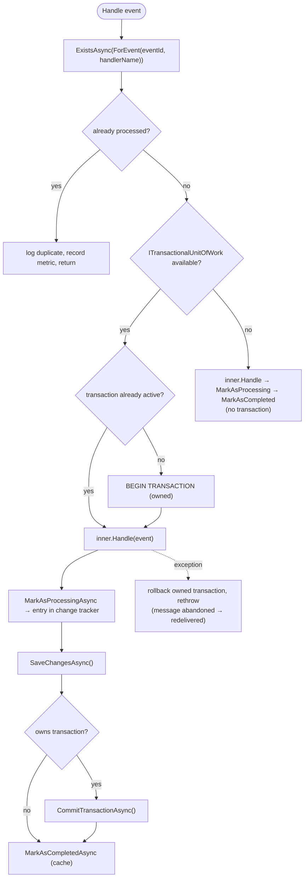
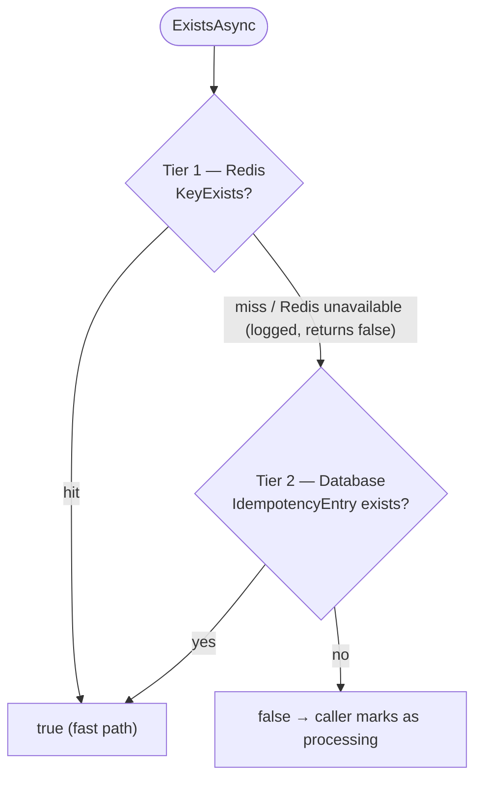

# Idempotency

Covers command deduplication, idempotent consumer for integration events, and the Redis hybrid cache layer. All mechanisms share a unified `IIdempotencyService` and `IdempotencyEntry` model.

---

## Unified Idempotency Model

A single `IdempotencyEntry` POCO with a composite key (`Id + Scope + Qualifier`) handles idempotency for both commands and integration events:

```csharp
// Platform.Messaging/Models/IdempotencyEntry.cs (POCO, no EF attributes)
public class IdempotencyEntry
{
    public Guid Id { get; set; }                         // RequestId or EventId
    public IdempotencyScope Scope { get; set; }          // Request or Event
    public string Qualifier { get; set; } = string.Empty; // Handler name for events, empty for requests
    public string? TypeName { get; set; }
    public DateTime ProcessedAt { get; set; }
}
```

```csharp
// Platform.Messaging.Abstractions/Services/IIdempotencyService.cs
public interface IIdempotencyService
{
    Task<bool> ExistsAsync(IdempotencyKey key);
    Task MarkAsProcessingAsync(IdempotencyKey key, string? typeName = null);
    Task MarkAsCompletedAsync(IdempotencyKey key);
    Task DiscardAsync(IdempotencyKey key);   // undo MarkAsProcessingAsync after a failure
}
```

```csharp
// Platform.Messaging.Abstractions/Models
public enum IdempotencyScope { Request, Event }

public readonly record struct IdempotencyKey(Guid Id, IdempotencyScope Scope, string? Qualifier = null)
{
    public static IdempotencyKey ForRequest(Guid requestId) => new(requestId, IdempotencyScope.Request);
    public static IdempotencyKey ForEvent(Guid eventId, string handlerName) => new(eventId, IdempotencyScope.Event, handlerName);
}
```

### Implementations



---

## Command Idempotency

Commands that implement `IIdempotentRequest` are deduplicated by `IdempotencyBehavior` in the pipeline. Two convenience options exist:

| Type | Location | Notes |
|---|---|---|
| `IIdempotentCommand` / `IIdempotentCommand<TResponse>` | Platform.Messaging.Abstractions | Interfaces with default `CreateResultForDuplicateRequest()` (`Result.Success(default)`) |
| `IdempotentCommand` / `IdempotentCommand<TResponse>` | Platform.Messaging | Abstract records: `RequestId` generated when not provided, `virtual CreateResultForDuplicateRequest()` |

### Command Definition

```csharp
// Accounts.Application/Commands/CreateCompanyCommand.cs
[DataContract]
public record CreateCompanyCommand : IdempotentCommand<bool>
{
    [DataMember] public Guid TenantId { get; private set; }
    [DataMember] public string LegalName { get; private set; } = null!;
    // ...

    public CreateCompanyCommand(Guid tenantId, string legalName, /* ... */ Guid? requestId = null)
        : base(requestId) { /* ... */ }

    public override Result<bool> CreateResultForDuplicateRequest() => Result.Success(true);
}
```

The API takes the request id from the `x-requestid` header and rejects empty values:

```csharp
// Accounts.API/APIs/AccountsApi.cs
public static async Task<Results<Ok<bool>, BadRequest<ApiErrorResponse>>> CreateCompanyAsync(
    [FromHeader(Name = "x-requestid")] Guid requestId,
    CreateCompanyRequest request,
    [AsParameters] AccountsServices services)
```

### Pipeline Flow



`IdempotencyBehavior` sits **outside** `TransactionBehavior`, but the entry it adds to the change tracker is flushed by the handler's `SaveChangesAsync()` / the final save in `CommitTransactionAsync()`, so it is committed atomically with the business data.

A request is only recorded as processed when it **succeeds**:

- **Failed `Result`** (validation or business error): `TransactionBehavior` rolls the transaction back, and `IdempotencyBehavior` calls `DiscardAsync`, which deletes the Redis key and detaches the entry from the change tracker. A retry with the same `x-requestid` is processed again instead of being answered as a duplicate.
- **Exception**: the transaction rolls back, so no entry is persisted in the database, and `IdempotencyBehavior` calls `DiscardAsync` before rethrowing. The discard is best effort: if it fails, a warning is logged and the original exception is rethrown. If the exception happens after the commit (e.g. while publishing integration events), the entry is already in the database, so a retry is still detected as a duplicate through the database fallback of `ExistsAsync`.

### API Response for Duplicates

A duplicate request returns whatever `CreateResultForDuplicateRequest()` produces (for `CreateCompanyCommand`, `Result.Success(true)`), which the endpoint maps to `200 OK`. The duplicate result is **not** a replay of the original response body; commands that need that must override `CreateResultForDuplicateRequest()` accordingly.

---

## Idempotent Consumer (Integration Events)

Integration events are deduplicated per handler by decorators applied with Scrutor on `IIntegrationEventHandler<T>`. The key is `IdempotencyKey.ForEvent(@event.Id, handlerName)`, where `handlerName` is the real handler type name obtained by unwrapping `IDecoratedHandler<T>` chains — so the same event can be processed independently by multiple handlers.

| Decorator | Project | Registered by | Guarantees |
|---|---|---|---|
| `IdempotencyIntegrationEventDecorator<T>` | Platform.Messaging | `AddRedisIdempotencyCache(...).ForIntegrationEventHandlers()` | Cache-only, non-transactional |
| `IdempotencyIntegrationEventEfDecorator<T>` | Platform.Messaging.EntityFramework | `AddIdempotencyEntityFramework<TContext>().ForIntegrationEventHandlers()` | Transactional (business data + entry committed together) |

When both are registered, the EF builder **unwraps** the Redis decorator and replaces it with the EF decorator, because the hybrid `IdempotencyEfService` already performs the Redis fast-path check.

### Decorator Chain



Scrutor decorates existing registrations in call order (last decorator = outermost). Services therefore call `AddSubscription` first, then the idempotency builders, then `AddSiriusMediator`.

### EF Decorator Flow



### Handler Example

```csharp
// Notifications.Infrastructure/IntegrationEvents/EventHandling
public class CompanyCreatedIntegrationEventHandler
    : IIntegrationEventHandler<CompanyCreatedIntegrationEvent>
{
    public async Task Handle(CompanyCreatedIntegrationEvent @event)
    {
        // Pure business logic — idempotency and telemetry are handled by decorators
        await _mediator.Send(new SendCompanyWelcomeEmailsCommand(/* ... */));
    }
}
```

---

## Redis Hybrid Cache

`IdempotencyEfService<TContext>` optionally wraps `IdempotencyRedisService` to provide a two-tier duplicate detection system.

### Two-Tier Architecture



### Configuration

```csharp
// Accounts.Infrastructure/Extensions/Extensions.cs (order matters)
services.AddRedisIdempotencyCache(builder.Configuration)   // registers IdempotencyRedisService
    .ForApiRequests()
    .ForIntegrationEventHandlers();

services.AddIdempotencyEntityFramework<AccountContext>()   // decorates it with IdempotencyEfService
    .ForApiRequests()
    .ForIntegrationEventHandlers();
```

`EfIdempotencyBuilder` checks whether an `IIdempotencyService` is already registered: if so it **decorates** it (`IdempotencyEfService(context, inner, logger)`), otherwise it registers a database-only `IdempotencyEfService`. It also enables `WithIdempotency()` on the shared `SiriusDbContextConfiguration`.

`IdempotencyRedisService` needs an `IConnectionMultiplexer`; services get it from Aspire with `builder.AddRedisClient("cache")` (or use the `AddRedisIdempotencyCache(configuration, redisConnectionString)` overload).

```csharp
public async Task<bool> ExistsAsync(IdempotencyKey key)
{
    if (_inner is not null && await _inner.ExistsAsync(key))
        return true;                                   // cache hit

    var qualifier = key.Qualifier ?? string.Empty;
    return await _context.Set<IdempotencyEntry>()      // source of truth
        .AnyAsync(e => e.Id == key.Id && e.Scope == key.Scope && e.Qualifier == qualifier);
}
```

### Redis Keys and TTLs

Options are bound from the `IdempotencyCache` section (`IdempotencyCacheOptions`):

```json
"IdempotencyCache": {
  "ProcessingTtl": "00:00:30",
  "CompletedTtl": "00:05:00",
  "KeyPrefix": "idempotency:"
}
```

| Phase | Value | Default TTL | Purpose |
|---|---|---|---|
| Processing | `processing` | 30 seconds | Block concurrent duplicates while the first request runs |
| Completed | `completed` | 5 minutes | Fast duplicate detection for retries |

Key format: `{KeyPrefix}{scope}:{id}` for requests and `{KeyPrefix}{scope}:{id}:{qualifier}` for events (scope in lower case, e.g. `idempotency:event:{eventId}:CompanyCreatedIntegrationEventHandler`).

### Resilience

Redis failures are non-fatal: every Redis call catches exceptions, logs a warning and falls back (`ExistsAsync` returns `false`). The database is the source of truth, and `SiriusDBContext` translates primary-key violations on `IdempotencyEntry` into `UniqueConstraintViolationException` as a final safety net.

---

## Database Schema

Table `IdempotencyEntry` in the **default schema of the owning context** (e.g. `Accounts.IdempotencyEntry`, `Notifications.IdempotencyEntry`), configured in `Platform.Persistence.EntityFramework.Relational` when `WithIdempotency()` is enabled:

| Column | Type | Notes |
|---|---|---|
| `Id` | `Guid` | RequestId (commands) or EventId (integration events) |
| `Scope` | `nvarchar(20)` | Enum stored as string: `Request` or `Event` |
| `Qualifier` | `nvarchar(255)` | Empty for requests, handler name for events (default `''`) |
| `TypeName` | `nvarchar(255)` | Command or event type name (nullable) |
| `ProcessedAt` | `datetime2` | UTC timestamp |

**Composite primary key:** `(Id, Scope, Qualifier)`
**Indexes:** `ProcessedAt`, `(Id, Scope)`

---

## Known Gaps

| Area | Details |
|---|---|
| No cleanup job | `IdempotencyEntry` rows are never purged; the `ProcessedAt` index exists to support a future retention job. |
