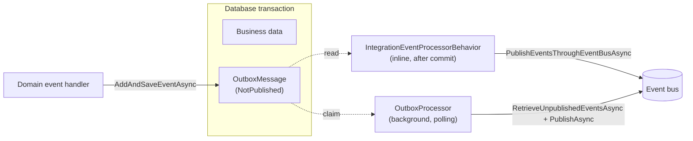
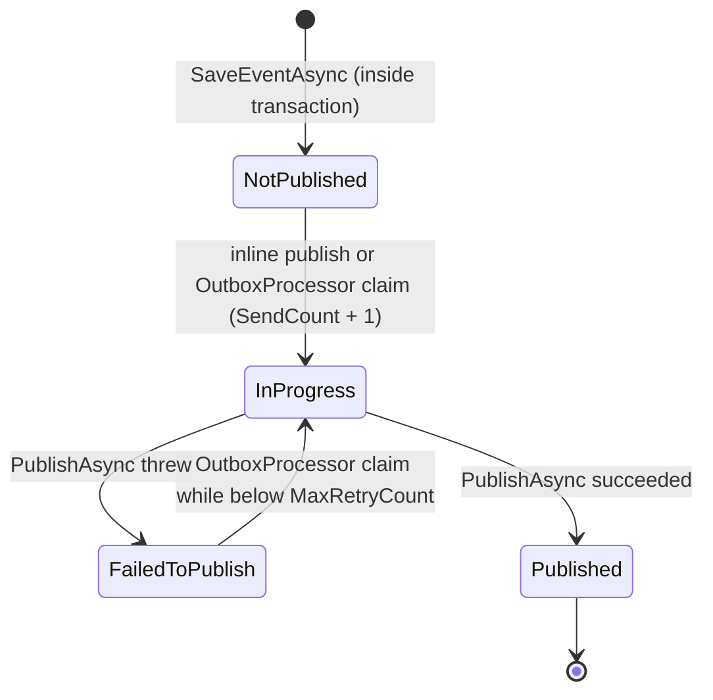
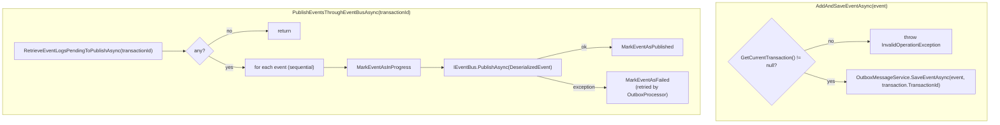
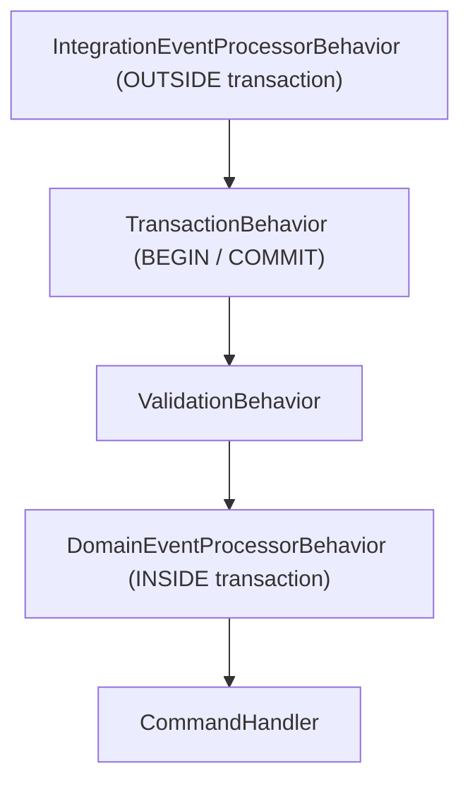
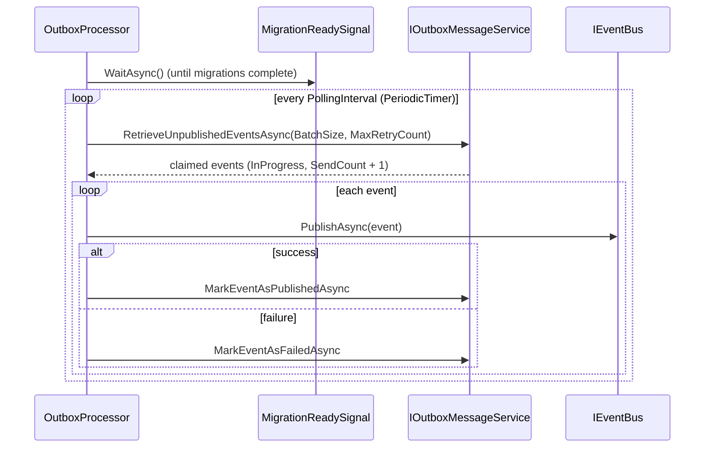

# Transactional Outbox

## Overview

The Transactional Outbox pattern guarantees that integration events are published reliably alongside business data changes. Business data and outbox entries are saved in the **same database transaction**, ensuring atomicity. Events are then published to the event bus right after commit (inline), and a background processor retries anything that was not published.

**Layer**: `Platform.Messaging.EntityFramework`  
**Key types**: `OutboxMessageService<TContext>`, `EventBusOutboxService<TContext>`, `OutboxProcessor`, `IntegrationEventProcessorBehavior<TRequest, TResponse>`



---

## Domain Model

`OutboxMessage` is a persistence-ignorant POCO defined in `Platform.Messaging`:

```csharp
public class OutboxMessage
{
    public Guid Id { get; set; }                       // = IntegrationEvent.Id
    public string TypeName { get; set; } = string.Empty; // event type FullName
    public OutboxMessageStatus Status { get; set; }
    public int SendCount { get; set; }
    public DateTime CreatedAt { get; set; }            // = IntegrationEvent.CreationDate
    public string Payload { get; set; } = string.Empty; // JSON
    public Guid TransactionId { get; set; }
    public byte[] RowVersion { get; set; } = null!;

    // Transient, populated after deserializing Payload. Not persisted.
    public IntegrationEvent? DeserializedEvent { get; set; }
}

public enum OutboxMessageStatus
{
    NotPublished = 0,
    InProgress = 1,
    Published = 2,
    FailedToPublish = 3
}
```

Entity configuration lives in `Platform.Persistence.EntityFramework.Relational` (`OutboxMessageConfiguration`), following the 5-layer boundary rules: table `OutboxMessage` in the context default schema, `RowVersion` as row version, `DeserializedEvent` ignored, indexes on `TransactionId` and `(Status, CreatedAt)`.

### Status Lifecycle



---

## Services

### OutboxMessageService&lt;TContext&gt;

Low-level service (`IOutboxMessageService`) that persists and retrieves outbox entries using EF Core:

| Method | Responsibility |
|--------|---------------|
| `SaveEventAsync(event, transactionId)` | Serializes the event (`System.Text.Json`, indented) and **adds** an `OutboxMessage` to the change tracker — persisted by the next `SaveChanges`/commit |
| `RetrieveEventLogsPendingToPublishAsync(transactionId)` | Loads `NotPublished` rows for the transaction, ordered by `CreatedAt`, and deserializes them |
| `MarkEventAsInProgressAsync` | Loads the row, sets `InProgress`, increments `SendCount`, `SaveChangesAsync` |
| `MarkEventAsPublishedAsync` | Sets `Published`, `SaveChangesAsync` |
| `MarkEventAsFailedAsync` | Sets `FailedToPublish`, `SaveChangesAsync` |
| `RetrieveUnpublishedEventsAsync(batchSize, maxRetryCount)` | Atomically claims a batch for the background processor (see [Concurrency Control](#concurrency-control)) |

Status updates load the tracked entity and rely on `RowVersion`; a `DbUpdateConcurrencyException` is logged, recorded as an activity event and rethrown.

### EventBusOutboxService&lt;TContext&gt;

Higher-level service (`IEventBusOutboxService`) that coordinates outbox persistence with event bus publishing:



Publishing failures are logged and counted; they do **not** fail the command, which has already committed.

---

## Pipeline Integration

### IntegrationEventProcessorBehavior

Registered **outside** `TransactionBehavior`. After the inner pipeline (including the commit) completes, it publishes the outbox events of the transaction:



```csharp
public async Task<TResponse> Handle(TRequest request, RequestHandlerDelegate<TResponse> next, CancellationToken cancellationToken)
{
    var response = await next(cancellationToken);
    var transactionId = _unitOfWork.GetCurrentTransaction()?.TransactionId ?? _unitOfWork.LastCommittedTransactionId;

    if (!transactionId.HasValue)
        return response;

    // activity "IntegrationEventProcessor {Command}"
    if (_outboxService is not null)
        await _outboxService.PublishEventsThroughEventBusAsync(transactionId.Value);

    return response;
}
```

When the command runs nested inside a transaction opened by `IdempotencyIntegrationEventEfDecorator`, the outbox rows are not flushed yet at this point, so nothing is published inline and the `OutboxProcessor` publishes them after the outer commit (see [03-domain-events-consistency.md](03-domain-events-consistency.md#integration-event--command-nested-transaction)).

### Domain Event Handlers → Outbox

Domain event handlers run inside the transaction and save integration events to the outbox atomically:

```csharp
// Accounts.Application/DomainEventHandlers/CompanyCreatedDomainEventHandler.cs
public async Task Handle(CompanyCreatedDomainEvent notification, CancellationToken cancellationToken)
{
    var company = await _companyRepository.GetAsync(notification.CompanyId);
    if (company != null)
    {
        var integrationEvent = new CompanyCreatedIntegrationEvent(/* ... */);
        await _outboxService.AddAndSaveEventAsync(integrationEvent);
    }
}
```

---

## Background Processor

`OutboxProcessor` is a `BackgroundService` registered automatically by `AddTransactionalOutbox<TContext>()`:



- **Startup gate**: waits for `MigrationReadySignal`, which is registered and signalled by `AddMigration<TContext>()` — a service that uses the outbox must also register its migrations.
- **Polling**: `PeriodicTimer` with `OutboxProcessorOptions.PollingInterval` (default **30 s**). A new DI scope is created per cycle.
- **Batch**: up to `BatchSize` (default **50**) events with status `NotPublished` or `FailedToPublish` and `SendCount < MaxRetryCount` (default **5**), oldest first.
- **Retry**: one attempt per event per cycle; the effective delay between retries is the polling interval (no exponential backoff).
- **Errors**: exceptions in a cycle are logged and the loop continues; cancellation stops the loop.

```csharp
services.AddTransactionalOutbox<AccountContext>(
    options => options.RegisterEventTypes(/* assemblies */),
    processor =>                                  // optional
    {
        processor.PollingInterval = TimeSpan.FromSeconds(10);
        processor.BatchSize = 100;
        processor.MaxRetryCount = 10;
    });
```

---

## Concurrency Control

When multiple `OutboxProcessor` instances run concurrently (e.g., scaled-out services), race conditions could cause duplicate publishing. The solution uses an **atomic claim pattern** in `RetrieveUnpublishedEventsAsync`:

### Three-Step Atomic Claim

1. **Select candidates**: IDs of the oldest `NotPublished` / `FailedToPublish` rows below the retry limit (`Take(batchSize)`).
2. **Claim**: a single `ExecuteUpdateAsync` sets `Status = InProgress` and `SendCount + 1`, re-applying the status/retry predicate. Rows already claimed by another instance no longer match and are skipped by the database.
3. **Load**: read back the candidate rows that are now `InProgress` and deserialize them.

```csharp
var claimedCount = await _context.Set<OutboxMessage>()
    .Where(e => candidateEventIds.Contains(e.Id)
        && (e.Status == OutboxMessageStatus.NotPublished || e.Status == OutboxMessageStatus.FailedToPublish)
        && e.SendCount < maxRetryCount)
    .ExecuteUpdateAsync(setters => setters
        .SetProperty(e => e.Status, OutboxMessageStatus.InProgress)
        .SetProperty(e => e.SendCount, e => e.SendCount + 1),
        cancellationToken);
```

If `claimedCount == 0`, another process won the race and the cycle ends.

### RowVersion Optimistic Concurrency

`OutboxMessage.RowVersion` is configured with `IsRowVersion()`. The claim itself relies on the status predicate of the `UPDATE`, while status transitions performed through tracked entities (`MarkEventAs*`) are protected by `RowVersion`: if another process modified the row in between, EF throws `DbUpdateConcurrencyException`.

This approach is **database-agnostic** — it uses standard EF Core APIs without raw SQL.

---

## Event Type Registration

The outbox stores `TypeName = event.GetType().FullName` and needs the type to deserialize the payload. Types are registered in `OutboxMessageOptions` when calling `AddTransactionalOutbox`, usually by scanning the contract assemblies:

```csharp
// Accounts.Infrastructure/Extensions/Extensions.cs
services.AddTransactionalOutbox<AccountContext>(options =>
{
    options.RegisterEventTypes(
        typeof(Sirius.Contracts.Accounts.AssemblyReference).Assembly,
        typeof(Sirius.Contracts.Identity.AssemblyReference).Assembly,
        typeof(Sirius.Contracts.Notifications.AssemblyReference).Assembly);
});
```

`RegisterEventTypes` also accepts `params Type[]` or `IEnumerable<Type>`. Each call **replaces** the previous list. This registry is independent from the event bus subscriptions (`AddSubscription`), which only cover consumed events.

Unregistered event types make deserialization throw `InvalidOperationException` ("Event type '...' is not registered").

---

## Telemetry

`OutboxMessageService`, `EventBusOutboxService` and `OutboxProcessor` emit (ActivitySource / Meter `Sirius.Domain.Application`):

| Signal | Details |
|--------|---------|
| Activities | `Save Event to Outbox`, `Retrieve Pending Events from Outbox`, `Update Outbox Event Status`, `Publish Outbox Events`, `Retrieve Unpublished Outbox Events`, `Outbox Background Processing` |
| Counters | `application.outbox.events_saved`, `application.outbox.state_changes` (tag `status`), `application.outbox.events_failed` (tag `event_type`) |
| Histograms | `application.outbox.operation_duration` (tag `operation`: `save`, `retrieve`, `update_status`, `retrieve_unpublished`), `application.outbox.batch_size` |

---

## Validation Checklist

- [ ] Domain event handlers save integration events via `IEventBusOutboxService.AddAndSaveEventAsync` (inside transaction)
- [ ] The service uses `AddSiriusMediator` so `IntegrationEventProcessorBehavior` runs outside `TransactionBehavior`
- [ ] `AddTransactionalOutbox<TContext>` is registered (it also registers `OutboxProcessor` and enables the outbox mapping)
- [ ] `AddMigration<TContext>` is registered so `MigrationReadySignal` exists and is signalled
- [ ] All published integration event types are registered via `OutboxMessageOptions.RegisterEventTypes`
- [ ] No direct `IEventBus.PublishAsync` calls from handlers (use the outbox)

---

## Known Gaps

| Area | Details |
|---|---|
| Stuck `InProgress` events | Events claimed or marked `InProgress` are never reclaimed if the process dies (or deserialization fails) before marking them `Published`/`FailedToPublish`. There is no timeout-based recovery. |
| Exhausted retries | Events that reach `MaxRetryCount` stay `FailedToPublish` with no dead-letter table or alert. |
| No backoff | Retries happen on every polling cycle; there is no exponential backoff. |
| Deferred publishing for nested commands | Commands triggered by integration events publish through the `OutboxProcessor`, adding up to one polling interval of latency. |
| Several nested commands *(latent)* | If an integration event handler sends two commands and the first adds outbox rows, the second command's `SaveChangesAsync()` flushes them and they are published before the decorator commits. No handler does this today ([details](../developer-guide/05-known-gaps.md#several-nested-commands-can-publish-before-commit)). |
| Duplicate save metric | `application.outbox.events_saved` is incremented by both `EventBusOutboxService` and `OutboxMessageService` for the same event. |
