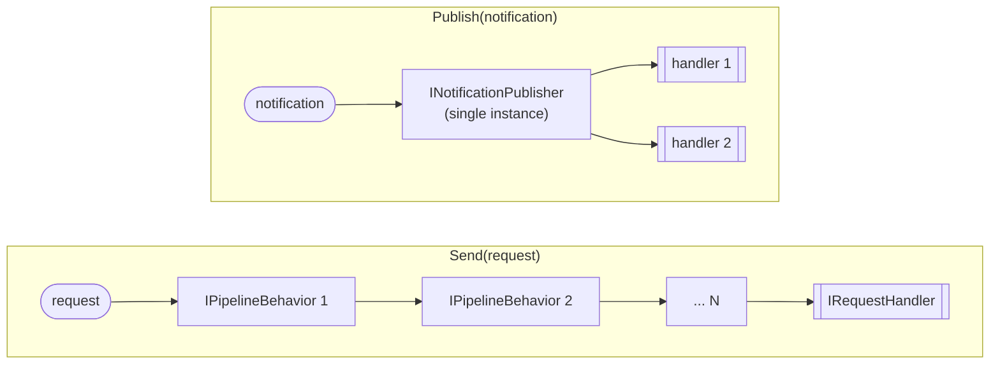
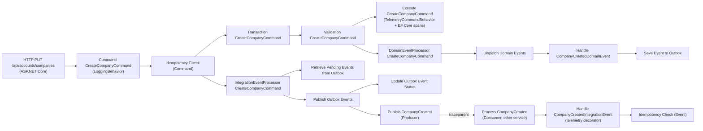

# Handler Telemetry Strategy

## Overview

Unified OpenTelemetry strategy for all handler types. Each handler type uses the correct extension point for its execution path, ensuring automatic distributed tracing and metrics with zero risk of bypass. Services get all of it by calling `AddQltMediator` (handlers) and `AddServiceDefaults` (exporters).

**Layers**: `Platform.Telemetry` (diagnostics + helpers), `Platform.Messaging` (behaviors, publisher, decorator), `Platform.ServiceDefaults` (OpenTelemetry SDK wiring)  
**Key types**: `TelemetryCommandBehavior<,>`, `TelemetryQueryBehavior<,>`, `TelemetryDomainEventBehavior`, `TelemetryIntegrationEventHandlerDecorator<T>`, `ApplicationDiagnostics`, `MigrationDiagnostics`

---

## Strategy Per Handler Type

| Handler Type | MediatR Path | Extension Mechanism | Implementation |
|---|---|---|---|
| **Commands** | `Send()` | `IPipelineBehavior<,>` | `TelemetryCommandBehavior<,>` |
| **Queries** | `Send()` | `IPipelineBehavior<,>` | `TelemetryQueryBehavior<,>` |
| **Domain Events** | `Publish()` | `INotificationPublisher` | `TelemetryDomainEventBehavior` |
| **Integration Events** | Outside MediatR (event bus) | Scrutor `TryDecorate` | `TelemetryIntegrationEventHandlerDecorator<>` |

---

## MediatR Execution Paths

MediatR has two distinct paths with different extension mechanisms:



`IPipelineBehavior` supports multiple behaviors composed automatically (Chain of Responsibility). `INotificationPublisher` is a single instance controlling all notification handler execution — it is **not chainable**.

---

## Commands and Queries — IPipelineBehavior

`TelemetryCommandBehavior<TRequest, TResponse>` wraps command execution with tracing and metrics:

```csharp
public class TelemetryCommandBehavior<TRequest, TResponse> : IPipelineBehavior<TRequest, TResponse>
    where TRequest : IRequest<TResponse>
{
    private static readonly bool IsCommand = DetectCommandType();

    public async Task<TResponse> Handle(TRequest request, RequestHandlerDelegate<TResponse> next,
        CancellationToken cancellationToken)
    {
        if (!IsCommand)
            return await next(cancellationToken);

        using var activity = ActivityHelper.StartHandlerActivity($"Execute {typeof(TRequest).Name}");
        ActivityHelper.SetHandlerTags(activity, commandType, "pipeline", "command");
        // Stopwatch → MetricsHelper.RecordCommandHandlerExecution(...)
        // Result.IsSuccess drives the success tag; failed Result → ActivityHelper.RecordResultError(...)
        // Exceptions → ActivityHelper.RecordException(...) and rethrow
    }
}
```

The static cached `bool IsCommand` skips non-command requests at zero cost; `DetectCommandType()` checks `ICommand` and `ICommand<>` once per closed generic type. `TelemetryQueryBehavior<,>` is identical but detects `IQuery<>` and records query metrics.

Both are registered with `services.AddTransient(typeof(IPipelineBehavior<,>), ...)` **after** `AddMediatR`, so they are the innermost behaviors and measure the handler itself (see [02-command-pipeline.md](02-command-pipeline.md#effective-order)).

---

## Domain Events — INotificationPublisher

`TelemetryDomainEventBehavior` replaces MediatR's default `ForeachAwaitPublisher` (keeping sequential execution) to add telemetry around each domain event handler:

```csharp
public class TelemetryDomainEventBehavior : INotificationPublisher
{
    public async Task Publish(
        IEnumerable<NotificationHandlerExecutor> handlerExecutors,
        INotification notification,
        CancellationToken cancellationToken)
    {
        foreach (var handler in handlerExecutors)
        {
            if (IsDomainEventHandler(handler.HandlerInstance))
                await ExecuteWithTelemetry(handler, notification, cancellationToken).ConfigureAwait(false);
            else
                await handler.HandlerCallback(notification, cancellationToken).ConfigureAwait(false);
        }
    }
}
```

Filters by the `IDomainEventHandler<>` interface — only domain event handlers get telemetry (`Handle {Event}` activity, `event.domain = true` tag). Other `INotificationHandler` registrations execute normally.

**Registration**: `services.AddSingleton<INotificationPublisher, TelemetryDomainEventBehavior>();`

**Order independence**: Works regardless of registration order relative to `AddMediatR()`. MediatR uses `TryAddSingleton` for its default publisher.

---

## Integration Events — Scrutor Decorator

Integration event handlers are registered directly in DI via `eventBus.AddSubscription<TEvent, THandler>()` (not through MediatR), so Scrutor can find and decorate them. The registration uses a factory so the decorator is built for the concrete event type:

```csharp
services.TryDecorate(typeof(IIntegrationEventHandler<>), (inner, serviceProvider) =>
{
    var eventType = /* TEvent from inner's IIntegrationEventHandler<> interface */;
    var decoratorType = typeof(TelemetryIntegrationEventHandlerDecorator<>).MakeGenericType(eventType);
    return Activator.CreateInstance(decoratorType, inner)!;
});
```

The decorator creates a `Consumer` activity `Handle {Event}`, tags event id and creation date, and reports the real handler name by unwrapping `IDecoratedHandler<T>` chains. Because `AddQltMediator` runs after the idempotency builders, telemetry is the **outermost** decorator and measures total time including the idempotency check.

---

## Why Not Scrutor for Everything?

| Factor | Scrutor `TryDecorate` | MediatR Native |
|---|---|---|
| **MediatR commands/queries** | ❌ Fails silently (registered as `IRequestHandler`, not `ICommandHandler`) | ✅ `IPipelineBehavior` |
| **MediatR notifications** | ❌ Fails silently (registered as `INotificationHandler`, not `IDomainEventHandler`) | ✅ `INotificationPublisher` |
| **Non-MediatR handlers** | ✅ Works (registered directly in DI) | N/A |
| **MediatR version upgrades** | ❌ Depends on DI registration internals | ✅ Public API contract |

---

## Trace Structure

Example span tree for an idempotent command (`CreateCompanyCommand`) with validators, as produced by the current pipeline order:



Activities that use `using var` span the remainder of their behavior, so later behaviors appear as their children. The producer propagates `traceparent`/`tracestate` through message properties, so the consumer span joins the same trace.

---

## Telemetry Data Captured

All handler-level implementations record the same categories:

| Signal | Method | Data |
|--------|--------|------|
| Distributed Tracing | `ActivityHelper.StartHandlerActivity()` | Activity (`Execute {Request}` / `Handle {Event}`) |
| Handler Tags | `ActivityHelper.SetHandlerTags()` | Message type, handler type, category (`command`, `query`, `domain-event`, `event`) |
| Execution Time | `Stopwatch` → `MetricsHelper.Record*Execution()` | Duration in ms, success/failure |
| Exceptions | `ActivityHelper.RecordException()` | Exception recorded on the activity |
| Result Errors | `ActivityHelper.RecordResultError()` | Error code + message (commands and queries) |

### Metrics Catalog

Meter `Qlt.Domain.Application` (version `1.0.0`):

| Area | Instruments | Recorded by |
|---|---|---|
| Requests (all) | `application.commands.processed`, `application.commands.duration` | `LoggingBehavior` |
| Command handlers | `application.command_handlers.processed`, `application.command_handlers.duration` | `TelemetryCommandBehavior` |
| Query handlers | `application.query_handlers.processed`, `application.query_handlers.duration` | `TelemetryQueryBehavior` |
| Validation | `application.validation.failures`, `application.validation.duration`, `application.validation.error_count` | `ValidationBehavior` |
| Transactions | `application.transactions.duration`, `application.transactions.entities_affected` | `TransactionBehavior` |
| Domain events | `application.domain_events.published`, `application.domain_event_handlers.processed`, `application.domain_event_handlers.duration` | dispatcher, `TelemetryDomainEventBehavior` |
| Integration events | `application.integration_events.published`, `application.integration_events.received`, `application.integration_event_handlers.processed`, `application.integration_event_handlers.duration` | event bus, telemetry decorator |
| Idempotency | `application.idempotency.check_duration`, `application.idempotency.duplicate_commands`, `application.idempotency.duplicates_detected` | `IdempotencyBehavior`, idempotency decorators |
| Outbox | `application.outbox.events_saved`, `application.outbox.state_changes`, `application.outbox.events_failed`, `application.outbox.operation_duration`, `application.outbox.batch_size` | outbox services (see [05-transactional-outbox.md](05-transactional-outbox.md#telemetry)) |

Meter `Qlt.Core.Persistence.Migrations`: `persistence.migrations.executed`, `persistence.migrations.duration` (activities `Migration operation {Context}`, `Migrating {Context}`, `Seeding {Context}`).

---

## Registration

`AddQltMediator` registers all four mechanisms automatically. Each extension is idempotent (guarded by a private marker type), so calling them again is harmless:

```csharp
services.AddIntegrationEventTelemetryDecorator();  // Scrutor — for non-MediatR handlers
services.AddDomainEventTelemetryBehavior();         // INotificationPublisher — for Publish() path
services.AddCommandTelemetryBehavior();             // IPipelineBehavior — commands
services.AddQueryTelemetryBehavior();               // IPipelineBehavior — queries
```

Exporting is configured by `ConfigureOpenTelemetry()` in `Platform.ServiceDefaults` (called by `AddServiceDefaults`):

```csharp
metrics.AddAspNetCoreInstrumentation()
    .AddHttpClientInstrumentation()
    .AddRuntimeInstrumentation()
    .AddMeter(ApplicationDiagnostics.SourceName)
    .AddMeter(MigrationDiagnostics.SourceName);

tracing.AddSource(builder.Environment.ApplicationName)
    .AddSource(ApplicationDiagnostics.SourceName)
    .AddSource(MigrationDiagnostics.SourceName)
    .AddAspNetCoreInstrumentation(/* excludes /health and /alive */)
    .AddHttpClientInstrumentation()
    .AddEntityFrameworkCoreInstrumentation();
```

The OTLP exporter is enabled when `OTEL_EXPORTER_OTLP_ENDPOINT` is set (Aspire sets it automatically); Development uses `AlwaysOnSampler`.

---

## INotificationPublisher Constraint

Unlike `IPipelineBehavior` which supports N behaviors chained automatically, `INotificationPublisher` is a single orchestrator. If additional cross-cutting concerns are needed for domain events, they must be added inside the same `TelemetryDomainEventBehavior` class rather than registering multiple publishers.

---

## Validation Checklist

- [ ] Every service calls `AddQltMediator` (registers all telemetry behaviors, the publisher and the decorator)
- [ ] Every service calls `AddServiceDefaults` (OpenTelemetry sources, meters and exporters)
- [ ] `AddQltMediator` is called after `AddSubscription` and the idempotency builders, so the telemetry decorator is outermost
- [ ] No Scrutor `TryDecorate` targeting `ICommandHandler<,>` or `IDomainEventHandler<>`

---

## Known Gaps

| Area | Details |
|---|---|
| Handler-only duration | Command/query telemetry is innermost, so `application.command_handlers.duration` excludes validation, transaction and domain event dispatch. End-to-end time is in `application.commands.duration` (LoggingBehavior). |
| Naming | `LoggingBehavior` records queries under `application.commands.*` and names its activity `Command {Name}` for queries too. |
| Duplicate outbox metric | `application.outbox.events_saved` is incremented twice per saved event. |
