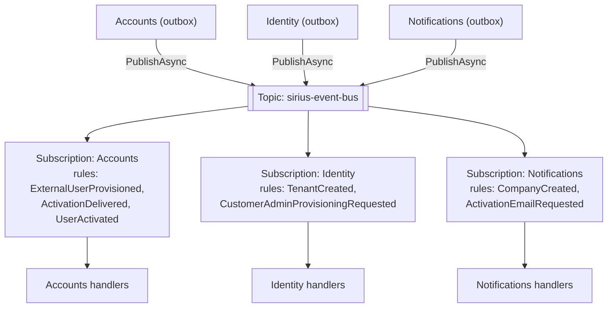
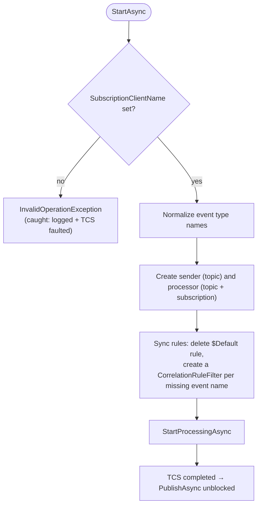
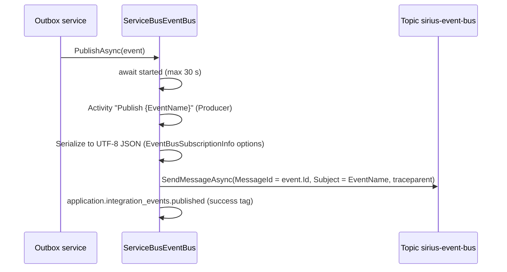
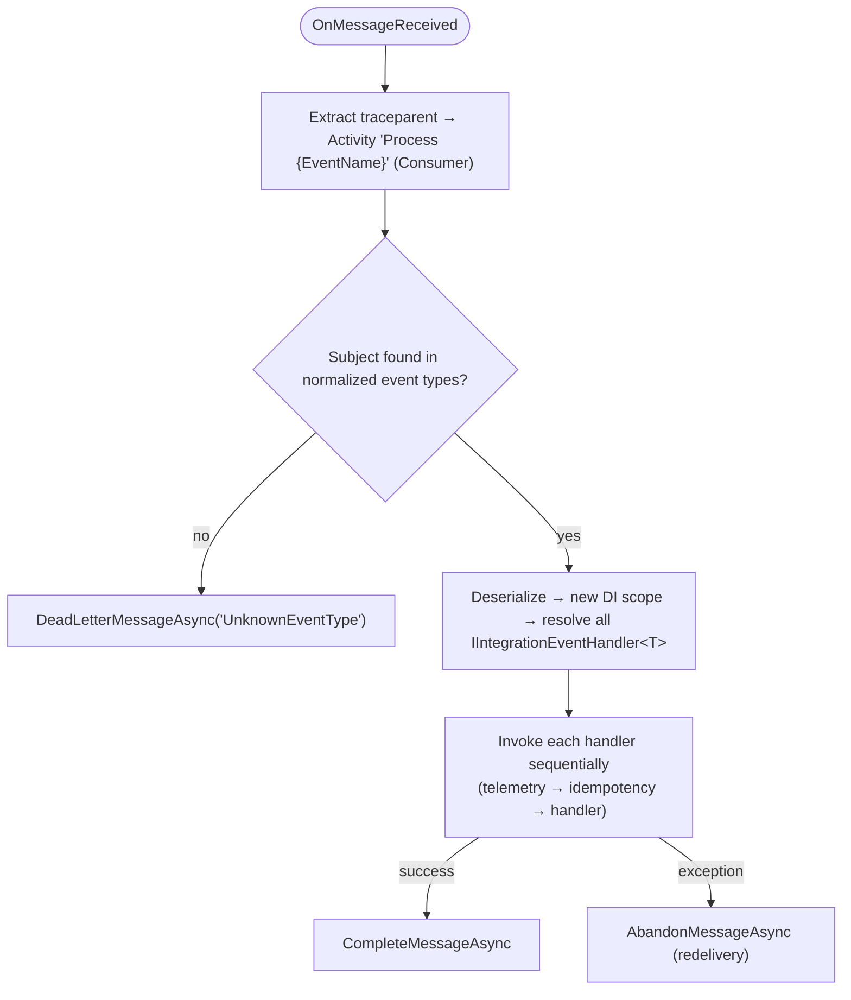

# Event Bus

## Overview

The Event Bus provides asynchronous, loosely-coupled communication between microservices using integration events. Services depend on the `IEventBus` abstraction — the underlying transport (Azure Service Bus, RabbitMQ) is selected by a single registration call in each service's infrastructure setup.

**Abstraction layer**: `Platform.EventBus`  
**Implementations**: `Platform.EventBus.ServiceBus` (default), `Platform.EventBus.RabbitMQ`

In normal operation services never call `IEventBus.PublishAsync` directly: events are published from the transactional outbox (`EventBusOutboxService`, `OutboxProcessor`) — see [05-transactional-outbox.md](05-transactional-outbox.md).

---

## Architecture

Azure Service Bus topology as provisioned by the Aspire AppHost (emulator) and synchronized by `ServiceBusEventBus` at startup:



Each subscription uses a **CorrelationRuleFilter** on the message `Subject` (the event name without the `IntegrationEvent` suffix) to receive only the event types the service subscribed to. Rules are created on startup from the registered subscriptions.

---

## IEventBus Abstraction

Defined in `Platform.EventBus`:

```csharp
public interface IEventBus
{
    Task PublishAsync(IntegrationEvent @event, CancellationToken cancellationToken = default);
}

public interface IEventBusBuilder
{
    IServiceCollection Services { get; }
}
```

Handler subscription uses the builder returned by the transport registration:

```csharp
// Accounts.Infrastructure/Extensions/Extensions.cs
builder.AddServiceBusEventBus("eventbus")
    .AddEventBusSubscriptions();

private static void AddEventBusSubscriptions(this IEventBusBuilder eventBus)
{
    eventBus.AddSubscription<ExternalUserProvisionedIntegrationEvent, ExternalUserProvisionedIntegrationEventHandler>();
    eventBus.AddSubscription<ActivationDeliveredIntegrationEvent, ActivationDeliveredIntegrationEventHandler>();
    eventBus.AddSubscription<UserActivatedIntegrationEvent, UserActivatedIntegrationEventHandler>();
}
```

`AddSubscription<TEvent, THandler>` registers:
1. The handler as **transient** `IIntegrationEventHandler<TEvent>` in DI — a plain registration so Scrutor decorators (telemetry, idempotency) can wrap it. Multiple handlers per event are supported.
2. The event type in `EventBusSubscriptionInfo.EventTypes[typeof(TEvent).Name]` (used for routing rules and deserialization without `Type.GetType`).

`ConfigureJsonOptions(...)` customizes `EventBusSubscriptionInfo.JsonSerializerOptions`, used for both serialization and deserialization on the bus.

---

## Azure Service Bus Implementation

`ServiceBusEventBus` is a singleton that implements `IEventBus`, `IHostedService` and `IAsyncDisposable`.

### Key Design Decisions

| Decision | Rationale |
|---|---|
| Single topic `sirius-event-bus`, one subscription per service (`SubscriptionClientName`) | Pub/sub fan-out; each service owns its subscription and filters |
| `AutoCompleteMessages = false` | Explicit control: complete on success, abandon on failure, dead-letter on unknown types |
| `IHostedService` lifecycle | Processor starts/stops with the host. A `TaskCompletionSource` gates `PublishAsync` until `StartAsync` finished (30 s timeout) |
| Normalized event type names | Strips `IntegrationEvent` (e.g., `CompanyCreatedIntegrationEvent` → `CompanyCreated`) for `Subject` and rule names |
| `MessageId = @event.Id` | Enables Service Bus duplicate detection when configured on the topic |
| OpenTelemetry tracing | `traceparent`/`tracestate` propagated via `ApplicationProperties` for end-to-end distributed traces |

### Startup



If startup fails, the exception is logged and stored in the `TaskCompletionSource`; the host keeps running and every `PublishAsync` fails, so events remain in the outbox until the bus is healthy again.

### Message Lifecycle

**Publish flow**:



**Receive flow**:



Because idempotency is tracked per handler, a redelivered message skips the handlers that already succeeded and retries only the failed ones.

### Retry & Dead-Letter Semantics

| Scenario | Action | Result |
|---|---|---|
| Handler succeeds | `CompleteMessageAsync` | Message removed |
| Handler throws (transient) | `AbandonMessageAsync` | Immediate redelivery |
| Max deliveries exceeded | Automatic (Service Bus) | Moved to DLQ after `MaxDeliveryCount` |
| Unknown event type | `DeadLetterMessageAsync` | Moved to DLQ with reason `UnknownEventType` |

---

## RabbitMQ Implementation

`RabbitMqEventBus` (singleton, `IEventBus` + `IHostedService` + `IDisposable`) is kept as an alternative transport:

| Aspect | Behavior |
|---|---|
| Topology | Direct exchange `sirius_event_bus`; durable queue named after `SubscriptionClientName`; one binding per subscribed event |
| Routing key | Full event type name (e.g. `CompanyCreatedIntegrationEvent`) — no normalization |
| Publish | New channel per publish, persistent delivery mode, `mandatory: true`, `traceparent`/`tracestate` headers |
| Publish retry | Polly pipeline for `BrokerUnreachableException` / `SocketException`, exponential delay `2^attempt` s, `RetryCount` (default 10) |
| Startup | Connection and consumer are set up on a background task; `StartAsync` returns immediately |
| Consume | Handlers resolved per message in a new scope, invoked sequentially |
| Failures | The message is **always acknowledged**, even when processing fails or the event type is unknown (no DLX) |

---

## Configuration

### DI Registration

```csharp
builder.AddServiceBusEventBus("eventbus");   // connection name provided by Aspire
```

Registers `ServiceBusClient` via the Aspire integration (`AddAzureServiceBusClient`, tracing enabled), binds `EventBusOptions` from the `EventBus` section, registers `IEventBus` → `ServiceBusEventBus` (singleton) and forwards the same instance as `IHostedService`.

### appsettings.json

```json
{
  "EventBus": {
    "SubscriptionClientName": "Accounts"
  }
}
```

| Service | `SubscriptionClientName` |
|---|---|
| Accounts | `Accounts` |
| Identity | `Identity` |
| Notifications | `Notifications` |

RabbitMQ's `EventBusOptions` adds `RetryCount` (default `10`).

### AppHost (local development)

```csharp
#define USE_AZURE_SERVICE_BUS   // or USE_RABBITMQ

var eventbus = builder.AddAzureServiceBus("eventbus")
    .RunAsEmulator(emulator => emulator.WithLifetime(ContainerLifetime.Persistent));

var eventBusTopic = eventbus.AddServiceBusTopic("sirius-event-bus");
eventBusTopic.AddServiceBusSubscription("accounts-sub", subscriptionName: "Accounts");
eventBusTopic.AddServiceBusSubscription("notifications-sub", subscriptionName: "Notifications");
eventBusTopic.AddServiceBusSubscription("identity-sub", subscriptionName: "Identity");
```

---

## Swapping Implementations

Changing the transport requires **only** registration changes — no handler or event changes:

```csharp
// Today (Azure Service Bus) — in each service's Infrastructure Extensions
builder.AddServiceBusEventBus("eventbus").AddEventBusSubscriptions();

// Alternative (RabbitMQ)
builder.AddRabbitMqEventBus("eventbus").AddEventBusSubscriptions();
```

plus switching the `USE_AZURE_SERVICE_BUS` / `USE_RABBITMQ` symbol in `AppHost.cs` and referencing the corresponding transport project. All services must use the same transport. This is the core architectural principle: **"Platform evolves, services sleep peacefully."**

---

## Validation Checklist

- [ ] Services depend on `IEventBus`, never on `ServiceBusEventBus` or `RabbitMqEventBus`
- [ ] Consumed integration event types are registered via `AddSubscription<TEvent, THandler>()` **before** the idempotency builders and `AddSiriusMediator` (so decorators apply)
- [ ] Published integration event types are registered in the outbox (`OutboxMessageOptions.RegisterEventTypes`)
- [ ] `SubscriptionClientName` configured per service in `appsettings.json` and matching the AppHost subscription
- [ ] Idempotent consumers handle potential duplicate deliveries (see [04-idempotency.md](04-idempotency.md))

---

## Known Gaps

| Area | Details |
|---|---|
| Stale Service Bus rules | Rule sync only creates missing rules; rules for events a service no longer subscribes to are not removed. |
| Silent Service Bus startup failure | A failed `StartAsync` does not stop the host; health depends on outbox retries. |
| RabbitMQ message loss | Failed messages are acknowledged without a dead-letter exchange. |
| RabbitMQ publish retry | The Polly pipeline uses the synchronous `Execute` overload around an async delegate, so failures that surface asynchronously are not retried. |
