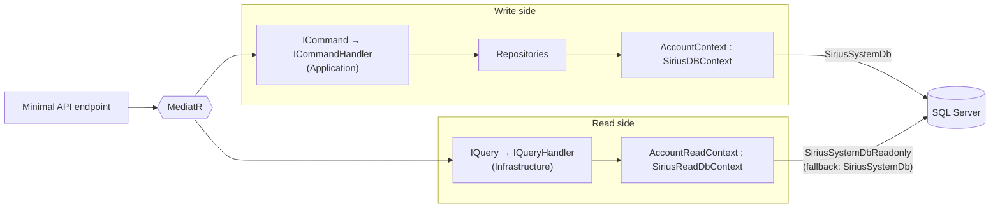

# CQRS Read Model

## Overview

The read side of CQRS uses a separate `SiriusReadDbContext` base class, fully isolated from write-side infrastructure. Queries use a dedicated context with no-tracking behavior and no access to `SaveChanges`, transactional outbox, or idempotency tables.

**Layer**: `Platform.Persistence.EntityFramework.Relational` (base class + registration), `Platform.Persistence.EntityFramework` (configuration)  
**Key types**: `SiriusReadDbContext`, `SiriusReadDbContextConfiguration`, `AddSiriusReadDbContext<T>`



---

## Write vs Read Context

| | Write (`SiriusDBContext`) | Read (`SiriusReadDbContext`) |
|---|---|---|
| Base class | `SiriusDBContext` | `SiriusReadDbContext` (abstract) |
| Tracking | Default (on) | `NoTrackingWithIdentityResolution`, `AutoDetectChangesEnabled = false` |
| `SaveChanges` | Audit timestamps + unique-constraint translation; commit through `ITransactionalUnitOfWork` | All four overloads `sealed` and throw `InvalidOperationException` |
| DI roles | Concrete type + `SiriusDBContext`, `ITransactionalUnitOfWork`, `IDomainEntityChangeTracker` | Only its own type |
| EF model | Domain entities + `IdempotencyEntry` / `OutboxMessage` (when enabled) | Domain entities only (+ `RowVersion`/`CreatedAt` audit mapping) |
| Pipeline | Commands (`TransactionBehavior`, domain events, outbox) | Queries (no transaction) |
| Connection (Accounts) | `SiriusSystemDb` | `SiriusSystemDbReadonly` (fallback to `SiriusSystemDb`) |

---

## Platform Components

### SiriusReadDbContextConfiguration

Defined in `Platform.Persistence.EntityFramework` (no provider dependency):

- `RegisterModelsFromAssembly(params Assembly[])` — registers entity configuration assemblies
- `SetDefaultSchema(string)` — sets the default schema for entity mappings

It is a separate type from `SiriusDbContextConfiguration`, so read contexts never pick up write-side features (idempotency, outbox). It is registered as a **singleton shared by all read contexts** of the process (`GetOrCreateSiriusReadDbContextConfiguration()`).

### SiriusReadDbContext

Defined in `Platform.Persistence.EntityFramework.Relational` (requires EF Relational for `HasDefaultSchema`):

- Abstract base class; constructor sets `QueryTrackingBehavior.NoTrackingWithIdentityResolution` and disables automatic change detection
- `OnModelCreating` applies configurations from the registered assemblies, the default schema, and the shared entity audit configuration
- `SaveChanges` / `SaveChangesAsync` (all overloads) are `sealed` and throw `InvalidOperationException("Read-only context. Use the write context to persist changes.")`

---

## Usage

### Define a Read Context

```csharp
// Accounts.Infrastructure/Persistence/AccountReadContext.cs
public class AccountReadContext : SiriusReadDbContext
{
    public DbSet<Company> Companies { get; set; } = null!;
    public DbSet<CompanyContact> CompanyContacts { get; set; } = null!;
    public DbSet<Tenant> Tenants { get; set; } = null!;
    public DbSet<Subscription> Subscriptions { get; set; } = null!;
    public DbSet<UserMembership> UserMemberships { get; set; } = null!;
    public DbSet<OnboardingProcess> OnboardingProcesses { get; set; } = null!;
    public DbSet<CustomerActivationProcess> CustomerActivationProcesses { get; set; } = null!;

    public AccountReadContext(
        DbContextOptions<AccountReadContext> options,
        SiriusReadDbContextConfiguration configuration)
        : base(options, configuration) { }
}
```

### Register in DI

```csharp
// Accounts.Infrastructure/Extensions/Extensions.cs
var connectionString = builder.Configuration.GetConnectionString("SiriusSystemDb");
var readConnectionString = builder.Configuration.GetConnectionString("SiriusSystemDbReadonly")
    ?? connectionString;

services.AddSiriusReadDbContext<AccountReadContext>(
    conf => conf
        .SetDefaultSchema("Accounts")
        .RegisterModelsFromAssembly(typeof(AssemblyReference).Assembly),
    options => options.UseSqlServer(readConnectionString)
);
```

The read context reuses the same `IEntityTypeConfiguration<T>` classes as the write context (same Infrastructure assembly), so both sides map the domain identically. Notifications follows the same pattern with `NotificationsReadContext`.

### Use in Queries

The query record lives in Application; the handler lives in Infrastructure and injects the read context:

```csharp
// Accounts.Application/Queries/GetCompanyByIdQuery.cs
public record GetCompanyByIdQuery(Guid Id) : IQuery<CompanyDetail>;

// Accounts.Infrastructure/Persistence/Queries/GetCompanyByIdQueryHandler.cs
public class GetCompanyByIdQueryHandler(AccountReadContext context)
    : IQueryHandler<GetCompanyByIdQuery, CompanyDetail>
{
    public async Task<Result<CompanyDetail>> Handle(GetCompanyByIdQuery request, CancellationToken cancellationToken)
    {
        var company = await context.Set<Company>()
            .FirstOrDefaultAsync(c => c.Id == request.Id, cancellationToken);

        if (company is null)
            return Result.Failure<CompanyDetail>(Error.NotFound.WithMessage($"Company with id '{request.Id}' was not found."));

        return Result.Success(new CompanyDetail { /* projection */ });
    }
}
```

`AsNoTracking()` is not needed — it is the default behavior from the base class. Queries flow through MediatR (`TelemetryQueryBehavior`, `LoggingBehavior`, `ValidationBehavior`), while `TransactionBehavior` and `IdempotencyBehavior` pass them through.

---

## Production Scenario

For SQL Server AlwaysOn or Azure SQL read replicas:

```
ConnectionStrings__SiriusSystemDbReadonly: Server=...;ApplicationIntent=ReadOnly;...
```

If `SiriusSystemDbReadonly` is not configured, the read context transparently falls back to the write connection string. No code changes required — purely infrastructure configuration.

---

## Validation Checklist

- [ ] Query handlers inject the read context, not the write context or repositories
- [ ] Read context does not map infrastructure tables (outbox, idempotency, audit log)
- [ ] `AddSiriusReadDbContext<T>` used for registration (not `AddSiriusSDBContext<T>`)
- [ ] No `SaveChanges` calls through read context (enforced by sealed overrides)

---

## Known Gaps

| Area | Details |
|---|---|
| Shared read configuration | `SiriusReadDbContextConfiguration` is a process-wide singleton: two read contexts in the same host would share schema and assemblies (last `SetDefaultSchema` wins). |
| Replica lag | Reading from a replica right after a command may return stale data; no read-your-writes mechanism is provided. |
