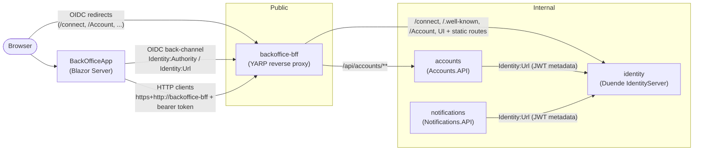
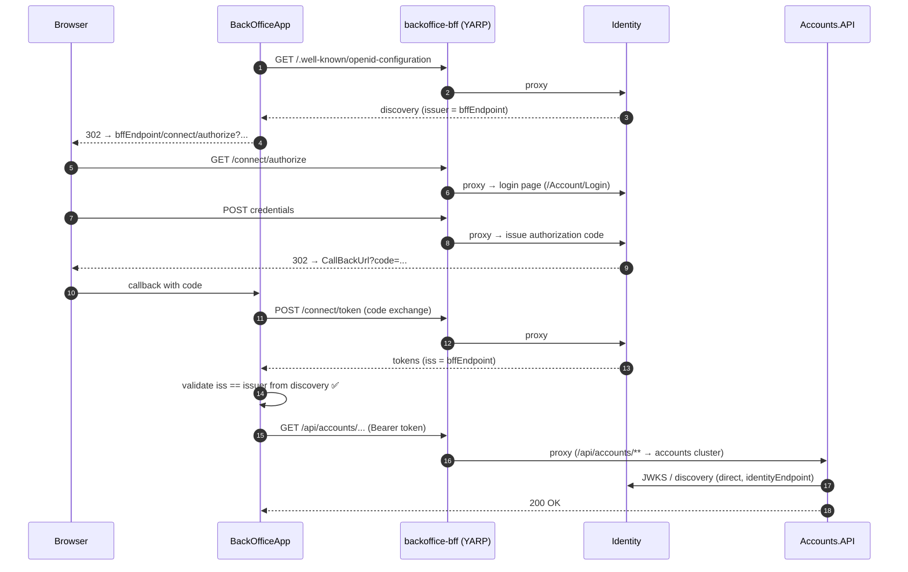

# Identity & BFF URL Configuration

## Overview

The platform uses a **BFF (Backend for Frontend) as the public facade** for IdentityServer (Duende) and for the APIs consumed by the BackOffice. All browser-facing identity traffic goes through the BFF URL. Internal services (APIs) talk to IdentityServer directly.

The BFF (`Infrastructure.Bff.BackOffice`) is a YARP reverse proxy configured from `appsettings.json` (`ReverseProxy` section) with Aspire service discovery as destination resolver.

---

## Component Map



The BFF proxies these routes (`Infrastructure.Bff.BackOffice/appsettings.json`):

| Route pattern | Cluster |
|---|---|
| `/api/accounts/{**remainder}` | `accounts` (`https://accounts`) |
| `/api/identity/{**remainder}` | `identity` (`https://identity`) |
| `/connect/**`, `/.well-known/**` | `identity` |
| `/Account/**`, `/Consent/**`, `/Device/**`, `/ExternalLogin/**`, `/Grants/**`, `/Redirect/**`, `/Diagnostics/**`, `/Home/**`, `/Ciba/**`, `/ServerSideSessions/**` | `identity` |
| `/lib/**`, `/css/**`, `/js/**`, `/favicon.ico`, `/duende-logo.svg` | `identity` (static assets of the login UI) |

Notifications is not exposed through the BFF.

---

## Correct URL Configuration

| Component | Config key | Value | Reason |
|---|---|---|---|
| `BackOfficeApp` | `Identity:Authority` | `bffEndpoint` | Browser OIDC flows go through the BFF proxy |
| `BackOfficeApp` | `Identity:Url` | `bffEndpoint` | `IdentityServer` named HttpClient goes through the BFF |
| `BackOfficeApp` | `CallBackUrl` | BackOfficeApp endpoint | OIDC redirect / post-logout URIs |
| `IdentityServer` | `IssuerUri` | `bffEndpoint` | Tokens must carry the BFF as the public issuer (`iss`) |
| `IdentityServer` | `AccountApiClient`, `NotificationsApiClient`, `BackOfficeClient` | Each app endpoint | Client redirect URIs seeded in the configuration store |
| `AccountsAPI` | `Identity:Url` | `identityEndpoint` | Server-to-server — no need to route through BFF |
| `Notifications` | `Identity:Url` | `identityEndpoint` | Server-to-server — no need to route through BFF |

> **Rule of thumb:** anything that runs in (or redirects) the browser uses `bffEndpoint`. Anything server-to-server uses `identityEndpoint` directly.

---

## Why IssuerUri = bffEndpoint

IdentityServer embeds the `iss` claim in every token. Clients validate `iss` against the `issuer` field in the discovery document (`/.well-known/openid-configuration`).

Since `/.well-known/**` is proxied through the BFF:

1. The BackOfficeApp fetches discovery from `bffEndpoint/.well-known/openid-configuration` → proxied to Identity.
2. Identity returns `"issuer": "bffEndpoint"` (because `IssuerUri = bffEndpoint`).
3. Tokens carry `iss = bffEndpoint`.
4. OIDC middleware validates: `iss == issuer_from_discovery` ✅

If `IssuerUri` were `identityEndpoint`, the `iss` in tokens would not match what the browser-facing app sees through the BFF, breaking token validation.

### API Token Validation

APIs configure JWT bearer authentication in `AddDefaultAuthentication()` (`Platform.ServiceDefaults`, called by `AddApiServiceDefaults()`):

```csharp
options.Authority = identityUrl;                                   // identityEndpoint
options.RequireHttpsMetadata = false;
options.Audience = audience;                                       // e.g. "accounts"
options.TokenValidationParameters.ValidIssuers = [identityUrl];    // + "https://10.0.2.2:5243" in DEBUG
options.TokenValidationParameters.ValidateAudience = false;
```

The APIs download metadata directly from Identity; the discovery document still reports `issuer = bffEndpoint` (because of `IssuerUri`), and the JWT bearer handler adds the issuer from the discovery document to the accepted issuers, so tokens issued as `bffEndpoint` validate against the internal endpoint.

---

## Authentication Flow (Browser)



---

## AppHost.cs Reference (Development)

`AppHost.cs` is the source of truth for URL wiring in local/Aspire environments:

```csharp
var bffEndpoint = backofficeBff.GetEndpoint(launchProfileName);
var identityEndpoint = identity.GetEndpoint(launchProfileName);

// Internal services connect directly (no BFF hop needed)
accountApiService.WithEnvironment("Identity__Url", identityEndpoint);
notifications.WithEnvironment("Identity__Url", identityEndpoint);

// Wire up Identity URLs through the BFF
backOfficeApp.WithEnvironment("Identity__Url", bffEndpoint);
backOfficeApp.WithEnvironment("Identity__Authority", bffEndpoint);   // browser traffic → BFF
identity.WithEnvironment("IssuerUri", bffEndpoint);                  // tokens issued as BFF

// Wire up the callback urls (self referencing)
backOfficeApp.WithEnvironment("CallBackUrl", backOfficeApp.GetEndpoint(launchProfileName));

// Identity has a reference to all of the apps for callback urls (cyclic reference)
identity.WithEnvironment("AccountApiClient", accountApiService.GetEndpoint(launchProfileName))
    .WithEnvironment("NotificationsApiClient", notifications.GetEndpoint(launchProfileName))
    .WithEnvironment("BackOfficeClient", backOfficeApp.GetEndpoint(launchProfileName));
```

`launchProfileName` is `https` by default, or `http` when `SIRIUS_USE_HTTP_ENDPOINTS=1` (used for CI / Playwright).

> ✅ `AppHost.cs` sets `Identity__Authority = bffEndpoint` and `IssuerUri = bffEndpoint`. Configuration is consistent.

---

## Known Gaps

| Area | Details |
|---|---|
| Audience validation | APIs set `Audience` but `ValidateAudience = false`, so any token from the issuer is accepted by any API; authorization relies on role policies. |
| HTTPS metadata | `RequireHttpsMetadata = false` in all environments. |
