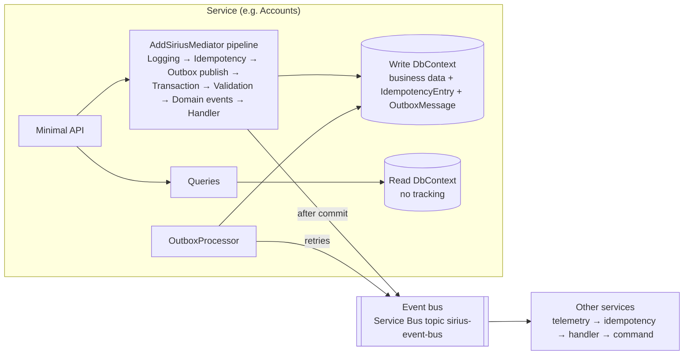

# Architecture Documentation

Technical architecture documentation for the Sirius platform. Each document covers a specific architectural area with implementation details, design decisions, and code references. All documents reflect the current implementation under `src/` and use Mermaid diagrams.

For high-level principles, ADRs, and project context see [Principles & ADRs](00-principles-and-adrs.md).

---

## Big Picture

---

## Architecture Health Summary

| Pattern | Health | Notes |
|---------|--------|-------|
| Single-Transaction Pipeline | ✅ Excellent | Command + domain events + idempotency entry + outbox in one atomic transaction |
| Pipeline Behavior Chain | ✅ Excellent | Order centralized in `AddSiriusMediator`; independent behaviors with SRP |
| Transactional Outbox | ✅ Solid | Inline publishing + background processor with atomic claim; no recovery of stuck `InProgress` rows |
| Domain Events (within transaction) | ✅ Solid | Cascading support, handlers can modify aggregates |
| Idempotency (Command) | 🟡 Solid with gaps | Redis fast-path + EF source of truth; failed `Result` and Redis `processing` key can mark retries as duplicates |
| Idempotent Consumer (Integration Events) | ✅ Solid | Automatic per-handler decorators via Scrutor, transactional with EF |
| Result Pattern (ROP) | ✅ Solid | Map/Bind/Match + ValidationFailure factories; HTTP mapping is 200/400 only |
| CQRS | ✅ Solid | Commands (`ICommand<T>`) and queries (`IQuery<T>`) with read-only `DbContext` |
| Telemetry / Observability | ✅ Excellent | Activities + metrics across behaviors, handlers, outbox, event bus and migrations |
| Event Bus | ✅ Solid | Azure Service Bus with rule-based routing and DLQ; RabbitMQ alternative is less robust |
| 5-Layer Separation | ✅ Excellent | Clean boundaries, persistence-ignorant POCOs |

---

## Documents

| Document | Description |
|----------|-------------|
| [Principles & ADRs](00-principles-and-adrs.md) | Mission, decision framework, non-breaking evolution strategies, success metrics, ADRs |
| [Messaging & Persistence Layers](01-messaging-persistence-layers.md) | 5-layer architecture, responsibilities, project dependencies |
| [Command Pipeline](02-command-pipeline.md) | Result Pattern, CQRS, `AddSiriusMediator`, pipeline order, Unit of Work |
| [Domain Events & Consistency](03-domain-events-consistency.md) | Domain events, single-transaction model, cross-service event flows |
| [Idempotency](04-idempotency.md) | Command deduplication, idempotent consumer, Redis hybrid |
| [Transactional Outbox](05-transactional-outbox.md) | Outbox pattern, atomic claim, `OutboxProcessor` |
| [Telemetry](06-telemetry.md) | OpenTelemetry strategy, trace structure, metrics catalog |
| [Event Bus](07-event-bus.md) | `IEventBus` abstraction, Azure Service Bus and RabbitMQ implementations |
| [CQRS Read Model](08-cqrs-read-model.md) | Read-only `DbContext`, query-side separation |
| [Identity & BFF URL Configuration](09-identity-bff-url-configuration.md) | BFF as public identity facade, URL wiring, issuer validation |

---

## Known Gaps

| Area | Status | Details |
|------|--------|---------|
| Authorization behavior | 🟡 Planned | No authorization behavior in the pipeline; enforced by endpoint policies |
| Failed `Result` committed | 🔴 Open | `TransactionBehavior` commits failed results, persisting the idempotency entry ([02](02-command-pipeline.md#known-gaps)) |
| Redis `processing` key | 🟡 Open | Retries within `ProcessingTtl` after a failure are answered as duplicates ([04](04-idempotency.md#known-gaps)) |
| Stuck outbox rows | 🟡 Open | `InProgress` rows are never reclaimed; exhausted retries have no dead-letter ([05](05-transactional-outbox.md#known-gaps)) |
| Nested command publishing | 🟡 By design | Commands triggered by integration events publish via `OutboxProcessor` (polling latency) ([03](03-domain-events-consistency.md#integration-event--command-nested-transaction)) |
| RabbitMQ transport | 🟡 Minor | Always acks failed messages; publish retry ineffective for async failures ([07](07-event-bus.md#known-gaps)) |
| Audience validation | 🟡 Minor | APIs disable audience validation ([09](09-identity-bff-url-configuration.md#known-gaps)) |
| SQL retry-on-failure | 🟡 Minor | Services do not enable `EnableRetryOnFailure()`, so transient SQL errors are not retried ([known gaps](../developer-guide/05-known-gaps.md#no-sql-retry-on-failure)) |
| Audit log | 🟡 Planned | `AuditLog` designed but not wired ([backlog](../backlog/audit-log-proposal.md)) |
| Repository nullable safety | ✅ Resolved | `IRepository<T>.GetAsync` / `Repository<T>.GetAsync` return `T?` |
