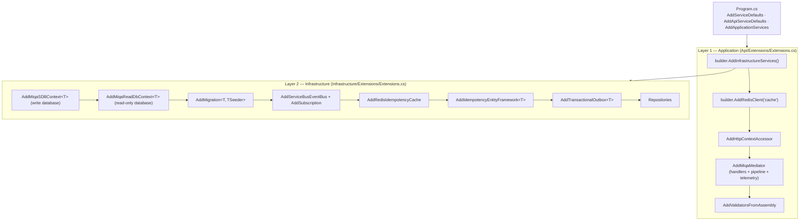
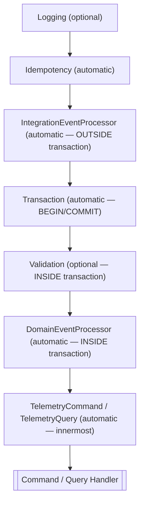

# Developer Guide: Service Configuration

## Overview

This guide explains how to configure services in the MiqaS platform following the **two-layer pattern**. The platform provides `AddMiqaMediator` to register the MediatR pipeline with automatic telemetry, eliminating manual behavior ordering and telemetry registration.

---

## Two-Layer Configuration

Every service splits its DI configuration into two layers, called from `Program.cs`:



The order of calls is **not cosmetic**: Scrutor decorates existing registrations in call order, so event subscriptions must be registered before the idempotency builders, Redis before EF idempotency, and `AddMiqaMediator` last (its telemetry decorator becomes the outermost one).

---

## Host Setup (Program.cs)

```csharp
// Accounts.API/Program.cs
var builder = WebApplication.CreateBuilder(args);

builder.AddServiceDefaults();        // OpenTelemetry, health checks, service discovery, HTTP resilience
builder.AddApiServiceDefaults();     // JWT bearer authentication, IUserHttpContext
builder.AddApplicationServices();    // Layer 1 (which calls Layer 2)

builder.Services.AddProblemDetails();
builder.Services.AddAuthorizationBuilder() /* role-based policies */;
builder.AddDefaultOpenApi(builder.Services.AddApiVersioning());

var app = builder.Build();

app.UseMiddleware<ExceptionHandlingMiddleware>();
app.NewVersionedApi("accounts").MapAccountsApiV1().RequireAuthorization();
// ... other endpoint groups

if (app.Environment.IsDevelopment())
    app.UseDefaultOpenApi();

app.MapDefaultEndpoints();           // /health and /alive
app.Run();
```

---

## AddMiqaMediator

Single entry point for the MediatR pipeline. Replaces manual `AddMediatR` + behavior registration + telemetry calls.

### What it registers automatically

- `IdempotencyBehavior`
- `IntegrationEventProcessorBehavior`
- `TransactionBehavior`
- `DomainEventProcessorBehavior`
- `TelemetryCommandBehavior`, `TelemetryQueryBehavior`, `TelemetryDomainEventBehavior` (via `INotificationPublisher`), `TelemetryIntegrationEventHandlerDecorator`

The call is idempotent: a second call to `AddMiqaMediator` is ignored.

### What the developer configures

| Method | Required | Purpose |
|--------|----------|---------|
| `RegisterServicesFromAssembly(assembly)` | Yes | MediatR handler discovery (Application **and** Infrastructure for query handlers) |
| `WithLogging(typeof(LoggingBehavior<,>))` | Optional | Logging at the outermost position |
| `WithValidation(typeof(ValidationBehavior<,>))` | Optional | Validation inside the transaction |

`WithLogging` / `WithValidation` throw `ArgumentException` if the type is not an open generic with two type parameters.

### Pipeline order (managed by platform)



### Required dependencies

| Behavior | Needs | Without it |
|---|---|---|
| `IdempotencyBehavior` | `IIdempotencyService` (optional) | Pass-through |
| `TransactionBehavior`, `DomainEventProcessorBehavior`, `IntegrationEventProcessorBehavior` | `ITransactionalUnitOfWork` (registered by `AddMiqaSDBContext<T>`) | **DI resolution fails** for every request |
| `IntegrationEventProcessorBehavior` | `IEventBusOutboxService` (optional, from `AddTransactionalOutbox<T>`) | No-op |
| `DomainEventProcessorBehavior` | `IDomainEntityChangeTracker` (optional, from `AddMiqaSDBContext<T>`) | No-op |

A service using `AddMiqaMediator` must therefore register a `MiqaDBContext` with `AddMiqaSDBContext<T>`.

---

## Complete Example: Accounts Service

### Layer 1 — Application

```csharp
// Accounts.API/Extensions/Extensions.cs
public static IServiceCollection AddApplicationServices(this IHostApplicationBuilder builder)
{
    var services = builder.Services;

    builder.AddInfrastructureServices();
    builder.AddRedisClient("cache");

    services.AddHttpContextAccessor();

    services.AddMiqaMediator(cfg =>
    {
        cfg.RegisterServicesFromAssembly(AssemblyReference.Assembly);
        cfg.RegisterServicesFromAssembly(typeof(Infrastructure.AssemblyReference).Assembly);
        cfg.WithLogging(typeof(LoggingBehavior<,>));
        cfg.WithValidation(typeof(ValidationBehavior<,>));
    });

    services.AddValidatorsFromAssembly(AssemblyReference.Assembly);

    return services;
}
```

### Layer 2 — Infrastructure

```csharp
// Accounts.Infrastructure/Extensions/Extensions.cs
public static void AddInfrastructureServices(this IHostApplicationBuilder builder)
{
    var services = builder.Services;

    var connectionString = builder.Configuration.GetConnectionString("MiqaSystemDb");
    var readConnectionString = builder.Configuration.GetConnectionString("MiqaSystemDbReadonly")
        ?? connectionString;

    services.AddMiqaSDBContext<AccountContext>(
        conf => conf
            .SetDefaultSchema("Accounts")
            .WithIdempotency()
            .RegisterModelsFromAssembly(typeof(AssemblyReference).Assembly),
        options => options.UseSqlServer(connectionString, sqlOptions =>
        {
            sqlOptions.MigrationsAssembly(typeof(AssemblyReference).Assembly.FullName);
        })
    );

    services.AddMiqaReadDbContext<AccountReadContext>(
        conf => conf
            .SetDefaultSchema("Accounts")
            .RegisterModelsFromAssembly(typeof(AssemblyReference).Assembly),
        options => options.UseSqlServer(readConnectionString)
    );

    services.AddHealthChecks()
        .AddDbContextCheck<AccountContext>(name: "accounts-db", tags: ["ready"]);

    services.AddMigration<AccountContext, MiqaDBContextSeed>();

    builder.AddServiceBusEventBus("eventbus")
        .AddEventBusSubscriptions();

    services.AddRedisIdempotencyCache(builder.Configuration)
        .ForApiRequests()
        .ForIntegrationEventHandlers();

    services.AddIdempotencyEntityFramework<AccountContext>()
        .ForApiRequests()
        .ForIntegrationEventHandlers();

    services.AddTransactionalOutbox<AccountContext>(options =>
    {
        options.RegisterEventTypes(
            typeof(Miqa.Contracts.Accounts.AssemblyReference).Assembly,
            typeof(Miqa.Contracts.Identity.AssemblyReference).Assembly,
            typeof(Miqa.Contracts.Notifications.AssemblyReference).Assembly);
    });

    services.AddScoped<ICompanyRepository, CompanyRepository>();
    services.AddScoped<ITenantRepository, TenantRepository>();
    services.AddScoped<ISubscriptionRepository, SubscriptionRepository>();
    services.AddScoped<IUserMembershipRepository, UserMembershipRepository>();
    services.AddScoped<IOnboardingProcessRepository, OnboardingProcessRepository>();
    services.AddScoped<ICustomerActivationProcessRepository, CustomerActivationProcessRepository>();
}

private static void AddEventBusSubscriptions(this IEventBusBuilder eventBus)
{
    eventBus.AddSubscription<ExternalUserProvisionedIntegrationEvent, ExternalUserProvisionedIntegrationEventHandler>();
    eventBus.AddSubscription<ActivationDeliveredIntegrationEvent, ActivationDeliveredIntegrationEventHandler>();
    eventBus.AddSubscription<UserActivatedIntegrationEvent, UserActivatedIntegrationEventHandler>();
}
```

---

## Infrastructure Component Reference

### Database

```csharp
services.AddMiqaSDBContext<MyContext>(
    conf => conf
        .SetDefaultSchema("MySchema")
        .WithIdempotency()                 // optional — also enabled by AddIdempotencyEntityFramework
        .RegisterModelsFromAssembly(typeof(AssemblyReference).Assembly),
    options => options.UseSqlServer(connectionString)
);

services.AddMigration<MyContext, MyContextSeed>();   // applies migrations + seed, signals MigrationReadySignal
```

`MiqaDbContextConfiguration` exposes `SetDefaultSchema`, `RegisterModelsFromAssembly`, `WithIdempotency` and `WithTransactionalOutbox`. It is a process-wide singleton shared by every `MiqaDBContext` in the host. `AddMiqaSDBContext<T>` also registers `MiqaDBContext`, `ITransactionalUnitOfWork` and `IDomainEntityChangeTracker` as the same scoped instance.

### Read-Only Database

```csharp
services.AddMiqaReadDbContext<MyReadContext>(
    conf => conf
        .SetDefaultSchema("MySchema")
        .RegisterModelsFromAssembly(typeof(AssemblyReference).Assembly),
    options => options.UseSqlServer(readConnectionString)
);
```

### Idempotency

```csharp
// Redis + EF (recommended) — Redis MUST be registered first
services.AddRedisIdempotencyCache(builder.Configuration)
    .ForApiRequests()
    .ForIntegrationEventHandlers();

services.AddIdempotencyEntityFramework<MyContext>()
    .ForApiRequests()
    .ForIntegrationEventHandlers();

// EF only (e.g. Identity)
services.AddIdempotencyEntityFramework<MyContext>()
    .ForIntegrationEventHandlers();
```

| Method | Effect |
|--------|--------|
| `AddRedisIdempotencyCache(configuration)` | Registers `IdempotencyRedisService` (binds the `IdempotencyCache` section; needs `IConnectionMultiplexer`, e.g. from `AddRedisClient("cache")`) |
| Redis `.ForApiRequests()` | No-op (Redis is already the registered service) |
| Redis `.ForIntegrationEventHandlers()` | Decorates handlers with the cache-only `IdempotencyIntegrationEventDecorator` |
| EF `.ForApiRequests()` | Registers `IdempotencyEfService<T>` — decorating Redis if present — so `IdempotencyBehavior` activates |
| EF `.ForIntegrationEventHandlers()` | Same service + decorates handlers with `IdempotencyIntegrationEventEfDecorator` (replacing the Redis decorator) |

When both Redis and EF are registered, EF decorates Redis — Redis as fast cache, EF as transactional guarantee.

### Transactional Outbox

```csharp
services.AddTransactionalOutbox<MyContext>(
    options => options.RegisterEventTypes(typeof(Miqa.Contracts.MyService.AssemblyReference).Assembly),
    processor => processor.PollingInterval = TimeSpan.FromSeconds(30));   // optional
```

Registers `IOutboxMessageService`, `IEventBusOutboxService`, the `OutboxProcessor` hosted service and enables the outbox table mapping. Register **every assembly containing integration events the service publishes**. The `OutboxProcessor` waits for `MigrationReadySignal`, so `AddMigration<T>` is required.

### Event Bus

```csharp
builder.AddServiceBusEventBus("eventbus")
    .AddSubscription<SomeIntegrationEvent, SomeIntegrationEventHandler>();
```

Requires `EventBus:SubscriptionClientName` in `appsettings.json` (see [Event Bus](../architecture/07-event-bus.md)).

---

## New Service Checklist

- [ ] Create `Api/Extensions/Extensions.cs` with `AddApplicationServices`
- [ ] Create `Infrastructure/Extensions/Extensions.cs` with `AddInfrastructureServices`
- [ ] Call `builder.AddInfrastructureServices()` first in the application layer, then `AddMiqaMediator`
- [ ] In `Program.cs`: `AddServiceDefaults`, `AddApiServiceDefaults`, `ExceptionHandlingMiddleware`, `MapDefaultEndpoints`
- [ ] Use `AddMiqaMediator` — do NOT call `AddMediatR` directly
- [ ] Register handlers from all relevant assemblies via `RegisterServicesFromAssembly`
- [ ] Add `WithLogging` / `WithValidation` as needed
- [ ] Configure `AddMiqaSDBContext<T>` and `AddMigration<T, TSeeder>`
- [ ] Register event subscriptions **before** the idempotency builders
- [ ] Register Redis idempotency **before** EF idempotency
- [ ] Configure `AddTransactionalOutbox<T>` with all published contract assemblies
- [ ] Add `EventBus:SubscriptionClientName` and `IdempotencyCache` sections to `appsettings.json`
- [ ] Add the subscription and service references in `AppHost.cs`
- [ ] Do NOT manually register telemetry behaviors — they are implicit

---

## Common Mistakes

### Calling AddMediatR directly

```csharp
// ❌ Bypasses platform pipeline and telemetry
services.AddMediatR(cfg => { cfg.RegisterServicesFromAssembly(assembly); });

// ✅ Platform manages pipeline order and telemetry
services.AddMiqaMediator(cfg => { cfg.RegisterServicesFromAssembly(assembly); });
```

### Manually registering telemetry

```csharp
// ❌ No longer needed — implicit in AddMiqaMediator
services.AddIntegrationEventTelemetryDecorator();
services.AddDomainEventTelemetryBehavior();
```

### Registering in the wrong order

```csharp
// ❌ EF registered first: the later Redis registration wins, IIdempotencyService resolves to the
//    cache-only service and no IdempotencyEntry is ever persisted for commands
services.AddIdempotencyEntityFramework<MyContext>().ForApiRequests();
services.AddRedisIdempotencyCache(builder.Configuration);

// ❌ Subscriptions after idempotency: TryDecorate finds no handlers to decorate
services.AddIdempotencyEntityFramework<MyContext>().ForIntegrationEventHandlers();
builder.AddServiceBusEventBus("eventbus").AddSubscription<E, H>();
```

### Mixing application and infrastructure concerns

```csharp
// ❌ Mixed in one method
public static void AddApplicationServices(this IHostApplicationBuilder builder)
{
    services.AddMiqaSDBContext<MyContext>(...);    // infrastructure
    services.AddMiqaMediator(cfg => { ... });     // application
}

// ✅ Clear separation
public static void AddApplicationServices(this IHostApplicationBuilder builder)
{
    builder.AddInfrastructureServices();          // delegates infrastructure
    services.AddMiqaMediator(cfg => { ... });      // application only
}
```
