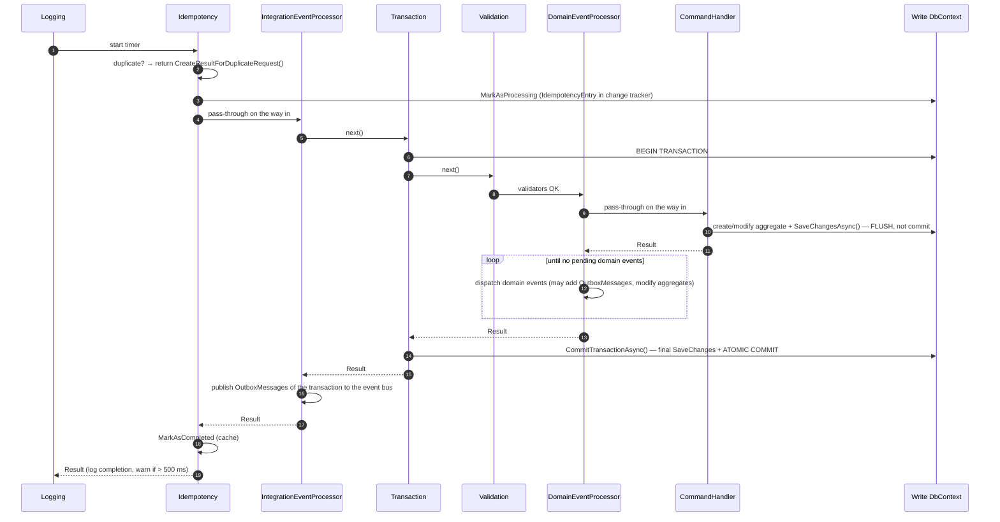
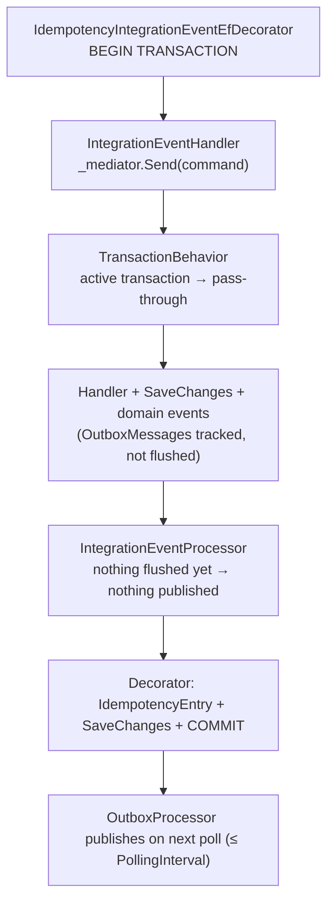

# Developer Guide: Transactional Pipeline and Domain Events

## Overview

Practical guide for developers working with the transactional pipeline. The core design follows the **eShop reference architecture**: strong consistency within a bounded context (one transaction), eventual consistency between bounded contexts (integration events via outbox).

For the internals see [Command Pipeline](../architecture/02-command-pipeline.md) and [Domain Events & Consistency](../architecture/03-domain-events-consistency.md).

---

## Pipeline Execution Order

Register via `AddMiqaMediator` — the platform manages all behavior ordering:

```csharp
services.AddMiqaMediator(cfg =>
{
    cfg.RegisterServicesFromAssembly(assembly);
    cfg.WithLogging(typeof(LoggingBehavior<,>));
    cfg.WithValidation(typeof(ValidationBehavior<,>));
});
```

Resulting execution (Russian dolls):



`TelemetryCommandBehavior` / `TelemetryQueryBehavior` sit between `DomainEventProcessor` and the handler; they only measure and do not change the flow.

---

## SaveChangesAsync Does NOT Commit

When `TransactionBehavior` has started a transaction, `SaveChangesAsync()` **flushes pending changes to the database but does NOT commit**. Changes are visible within the same transaction but invisible to other connections and will be rolled back if the transaction fails.

```csharp
// Accounts.Application/Commands/CreateCompanyCommandHandler.cs
public async Task<Result<bool>> Handle(CreateCompanyCommand message, CancellationToken cancellationToken)
{
    var address = Address.Create(
        message.Country, message.CountryCode, message.State,
        message.PostalCode, message.City!, message.Street);

    var company = Company.Create(
        message.TenantId, message.LegalName, message.TradeName,
        message.CompanyType, address, message.TaxId, message.TaxNumberType);

    _companyRepository.Add(company);

    // FLUSH to DB (applies defaults, RowVersion, audit timestamps) but does NOT commit.
    var saved = await _companyRepository.UnitOfWork.SaveChangesAsync(cancellationToken);

    return saved > 0
        ? Result.Success(true)
        : Result.Failure<bool>(Error.BadRequest.WithMessage("Failed to create company"));
}
```

### Why the flush is necessary

After the handler's `SaveChangesAsync()`, domain event handlers can:
- Query the database for the newly created entity (it exists within the transaction)
- Access database-generated values (defaults, `RowVersion`)
- Add OutboxMessages that reference the entity's ID

Entity IDs are generated in code by the `Entity` constructor, so they are available even before the flush.

### The two SaveChangesAsync calls

| Call | When | What it saves |
|------|------|---------------|
| **1st** — in CommandHandler | During handler execution | Aggregate entity, idempotency entry |
| **2nd** — in CommitTransactionAsync | At commit time | OutboxMessages, domain event handler modifications |

Both execute within the **same database transaction** and both apply `CreatedAt` / `UpdatedAt` audit timestamps. Neither is a commit on its own.

---

## Domain Event Handler Rules

### DO

- ✅ Keep handlers lightweight (under ~100ms)
- ✅ Add integration events via `IEventBusOutboxService.AddAndSaveEventAsync()`
- ✅ Query entities flushed by the command handler's `SaveChangesAsync()`
- ✅ Modify other aggregates (changes committed atomically)
- ✅ Raise new domain events on modified aggregates (cascade loop handles them)

### DO NOT

- ❌ Call `SaveChangesAsync()` in a domain event handler — `CommitTransactionAsync` handles it
- ❌ Start new transactions
- ❌ Perform heavy computation or external HTTP calls (extends transaction lock time)
- ❌ Assume the entity is "permanently saved" — it's only flushed, not committed
- ❌ Swallow exceptions silently — failure must propagate to trigger rollback

### Example

```csharp
// Accounts.Application/DomainEventHandlers/CompanyCreatedDomainEventHandler.cs
public class CompanyCreatedDomainEventHandler : IDomainEventHandler<CompanyCreatedDomainEvent>
{
    private readonly ILogger<CompanyCreatedDomainEventHandler> _logger;
    private readonly ICompanyRepository _companyRepository;
    private readonly IEventBusOutboxService _outboxService;

    public async Task Handle(CompanyCreatedDomainEvent notification, CancellationToken cancellationToken)
    {
        var company = await _companyRepository.GetAsync(notification.CompanyId);

        if (company != null)
        {
            await _outboxService.AddAndSaveEventAsync(new CompanyCreatedIntegrationEvent(
                company.TenantId,
                company.Id,
                company.LegalName,
                company.TradeName,
                company.TaxId,
                company.Address?.CountryCode!));
        }
        else
        {
            _logger.LogWarning("Company {CompanyId} not found ... Integration event not published.",
                notification.CompanyId);
        }
    }
}
```

---

## When to Use Domain Events vs Integration Events

| Scenario | Use |
|----------|-----|
| Side effect within same bounded context that must be atomic | **Domain Event** |
| Notify other bounded contexts about a state change | **Integration Event** (via Outbox) |
| Heavy processing (email, PDF, external API) | **Integration Event** → async handler |
| Modify another aggregate in the same context | **Domain Event** (within transaction) |
| Fire-and-forget notification | **Integration Event** |

In Accounts, every integration event is emitted from a domain event handler (`CompanyCreated`, `TenantCreated`, `ActivationEmailRequested`, `AdminProvisioningRequested`, `CustomerGoLive`); command handlers never touch the outbox directly.

---

## Commands Triggered by Integration Events

Integration event handlers send commands through MediatR. The idempotency decorator has already opened a transaction, so the command runs **nested**:



Consequences for developers:
- Use `ICommand<T>` (not `IdempotentCommand<T>`) — the decorator already guarantees idempotency per handler.
- Business data, idempotency entry and outbox messages are still committed atomically.
- Integration events emitted by these commands are published with up to one polling interval (default 30 s) of delay.

---

## Risk Mitigation

### Transaction Duration

Long-running domain event handlers extend transaction duration. Keep handlers under ~100ms. If processing is heavy, publish an integration event and handle it asynchronously.

### Cascading Events

`DomainEventProcessorBehavior` handles cascades via a `while` loop — safe but monitor depth (`processor.dispatch_cycles` tag on the `DomainEventProcessor {Command}` activity). Design domain events as leaf operations when possible.

### Handler Failure = Full Rollback

If ANY domain event handler throws, the ENTIRE transaction rolls back. This is by design (atomic consistency). If the aggregate must survive handler failures, use an integration event instead.

### Returning a Failed Result Does NOT Roll Back

`TransactionBehavior` only rolls back on exceptions. If a validator or handler returns `Result.Failure(...)`, the transaction is **committed** with whatever was tracked — including the idempotency entry. Consequences:
- Do not add entities to the context and then return a failure; validate first or throw.
- A retry with the same `x-requestid` after a failed `Result` is answered as a duplicate (see [Known Gaps](05-known-gaps.md)).

### AddAndSaveEventAsync Requires Active Transaction

`IEventBusOutboxService.AddAndSaveEventAsync()` throws `InvalidOperationException` without an active transaction. Only call from within the pipeline (domain event handlers) or inside an integration event decorator scope.

---

## Failure Scenarios

| Scenario | Result |
|----------|--------|
| Command handler throws | Transaction ROLLBACK. Nothing persisted. Client receives `500` via `ExceptionHandlingMiddleware`. |
| Validator fails / handler returns failed `Result` | Transaction COMMITTED (idempotency entry persisted). Client receives `400`. |
| Domain event handler throws | Transaction ROLLBACK. Everything reverted (aggregate + outbox + idempotency). |
| CommitTransactionAsync fails | Transaction ROLLBACK and exception rethrown. The execution strategy only retries when SQL retry-on-failure is configured (it is not today). |
| Integration event publish fails (after commit) | Aggregate IS committed. OutboxMessage status = `FailedToPublish`. `OutboxProcessor` retries. |

---

## Quick Reference: What Runs Where

| Component | Inside Transaction | After Commit |
|-----------|-------------------|--------------|
| IdempotencyBehavior duplicate check + MarkAsProcessing | ⚪ before BEGIN (entry committed with the transaction) | |
| ValidationBehavior | ✅ | |
| CommandHandler | ✅ | |
| DomainEventProcessorBehavior | ✅ | |
| Domain event handlers | ✅ | |
| CommitTransactionAsync | ✅ (final flush + commit) | |
| IntegrationEventProcessorBehavior | | ✅ |
| IdempotencyBehavior.MarkAsCompleted (cache) | | ✅ |
| OutboxProcessor (background) | | ✅ |
