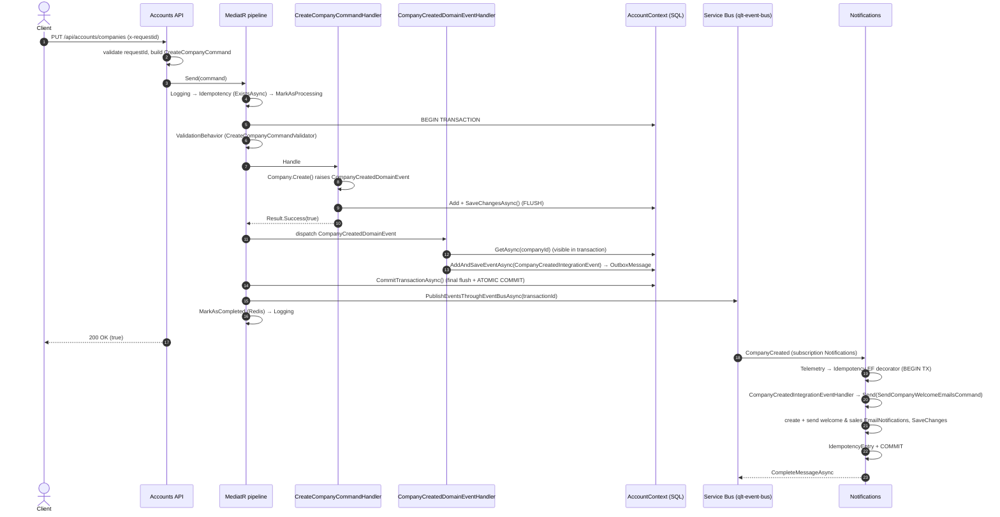
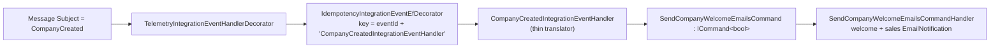

# Developer Guide: End-to-End Flow — CreateCompany

## Overview

Walkthrough of the `CreateCompany` endpoint (Accounts) and its consumer in Notifications, showing how **CQRS**, **Domain Events**, **Integration Events**, **Transactional Outbox**, **Idempotent Consumer**, **Unit of Work**, and **Result Pattern** work together in a real flow.

---

## Flow Diagram



---

## Phase-by-Phase

### 1. API Endpoint

```
PUT /api/accounts/companies HTTP/1.1
x-requestid: {guid}
Authorization: Bearer {token}
Content-Type: application/json
```

```csharp
// Accounts.API/APIs/AccountsApi.cs
public static async Task<Results<Ok<bool>, BadRequest<ApiErrorResponse>>> CreateCompanyAsync(
    [FromHeader(Name = "x-requestid")] Guid requestId,
    CreateCompanyRequest request,
    [AsParameters] AccountsServices services)
{
    if (requestId == Guid.Empty)
        return TypedResults.BadRequest(new ApiErrorResponse { Code = "ValidationError", Message = "Empty GUID is not valid for request ID", ... });

    var command = new CreateCompanyCommand(request.TenantId, request.LegalName, /* ... */ requestId: requestId);
    var result = await services.Mediator.Send(command);

    return result.ToHttpResult(services.UserHttpContext.TraceId);   // 200 OK or 400 ApiErrorResponse
}
```

### 2. IdempotencyBehavior

- Pattern-matches `IIdempotentRequest` (`CreateCompanyCommand : IdempotentCommand<bool>`)
- Checks `IdempotencyKey.ForRequest(requestId)` — `(Id: requestId, Scope: Request, Qualifier: null)` — via Redis first, then the `IdempotencyEntry` table
- If it exists: returns `CreateResultForDuplicateRequest()` (`Result.Success(true)`) without executing the handler
- If new: `MarkAsProcessingAsync()` writes the Redis `processing` key and adds an `IdempotencyEntry` to the EF change tracker (no `SaveChanges` yet)

### 3. TransactionBehavior

Begins the database transaction inside the EF execution strategy, executes the inner pipeline, and commits atomically:

```csharp
await strategy.ExecuteAsync(async () =>
{
    await using var transaction = await _dbTransaction.BeginTransactionAsync();
    response = await next(cancellationToken);
    await _dbTransaction.CommitTransactionAsync(transaction);
});
```

### 4. ValidationBehavior

Runs `CreateCompanyCommandValidator` (tenant, names, tax id format, tax number type, country...). On failure returns `Result.ValidationFailure` → `400 Bad Request` with per-property errors.

### 5. CommandHandler

```csharp
var company = Company.Create(
    message.TenantId, message.LegalName, message.TradeName,
    message.CompanyType, address, message.TaxId, message.TaxNumberType);

_companyRepository.Add(company);
var saved = await _companyRepository.UnitOfWork.SaveChangesAsync(cancellationToken);
```

`Company.Create()` validates business rules (throws `AccountDomainException`), sets `Status = Pending`, and raises `CompanyCreatedDomainEvent`.

### 6. DomainEventProcessorBehavior

After the handler returns, dispatches domain events within the active transaction. The cascade loop re-checks for new events until none remain.

### 7. Domain Event Handler

```csharp
public async Task Handle(CompanyCreatedDomainEvent notification, CancellationToken cancellationToken)
{
    var company = await _companyRepository.GetAsync(notification.CompanyId);
    if (company != null)
        await _outboxService.AddAndSaveEventAsync(new CompanyCreatedIntegrationEvent(
            company.TenantId, company.Id, company.LegalName,
            company.TradeName, company.TaxId, company.Address?.CountryCode!));
}
```

### 8. Transaction Commit

`CommitTransactionAsync()` applies audit timestamps, flushes the OutboxMessage, then commits. Company + IdempotencyEntry + OutboxMessage are committed atomically, and `LastCommittedTransactionId` is set.

### 9. IntegrationEventProcessorBehavior

After commit, reads the transaction id and publishes the pending outbox events (status `NotPublished → InProgress → Published`). If publishing fails the row becomes `FailedToPublish` and the `OutboxProcessor` retries it.

### 10. Consumer — Notifications

`ServiceBusEventBus` receives the message on the `Notifications` subscription (rule `CompanyCreated`) and resolves the decorated handler chain:



The command handler creates two `EmailNotification` aggregates, sends them through `IEmailService`, marks them as sent and saves. The idempotency entry is committed in the same transaction; on success the message is completed, on failure it is abandoned and redelivered.

> Emails are sent **before** the transaction commits. If the commit fails, the redelivered message sends them again — side effects with external systems are at-least-once.

---

## What Gets Committed Atomically

Accounts transaction (database `QltSystemDb`, schema `Accounts`):

| Data | Table | Same Transaction |
|------|-------|:---:|
| Company entity | `Accounts.Company` | ✅ |
| Idempotency entry (`Scope = Request`) | `Accounts.IdempotencyEntry` | ✅ |
| Outbox message (`CompanyCreatedIntegrationEvent`) | `Accounts.OutboxMessage` | ✅ |

Notifications transaction (same database, schema `Notifications`):

| Data | Table | Same Transaction |
|------|-------|:---:|
| Welcome + sales email notifications | `Notifications.EmailNotification` | ✅ |
| Idempotency entry (`Scope = Event`, qualifier = handler name) | `Notifications.IdempotencyEntry` | ✅ |

---

## Failure Impact

| Failure Point | Aggregate Persisted? | Outbox Persisted? | Event Published? |
|---|:---:|:---:|:---:|
| Validation fails / handler returns failed `Result` | ❌ (nothing added) | ❌ | ❌ — but the idempotency entry IS committed |
| CommandHandler throws | ❌ | ❌ | ❌ |
| Domain event handler throws | ❌ | ❌ | ❌ |
| CommitAsync fails | ❌ | ❌ | ❌ |
| Event bus publish fails | ✅ | ✅ (status: `FailedToPublish`) | ❌ (OutboxProcessor retries) |
| Consumer handler throws | ✅ | ✅ (status: `Published`) | ✅ (message abandoned and redelivered) |
| Duplicate request (same `x-requestid`) | — (handler skipped) | — | — (returns `200 OK`, `true`) |
