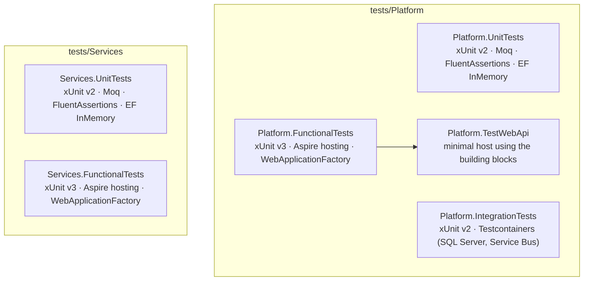
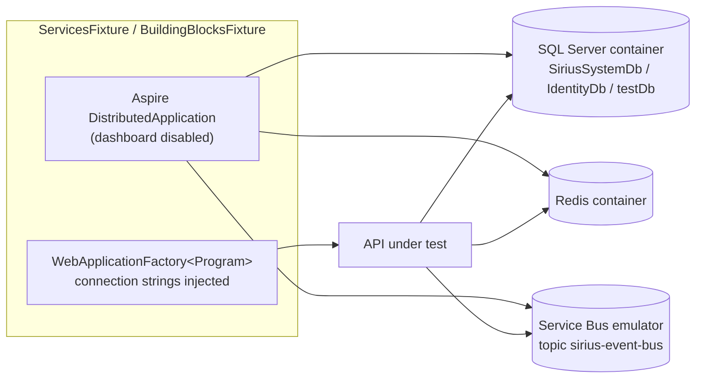

# Developer Guide: Testing

## Overview

Testing strategy for SiriusS platform components and business services. Tests are split into two top-level groups under `tests/`:

- **`Platform/`** — architecture and infrastructure tests (independent of any business service)
- **`Services/`** — business service tests (Accounts, Identity, Notifications)



---

## Test Projects

| Project | Path | Scope | Frameworks |
|---------|------|-------|------------|
| `Platform.UnitTests` | `tests/Platform/` | Unit | xUnit 2, Moq, FluentAssertions, EF Core InMemory |
| `Platform.IntegrationTests` | `tests/Platform/` | Integration | xUnit 2, FluentAssertions, Testcontainers (`MsSql`, `ServiceBus`) |
| `Platform.FunctionalTests` | `tests/Platform/` | Functional | xUnit v3 (Microsoft Testing Platform), Aspire hosting (SQL Server, Redis, Service Bus emulator), `WebApplicationFactory` |
| `Platform.TestWebApi` | `tests/Platform/` | Test host | Web API host used by `Platform.FunctionalTests` (`TestDbContext`, `TestEntity`, commands, domain event handlers) |
| `Services.FunctionalTests` | `tests/Services/` | Functional | xUnit v3 (Microsoft Testing Platform), Aspire hosting, `WebApplicationFactory` over Accounts.API |
| `Services.UnitTests` | `tests/Services/` | Unit | xUnit 2, Moq, FluentAssertions, EF Core InMemory (Accounts, Identity, Notifications) |

Integration and functional tests need **Docker** running (Testcontainers / Aspire containers).

---

## Naming Convention

```csharp
[Fact]
public async Task MethodName_WhenCondition_ExpectedBehavior()
{
    // Arrange
    // Act
    // Assert
}
```

Real examples: `Create_WithValidData_CreatesCompanyWithPendingStatus`, `Create_WithUnknownTaxNumberType_ThrowsAccountDomainException`, `DuplicateRequest_ShouldReturnSuccess_WithoutCreatingDuplicateEntity`.

---

## Testing Guidelines

### Test Independence

Each test must:
- Set up its own data
- Clean up after itself
- Not depend on execution order
- Use InMemory DB with unique names (for unit tests)

### Mocking Strategy

- Mock external dependencies (Redis, HTTP, event bus, `IEventBusOutboxService`, `IUnitOfWork`)
- Use real EF Core InMemory for database logic (unit tests)
- Use Testcontainers for real database / broker interactions (integration tests)
- Mock loggers to verify logging behavior

### What to Test per Layer

| Layer | Test | Example |
|---|---|---|
| Domain | Aggregate invariants, state transitions, raised domain events | `CompanyTests`, `OnboardingProcessTests` |
| Application — commands | Handler with mocked repositories / unit of work | `StartCustomerOnboardingCommandHandlerTests` |
| Application — validators | FluentValidation rules | `StartCustomerOnboardingCommandValidatorTests` |
| Application — domain event handlers | Outbox calls with the right integration event | `CompanyCreatedDomainEventHandlerTests` |
| Infrastructure — integration event handlers | Thin translator sends the right command via mocked `IMediator` | `UserActivatedIntegrationEventHandlerTests` |
| API | Endpoints, authorization policies, HTTP status codes | `BackOfficeOnboardingApiTests`, `BackOfficeOnboardingAuthorizationTests` |

### Coverage Focus

Priority areas:
1. Critical path (happy path)
2. Error handling (fallback, resilience)
3. Edge cases (null, empty, duplicates)
4. Integration points (cache + DB, behaviors)

### Assertions

Unit and integration tests use FluentAssertions:

```csharp
result.IsSuccess.Should().BeTrue();
actual.Should().Be("expected");
collection.Should().HaveCount(3);
```

Functional tests (xUnit v3) use xUnit's `Assert`.

---

## Functional Test Fixtures

Functional tests do not start the real `AppHost`. Each fixture builds its own Aspire `DistributedApplication` with the containers it needs and hosts the API in-process with `WebApplicationFactory<Program>`:



| Fixture | Usage | Notes |
|---|---|---|
| `BuildingBlocksFixture` | `[Collection("BuildingBlocks")]` (`ICollectionFixture`) | Hosts `Platform.TestWebApi`; SQL Server on port 1446, subscription `Platform` |
| `ServicesFixture` (abstract) → `AccountsFixture`, `IdentityFixture`, `NotificationsFixture` | `IClassFixture<AccountsFixture>` etc. | SQL Server on port 1445 with `SiriusSystemDb` and `IdentityDb`; adds `AutoAuthorizeMiddleware` through an `IStartupFilter` |

`AutoAuthorizeMiddleware` authenticates every request with a fixed test identity (`sub = AutoAuthorizeMiddleware.IDENTITY_ID`) so endpoints protected by `RequireAuthorization()` and role policies can be exercised. The role defaults to `PlatformAdmin` and can be overridden per request with the `X-Test-Role` header — authorization tests use it to assert `403 Forbidden` for denied roles.

---

## Running Tests

```bash
# Unit and integration tests (xUnit v2 / VSTest)
dotnet test tests/Platform/Platform.UnitTests
dotnet test tests/Platform/Platform.IntegrationTests
dotnet test tests/Services/Services.UnitTests

# Functional tests (xUnit v3 executables, Docker required)
dotnet run --project tests/Platform/Platform.FunctionalTests
dotnet run --project tests/Services/Services.FunctionalTests

# Specific test class
dotnet test tests/Platform/Platform.UnitTests --filter "FullyQualifiedName~IdempotencyEfServiceTests"
dotnet run --project tests/Services/Services.FunctionalTests -- --filter-class "Services.FunctionalTests.Accounts.AccountsApiTests"

# With coverage (unit tests)
dotnet test /p:CollectCoverage=true /p:CoverletOutputFormat=opencover
```

---

## Test Structure

### Platform

```
tests/Platform/
├── Platform.UnitTests/
│   ├── Behaviors/
│   │   └── ValidationBehaviorTests.cs
│   ├── Core/
│   │   ├── ErrorTests.cs
│   │   ├── ResultTests.cs
│   │   └── ValidationErrorTests.cs
│   └── Messaging/
│       ├── IdempotencyIntegrationEventDecoratorTests.cs
│       ├── EntityFramework/
│       │   ├── EfIdempotencyBuilderTests.cs
│       │   ├── IdempotencyEfServiceTests.cs
│       │   ├── IdempotencyIntegrationEventEfDecoratorTests.cs
│       │   └── OutboxMessageServiceConcurrencyTests.cs
│       └── Redis/
│           └── IdempotencyRedisServiceTests.cs
├── Platform.IntegrationTests/
│   ├── Infrastructure/
│   │   └── IntegrationTestBase.cs          (SQL Server Testcontainer + TestDbContext)
│   ├── EventBus/
│   │   ├── ServiceBusFixture.cs
│   │   └── ServiceBusEventBusTests.cs
│   ├── Messaging/
│   │   └── OutboxConcurrencyIntegrationTests.cs
│   └── Persistence/
│       └── EntityAuditIntegrationTests.cs
├── Platform.FunctionalTests/
│   ├── BuildingBlocksFixture.cs
│   ├── BuildingBlocksCollection.cs
│   └── Tests/
│       ├── DomainEventsTests.cs
│       ├── IdempotencyTests.cs
│       └── OutboxPatternTests.cs
└── Platform.TestWebApi/
    ├── Commands/ · Controllers/ · DomainEventHandlers/ · IntegrationEvents/ · Validators/
    └── Infrastructure/                     (TestDbContext, TestReadDbContext, TestEntity, migrations)
```

### Services

```
tests/Services/
├── Services.UnitTests/
│   ├── Accounts/
│   │   ├── AccountsTestBase.cs
│   │   ├── Application/
│   │   │   ├── Commands/                   (handler + validator tests)
│   │   │   ├── DomainEventHandlers/
│   │   │   └── Queries/
│   │   ├── Domain/                         (Company, Tenant, Subscription, UserMembership,
│   │   │                                    OnboardingProcess, CustomerActivationProcess)
│   │   └── Infrastructure/                 (integration event handlers)
│   ├── Identity/
│   │   ├── IdentityTestBase.cs
│   │   ├── IntegrationEvents/
│   │   ├── Models/
│   │   └── Pages/
│   ├── Notifications/
│   │   ├── Application/Commands/
│   │   └── IntegrationEvents/
│   └── Notificatios/
│       └── NotificatiosTestBase.cs
└── Services.FunctionalTests/
    ├── ServicesFixture.cs
    ├── AutoAuthorizeMiddleware.cs
    ├── Accounts/
    │   ├── AccountsFixture.cs
    │   ├── AccountsApiTests.cs
    │   ├── BackOfficeActivationApiTests.cs
    │   ├── BackOfficeActivationAuthorizationTests.cs
    │   ├── BackOfficeOnboardingApiTests.cs
    │   └── BackOfficeOnboardingAuthorizationTests.cs
    ├── Identity/
    │   ├── IdentityFixture.cs
    │   └── IdentityApiTests.cs
    └── Notificatios/
        └── NotificationsFixture.cs
```

### Template

```csharp
using FluentAssertions;
using Moq;
using Xunit;

namespace Platform.UnitTests.Messaging.ComponentType;

public class ComponentNameTests
{
    private readonly Mock<IDependency> _mockDependency;

    public ComponentNameTests()
    {
        _mockDependency = new Mock<IDependency>();
    }

    [Fact]
    public async Task MethodName_WhenCondition_ExpectedBehavior()
    {
        // Arrange
        var sut = CreateSystemUnderTest();

        // Act
        var result = await sut.MethodName();

        // Assert
        result.Should().NotBeNull();
    }

    private ComponentName CreateSystemUnderTest() => new(...);
}
```

---

## Current Coverage

Test counts are `[Fact]` / `[Theory]` methods (theories count once).

### Platform

| Component | Project | Tests | Status |
|-----------|---------|------:|--------|
| Result / Error / ValidationError | `Platform.UnitTests` | 44 | ✅ Complete |
| ValidationBehavior | `Platform.UnitTests` | 8 | ✅ Complete |
| IdempotencyEfService | `Platform.UnitTests` | 12 | ✅ Complete |
| EfIdempotencyBuilder | `Platform.UnitTests` | 4 | ✅ Complete |
| IdempotencyIntegrationEventEfDecorator | `Platform.UnitTests` | 9 | ✅ Complete |
| IdempotencyIntegrationEventDecorator (Redis) | `Platform.UnitTests` | 6 | ✅ Complete |
| OutboxMessageService (concurrency) | `Platform.UnitTests` | 15 | ✅ Complete |
| IdempotencyRedisService | `Platform.UnitTests` | 11 | ✅ Complete |
| EntityAudit (integration) | `Platform.IntegrationTests` | 7 | ✅ Complete |
| OutboxConcurrency (integration) | `Platform.IntegrationTests` | 10 | ✅ Complete |
| ServiceBusEventBus (integration) | `Platform.IntegrationTests` | 6 | ✅ Complete |
| DomainEvents (functional) | `Platform.FunctionalTests` | 1 | ✅ Complete |
| Idempotency (functional) | `Platform.FunctionalTests` | 2 | ✅ Complete |
| OutboxPattern (functional) | `Platform.FunctionalTests` | 1 | ✅ Complete |
| TransactionBehavior / DomainEventProcessor / IntegrationEventProcessor (unit) | — | 0 | 🟡 Covered only functionally |
| OutboxProcessor, RabbitMqEventBus | — | 0 | 🟡 Pending |

### Services

| Component | Project | Tests | Status |
|-----------|---------|------:|--------|
| Accounts domain (7 aggregates/snapshots) | `Services.UnitTests` | 141 | ✅ Complete |
| Accounts command handlers + validator | `Services.UnitTests` | 52 | ✅ Complete |
| Accounts domain event handlers | `Services.UnitTests` | 11 | ✅ Complete |
| Accounts query helpers | `Services.UnitTests` | 16 | ✅ Complete |
| Accounts integration event handlers | `Services.UnitTests` | 5 | ✅ Complete |
| Identity (models, integration event handlers, ConfirmEmail page) | `Services.UnitTests` | 32 | ✅ Complete |
| Notifications (commands, integration event handlers) | `Services.UnitTests` | 13 | ✅ Complete |
| AccountsApi (functional) | `Services.FunctionalTests` | 2 | ✅ Complete |
| BackOffice Onboarding API + authorization (functional) | `Services.FunctionalTests` | 27 | ✅ Complete |
| BackOffice Activation API + authorization (functional) | `Services.FunctionalTests` | 24 | ✅ Complete |
| IdentityApi (functional) | `Services.FunctionalTests` | 2 | ✅ Complete |
| Notifications API (functional) | `Services.FunctionalTests` | 0 | 🟡 Pending (fixture only) |
