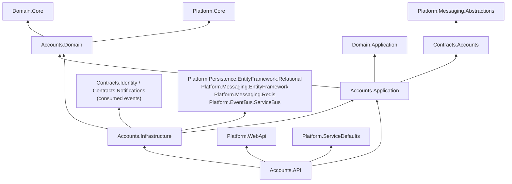
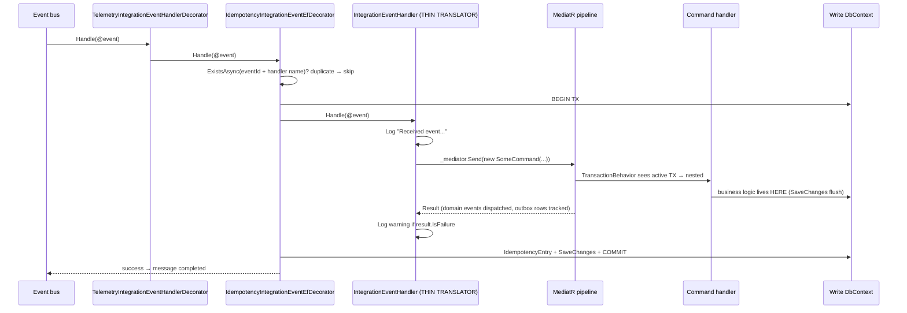
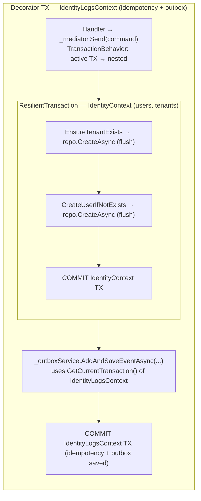

# Copilot Development Rules — Sirius Services

This document defines the rules and patterns that **must** be followed when implementing features in `Sirius.Services.*` microservices. In this repository the platform (`src/Sirius.Platform`, `src/Sirius.Domain`) is consumed through project references (several projects are also packable as NuGet) — do not modify or recreate platform internals from a service.

---

## Service Project Structure

Every service follows a **4-project structure** plus a **shared Contracts project** that lives outside the service folder:

```
src/
├── Sirius.Services/Sirius.Services.{ServiceName}/
│   ├── Api/                    ← Web host ({ServiceName}.API.csproj), Program.cs
│   │   ├── APIs/               ← Endpoint classes + {ServiceName}Services class
│   │   ├── Authorization/      ← Policy names and roles
│   │   └── Extensions/         ← AddApplicationServices (DI)
│   ├── Application/            ← Commands, Queries, Handlers, Validators, Domain Event Handlers
│   │   ├── Commands/
│   │   ├── Queries/            ← Query records + view models
│   │   ├── Validators/
│   │   ├── DomainEventHandlers/
│   │   └── AssemblyReference.cs
│   ├── Domain/                 ← Entities, Value Objects, Repositories, Domain Events
│   │   ├── Models/{Aggregate}/
│   │   ├── Events/
│   │   ├── Repositories/
│   │   ├── Services/           ← Domain service interfaces
│   │   └── Exceptions/
│   └── Infrastructure/         ← DbContexts, Repositories, Configurations, DI
│       ├── Persistence/
│       │   ├── EntityConfigurations/
│       │   ├── Queries/        ← Query handlers (use read context)
│       │   ├── Repositories/
│       │   ├── Migrations/
│       │   └── Seed/
│       ├── IntegrationEvents/EventHandling/   ← Consumed integration event handlers
│       ├── Services/           ← Domain service implementations
│       ├── Extensions/         ← AddInfrastructureServices (DI)
│       └── AssemblyReference.cs
└── Sirius.Contracts/Sirius.Contracts.{ServiceName}/ ← Integration events PUBLISHED by the service
    ├── IntegrationEvents/
    └── AssemblyReference.cs
```

Project references (Accounts as reference):



### AssemblyReference Pattern

Every project that needs assembly scanning (Application, Infrastructure, Contracts) must have:

```csharp
using System.Reflection;

namespace Sirius.Services.{ServiceName}.{Layer};   // Contracts: Sirius.Contracts.{ServiceName}

public static class AssemblyReference
{
    public static readonly Assembly Assembly = typeof(AssemblyReference).Assembly;
}
```

---

## Contracts Project — Integration Event Sharing

Integration events and their models live in a **separate Contracts project** (`src/Sirius.Contracts/Sirius.Contracts.{ServiceName}`) that is shared between microservices. Existing projects: `Contracts.Accounts`, `Contracts.Identity`, `Contracts.Notifications`.

### Rules

- The Contracts project only references `Platform.Messaging.Abstractions` — nothing else
- It contains **only** integration event records and any DTOs they carry
- The producing service references it from **Application** (domain event handlers create the events)
- Services that consume these events reference it from **Infrastructure** (integration event handlers)
- Every service registers the contract assemblies it **publishes** in `AddTransactionalOutbox(...RegisterEventTypes(...))`
- Never put commands, queries, domain events, or domain entities in Contracts

### Example

```csharp
// src/Sirius.Contracts/Sirius.Contracts.Accounts/IntegrationEvents/CompanyCreatedIntegrationEvent.cs
using Sirius.Platform.Messaging.IntegrationEvents;

namespace Sirius.Contracts.Accounts.IntegrationEvents;

public record CompanyCreatedIntegrationEvent(
    Guid TenantId,
    Guid CompanyId,
    string LegalName,
    string TradeName,
    string TaxId,
    string CountryCode) : IntegrationEvent;
```

### Contracts .csproj

```xml
<Project Sdk="Microsoft.NET.Sdk">
  <PropertyGroup>
    <TargetFramework>net10.0</TargetFramework>
    <ImplicitUsings>enable</ImplicitUsings>
    <Nullable>enable</Nullable>
    <RootNamespace>Sirius.Contracts.{ServiceName}</RootNamespace>
  </PropertyGroup>
  <ItemGroup>
    <ProjectReference Include="..\..\Sirius.Platform\Sirius.Platform.Messaging.Abstractions\Platform.Messaging.Abstractions.csproj" />
  </ItemGroup>
</Project>
```

---

## DI Configuration — Two-Layer Pattern

### Layer 1: Application (`Api/Extensions/Extensions.cs`)

```csharp
public static IServiceCollection AddApplicationServices(this IHostApplicationBuilder builder)
{
    var services = builder.Services;

    builder.AddInfrastructureServices();
    builder.AddRedisClient("cache");

    services.AddHttpContextAccessor();

    services.AddSiriusMediator(cfg =>
    {
        cfg.RegisterServicesFromAssembly(AssemblyReference.Assembly);          // Application handlers
        cfg.RegisterServicesFromAssembly(typeof(Infrastructure.AssemblyReference).Assembly); // Query handlers
        cfg.WithLogging(typeof(LoggingBehavior<,>));
        cfg.WithValidation(typeof(ValidationBehavior<,>));
    });

    services.AddValidatorsFromAssembly(AssemblyReference.Assembly);

    return services;
}
```

### Layer 2: Infrastructure (`Infrastructure/Extensions/Extensions.cs`)

```csharp
public static void AddInfrastructureServices(this IHostApplicationBuilder builder)
{
    var services = builder.Services;
    // Services share the SiriusDb database, each one in its own schema
    var connectionString = builder.Configuration.GetConnectionString("SiriusDb");
    var readConnectionString = builder.Configuration.GetConnectionString("SiriusDbReadonly")
        ?? connectionString;

    // Write context
    services.AddSiriusSDBContext<{ServiceName}Context>(
        conf => conf
            .SetDefaultSchema("{ServiceName}")
            .WithIdempotency()
            .RegisterModelsFromAssembly(typeof(AssemblyReference).Assembly),
        options => options.UseSqlServer(connectionString, sqlOptions =>
        {
            sqlOptions.MigrationsAssembly(typeof(AssemblyReference).Assembly.FullName);
        })
    );

    // Read context
    services.AddSiriusReadDbContext<{ServiceName}ReadContext>(
        conf => conf
            .SetDefaultSchema("{ServiceName}")
            .RegisterModelsFromAssembly(typeof(AssemblyReference).Assembly),
        options => options.UseSqlServer(readConnectionString)
    );

    services.AddHealthChecks()
        .AddDbContextCheck<{ServiceName}Context>(name: "{servicename}-db", tags: ["ready"]);

    // Required: applies migrations + seed and signals MigrationReadySignal (awaited by the OutboxProcessor)
    services.AddMigration<{ServiceName}Context, {ServiceName}ContextSeed>();

    // Event bus + subscriptions — BEFORE the idempotency builders
    builder.AddServiceBusEventBus("eventbus")
        .AddEventBusSubscriptions();

    // Idempotency: Redis (fast) FIRST, then EF (transactional guarantee) decorates it
    services.AddRedisIdempotencyCache(builder.Configuration)
        .ForApiRequests()
        .ForIntegrationEventHandlers();

    services.AddIdempotencyEntityFramework<{ServiceName}Context>()
        .ForApiRequests()
        .ForIntegrationEventHandlers();

    // Transactional outbox — register every contracts assembly whose events this service PUBLISHES
    services.AddTransactionalOutbox<{ServiceName}Context>(options =>
    {
        options.RegisterEventTypes(typeof(Sirius.Contracts.{ServiceName}.AssemblyReference).Assembly);
    });

    // Repositories
    services.AddScoped<I{Entity}Repository, {Entity}Repository>();
}

private static void AddEventBusSubscriptions(this IEventBusBuilder eventBus)
{
    // Register integration event subscriptions from OTHER services
    eventBus.AddSubscription<SomeExternalEvent, SomeExternalEventHandler>();
}
```

### Critical DI Rules

- **Always use `AddSiriusMediator`** — never call `AddMediatR` directly
- **Never manually register telemetry** — `AddSiriusMediator` handles it automatically
- **Register handlers from both assemblies** — Application (commands, domain event handlers) and Infrastructure (query handlers)
- **Infrastructure calls go in `AddInfrastructureServices`** — database, event bus, idempotency, outbox, repositories
- **Order matters** — `AddInfrastructureServices` before `AddSiriusMediator`; inside it: subscriptions → Redis idempotency → EF idempotency → outbox (Scrutor decorates in call order)
- **Configuration** — `appsettings.json` needs `EventBus:SubscriptionClientName` (matching the AppHost subscription) and the `IdempotencyCache` section; connection names `SiriusDb`, `eventbus` and `cache` come from Aspire

---

## Commands

### Idempotent Command (default for API-facing commands)

```csharp
[DataContract]
public record CreateOrderCommand : IdempotentCommand<bool>
{
    [DataMember]
    public string CustomerName { get; private set; } = null!;

    // ... other properties

    public CreateOrderCommand() { }

    public CreateOrderCommand(string customerName, /* ... */ Guid? requestId = null)
        : base(requestId)
    {
        CustomerName = customerName;
    }

    public override Result<bool> CreateResultForDuplicateRequest()
    {
        return Result.Success(true);
    }
}
```

### Command Handler

```csharp
public class CreateOrderCommandHandler : ICommandHandler<CreateOrderCommand, bool>
{
    private readonly IOrderRepository _orderRepository;

    public CreateOrderCommandHandler(IOrderRepository orderRepository)
    {
        _orderRepository = orderRepository ?? throw new ArgumentNullException(nameof(orderRepository));
    }

    public async Task<Result<bool>> Handle(CreateOrderCommand message, CancellationToken cancellationToken)
    {
        var order = Order.Create(message.CustomerName, /* ... */);
        _orderRepository.Add(order);

        // FLUSH — not commit. The transaction commits later.
        var saved = await _orderRepository.UnitOfWork.SaveChangesAsync(cancellationToken);

        return saved > 0
            ? Result.Success(true)
            : Result.Failure<bool>(Error.BadRequest.WithMessage("Failed to create order"));
    }
}
```

### Command Rules

- `SaveChangesAsync()` **flushes** to DB but does NOT commit — the `TransactionBehavior` commits later
- Always return `Result<T>`, never throw exceptions for expected failures
- Override `CreateResultForDuplicateRequest()` to return a meaningful value (e.g., `true` for creation commands) — the default returns `Result.Success(default)`
- Use `[DataContract]` / `[DataMember]` for serialization support
- A failed `Result` rolls back the transaction when `TransactionBehavior` owns it, and the idempotency key is discarded, so the client can retry with the same `x-requestid`. In nested commands (sent from integration event handlers) the decorator owns the transaction and commits whatever was tracked when the handler returns normally; check business preconditions **before** modifying entities, and throw from the integration event handler when the changes must be discarded

---

## Queries

### Query Definition (Application layer)

```csharp
public record GetOrderByIdQuery(Guid Id) : IQuery<OrderViewModel>;

public record GetAllOrdersQuery : IQuery<IEnumerable<OrderSummary>>;
```

### Query Handler (Infrastructure layer — uses read context)

```csharp
public class GetOrderByIdQueryHandler(OrderReadContext context)
    : IQueryHandler<GetOrderByIdQuery, OrderViewModel>
{
    public async Task<Result<OrderViewModel>> Handle(GetOrderByIdQuery request, CancellationToken cancellationToken)
    {
        var order = await context.Orders
            .Where(o => o.Id == request.Id)
            .Select(o => new OrderViewModel { Id = o.Id, Name = o.Name /* ... */ })
            .FirstOrDefaultAsync(cancellationToken);

        return order is not null
            ? Result.Success(order)
            : Result.Failure<OrderViewModel>(Error.NotFound);
    }
}
```

### Query Rules

- Query handlers go in `Infrastructure/Persistence/Queries/`
- Always inject the **read context** (`{Service}ReadContext`), never the write context
- No need for `AsNoTracking()` — the read context has it by default
- Return `Result<T>` for single items (may not exist), `Result<IEnumerable<T>>` for collections
- ViewModels/DTOs go in `Application/Queries/`

---

## Domain Layer

### Aggregate Root

```csharp
public class Order : Entity, IAggregateRoot
{
    public string CustomerName { get; private set; } = null!;
    // ... properties with private setters

    protected Order() { }  // EF constructor

    public static Order Create(string customerName /* ... */)
    {
        var order = new Order
        {
            CustomerName = customerName.Trim(),
            // ...
        };

        order.AddDomainEvent(new OrderCreatedDomainEvent(order.Id, order.CustomerName));
        return order;
    }
}
```

### Domain Event

```csharp
using MediatR;
using Sirius.Domain.SeedWork;

public record OrderCreatedDomainEvent(
    Guid OrderId,
    string CustomerName) : IDomainEvent, INotification;
```

### Repository Interface (Domain layer)

```csharp
using Sirius.Domain.SeedWork;

public interface IOrderRepository : IRepository<Order>
{
    Order Add(Order order);
    void Update(Order order);
    Task<Order?> GetAsync(Guid orderId);
}
```

### Repository Implementation (Infrastructure layer)

```csharp
using Sirius.Platform.Persistence.Repositories;

public class OrderRepository : Repository<Order>, IOrderRepository
{
    public OrderRepository(OrderContext context) : base(context) { }
}
```

### Domain Rules

- Entities have **private setters** — mutation through methods only
- Use **factory methods** (`Create(...)`) with business validation
- Raise domain events via `AddDomainEvent()` in factory methods or mutation methods
- Domain events must implement both `IDomainEvent` and `INotification`
- Repository interfaces in Domain, implementations in Infrastructure
- Value Objects use `ValueObject` base class with `GetEqualityComponents()`
- `Entity` base class provides `CreatedAt`, `UpdatedAt`, and `RowVersion` automatically — **never declare these in your entities**. The platform sets `CreatedAt` on insert, `UpdatedAt` on update, and `RowVersion` is managed by the database as a concurrency token

---

## Domain Event Handlers

Domain event handlers run **inside the same transaction** as the command. They can modify aggregates and save integration events to the outbox.

```csharp
public class OrderCreatedDomainEventHandler : IDomainEventHandler<OrderCreatedDomainEvent>
{
    private readonly IOrderRepository _repository;
    private readonly IEventBusOutboxService _outboxService;

    public OrderCreatedDomainEventHandler(
        IOrderRepository repository,
        IEventBusOutboxService outboxService)
    {
        _repository = repository;
        _outboxService = outboxService;
    }

    public async Task Handle(OrderCreatedDomainEvent notification, CancellationToken cancellationToken)
    {
        var order = await _repository.GetAsync(notification.OrderId);
        if (order is null) return;

        await _outboxService.AddAndSaveEventAsync(
            new OrderCompletedIntegrationEvent(
                order.Id,
                order.CustomerId,
                order.Total,
                order.Currency));
    }
}
```

### Domain Event Handler Rules

- Keep handlers **lightweight** (under ~100ms)
- **Do NOT** call `SaveChangesAsync()` — the transaction handles it
- **Do NOT** start new transactions
- **Do NOT** call external HTTP APIs or heavy I/O — use integration events for async work
- Use `IEventBusOutboxService.AddAndSaveEventAsync()` to publish integration events
- Handlers CAN query entities and modify aggregates (within same transaction)

---

## Integration Event Handlers (Consuming Events)

Integration event handlers act as **thin translators** — they receive an external event, map it to an internal command, and delegate all business logic to MediatR. This preserves DDD layer separation and ensures business operations run inside the proper transactional pipeline.

### Architecture — Thin Translator Pattern



The write DbContext is the service's `SiriusDBContext` (`AccountContext`, `NotificationsContext`, or `IdentityLogsContext` in Identity). Outbox rows produced by the nested command are published by the `OutboxProcessor` after this commit.

### Handler Template (Layered Services)

```csharp
using MediatR;
using Sirius.Platform.Messaging.IntegrationEvents;

public class OrderCompletedIntegrationEventHandler
    : IIntegrationEventHandler<OrderCompletedIntegrationEvent>
{
    private readonly IMediator _mediator;
    private readonly ILogger<OrderCompletedIntegrationEventHandler> _logger;

    public OrderCompletedIntegrationEventHandler(
        IMediator mediator,
        ILogger<OrderCompletedIntegrationEventHandler> logger)
    {
        _mediator = mediator ?? throw new ArgumentNullException(nameof(mediator));
        _logger = logger ?? throw new ArgumentNullException(nameof(logger));
    }

    public async Task Handle(OrderCompletedIntegrationEvent @event)
    {
        _logger.LogInformation(
            "Received OrderCompleted event for order {OrderId}.",
            @event.OrderId);

        var result = await _mediator.Send(
            new ProcessCompletedOrderCommand(
                @event.OrderId,
                @event.CustomerId,
                @event.Total));

        if (result.IsFailure)
            _logger.LogWarning(
                "ProcessCompletedOrder failed for order {OrderId}: {Error}",
                @event.OrderId,
                result.Error.Message);
    }
}
```

### Command from Integration Event

Commands triggered by integration events use `ICommand<T>` — **not** `IdempotentCommand<T>` — because idempotency is already handled by the `IdempotencyIntegrationEventEfDecorator`.

```csharp
using Sirius.Platform.Messaging.Commands;

public record ProcessCompletedOrderCommand(
    Guid OrderId,
    Guid CustomerId,
    decimal Total) : ICommand<bool>;
```

In layered services (Accounts, Notifications), the command handler benefits from the full MediatR pipeline. `TransactionBehavior` detects the decorator's active transaction and runs nested, `DomainEventProcessorBehavior` dispatches domain events inside it, and `SaveChangesAsync()` flushes within the decorator-managed transaction — same handler code as API-facing commands. The resulting integration events are published by the `OutboxProcessor` once the decorator commits.

### Handler Template (Identity — Dual DbContext)

Identity uses a **monolithic project** with two separate DbContexts:
- `IdentityContext` (`IdentityDbContext`) — users, tenants, roles
- `IdentityLogsContext` (`SiriusDBContext`) — idempotency, outbox

These contexts do **not** share a transaction. The approach is:
1. **Decorator** wraps the handler with a transaction on `IdentityLogsContext` (idempotency + outbox)
2. **Command handler** uses `ResilientTransaction.New(IdentityContext)` for business operations
3. **Outbox publish** runs within the decorator's `IdentityLogsContext` transaction



The two commits are **independent**: if the outer commit fails after the `IdentityContext` commit, the message is redelivered and the "if not exists" checks make the retry safe.

**Integration event handler** — identical thin translator pattern:

```csharp
public class CustomerAdminProvisioningRequestedIntegrationEventHandler
    : IIntegrationEventHandler<CustomerAdminProvisioningRequestedIntegrationEvent>
{
    private readonly IMediator _mediator;
    private readonly ILogger<CustomerAdminProvisioningRequestedIntegrationEventHandler> _logger;

    // Constructor: IMediator + ILogger only

    public async Task Handle(CustomerAdminProvisioningRequestedIntegrationEvent @event)
    {
        _logger.LogInformation("Received event for tenant {TenantId}.", @event.TenantId);

        var result = await _mediator.Send(
            new ProvisionCustomerAdminCommand(
                @event.SubscriptionId, @event.TenantId, @event.CompanyId,
                @event.OnboardingProcessId, @event.AdminEmail,
                @event.AdminFirstName, @event.AdminLastName, @event.TenantName));

        if (result.IsFailure)
            _logger.LogWarning("ProvisionCustomerAdmin failed: {Error}", result.Error.Message);
    }
}
```

**Command handler** — uses `ResilientTransaction` for `IdentityContext`:

```csharp
public class ProvisionCustomerAdminCommandHandler
    : ICommandHandler<ProvisionCustomerAdminCommand, bool>
{
    private readonly IdentityContext _identityContext;
    private readonly ITenantRepository _tenantRepository;
    private readonly IUserRepository _userRepository;
    private readonly IEventBusOutboxService _outboxService;
    private readonly ILogger<ProvisionCustomerAdminCommandHandler> _logger;

    public async Task<Result<bool>> Handle(
        ProvisionCustomerAdminCommand message, CancellationToken cancellationToken)
    {
        ApplicationUser? adminUser = null;

        await ResilientTransaction.New(_identityContext).ExecuteAsync(async () =>
        {
            await EnsureTenantExistsAsync(message);
            adminUser = await CreateAdminUserIfNotExistsAsync(message);
        });

        // Outbox publish runs within the decorator's IdentityLogsContext transaction
        await _outboxService.AddAndSaveEventAsync(
            new ExternalUserProvisionedIntegrationEvent(
                Guid.Parse(adminUser!.Id), message.TenantId, ...));

        return Result.Success(true);
    }
}
```

**Key differences from layered services:**
- Identity uses `AddSiriusMediator` with `WithLogging` only (no `WithValidation`). All platform behaviors are present, but `ITransactionalUnitOfWork` is `IdentityLogsContext`, so `TransactionBehavior` / `DomainEventProcessorBehavior` only cover the idempotency + outbox context — not users or tenants
- Handler must manage its own `IdentityContext` transaction via `ResilientTransaction`
- `AddAndSaveEventAsync` works because there is an active transaction on `IdentityLogsContext` — opened by the decorator (event path) or by `TransactionBehavior` (commands sent from Razor pages such as `ConfirmEmailCommand`)
- Multiple `SaveChangesAsync` calls inside `ResilientTransaction` are safe — they flush within the transaction, commit happens at end

### Registration

```csharp
private static void AddEventBusSubscriptions(this IEventBusBuilder eventBus)
{
    eventBus.AddSubscription<OrderCompletedIntegrationEvent, OrderCompletedIntegrationEventHandler>();
}
```

### Integration Event Handler Rules

- **Thin translator only** — handlers inject `IMediator` + `ILogger`, nothing else
- **Never inject repositories, DbContexts, or domain services** into the handler — those belong in the command handler
- **Use `ICommand<T>`** for commands triggered by integration events — not `IdempotentCommand<T>` (decorator handles idempotency)
- Implement `IIntegrationEventHandler<T>` — telemetry and idempotency decorators are applied automatically
- Reference the **Contracts project** of the producing service
- Register via `AddSubscription<TEvent, THandler>()` in `AddEventBusSubscriptions`
- Log the received event at `Information` level, log failures at `Warning` level
- **Layered services**: command handler benefits from full MediatR pipeline (transactions, domain events, outbox — all automatic)
- **Identity**: command handler must use `ResilientTransaction.New(IdentityContext)` for business operations and `AddAndSaveEventAsync` for outbox (leveraging decorator's transaction)

---

## Entity Configurations

Only configure **your domain entities**. Never create configurations for platform tables.

```csharp
internal sealed class OrderConfiguration : IEntityTypeConfiguration<Order>
{
    private const string TableName = "Order";   // singular, schema comes from SetDefaultSchema

    public void Configure(EntityTypeBuilder<Order> entity)
    {
        entity.ToTable(TableName);
        entity.HasKey(e => e.Id);
        entity.Property(x => x.Id).ValueGeneratedNever();

        entity.Property(e => e.CustomerName)
            .IsRequired()
            .HasMaxLength(200);

        // Value Objects as owned types
        entity.OwnsOne(e => e.ShippingAddress, addr =>
        {
            addr.Property(a => a.Street).HasMaxLength(200);
            addr.Property(a => a.City).HasMaxLength(100);
        });
    }
}
```

### Entity Configuration Rules

- Configurations go in `Infrastructure/Persistence/EntityConfigurations/`
- Mark as `internal sealed class`
- **Never create configurations for**: `OutboxMessage`, `IdempotencyEntry`, `AuditLog` — the platform manages these
- **Never hand-edit migration entries for platform tables** — they are added to the model automatically by `.WithIdempotency()` / `AddIdempotencyEntityFramework` and `AddTransactionalOutbox`; just generate migrations normally
- **Never configure `RowVersion` or `CreatedAt`** — `ConfigureEntityAuditProperties` maps them for every `Entity` type
- Use `ValueGeneratedNever()` for entity IDs (generated in code via `Entity` base constructor)
- Store enums as strings (`HasConversion<string>()` + `HasMaxLength`), as existing configurations do
- Configurations are auto-discovered from the assembly registered via `RegisterModelsFromAssembly` (both write and read contexts use the same assembly)

---

## DbContext

### Write Context

```csharp
public class OrderContext : SiriusDBContext
{
    public DbSet<Order> Orders { get; set; } = null!;

    public OrderContext(
        DbContextOptions<OrderContext> options,
        SiriusDbContextConfiguration configuration)
        : base(options, configuration) { }

    protected override void OnModelCreating(ModelBuilder modelBuilder)
    {
        base.OnModelCreating(modelBuilder);
        // Entity configurations auto-discovered — no manual ApplyConfiguration needed
    }
}
```

### Read Context

```csharp
public class OrderReadContext : SiriusReadDbContext
{
    public DbSet<Order> Orders { get; set; } = null!;

    public OrderReadContext(
        DbContextOptions<OrderReadContext> options,
        SiriusReadDbContextConfiguration configuration)
        : base(options, configuration) { }
}
```

### DbContext Rules

- Write context inherits `SiriusDBContext` — read context inherits `SiriusReadDbContext`
- The constructor only needs `DbContextOptions<T>` and `SiriusDbContextConfiguration` (existing contexts such as `AccountContext` also inject an unused `IMediator` — not required)
- Call `base.OnModelCreating(modelBuilder)` in write context — it applies platform configurations
- Read context does **not** need `OnModelCreating` override
- Never call `SaveChanges` on the read context (throws `InvalidOperationException`)

---

## API Endpoints

```csharp
public static class OrdersApi
{
    public static RouteGroupBuilder MapOrdersApiV1(this IEndpointRouteBuilder app)
    {
        var api = app.MapGroup("api/orders").HasApiVersion(1.0);
        api.MapPut("/", CreateOrderAsync);
        api.MapGet("/{id:guid}", GetOrderByIdAsync);
        api.MapGet("/", GetAllOrdersAsync);
        return api;
    }

    public static async Task<Results<Ok<bool>, BadRequest<ApiErrorResponse>>> CreateOrderAsync(
        [FromHeader(Name = "x-requestid")] Guid requestId,
        CreateOrderRequest request,
        [AsParameters] OrdersServices services)
    {
        if (requestId == Guid.Empty)
            return TypedResults.BadRequest(new ApiErrorResponse
            {
                Code = "ValidationError",
                Message = "Empty GUID is not valid for request ID",
                TraceId = services.CurrentUser.TraceId
            });

        var command = new CreateOrderCommand(/* ... */ requestId: requestId);
        var result = await services.Mediator.Send(command);
        return result.ToHttpResult(services.CurrentUser.TraceId);   // 200 OK or 400 ApiErrorResponse
    }

    public static async Task<Results<Ok<OrderViewModel>, NotFound<ApiErrorResponse>>> GetOrderByIdAsync(
        Guid id,
        [AsParameters] OrdersServices services)
    {
        var result = await services.Mediator.Send(new GetOrderByIdQuery(id));

        if (result.IsFailure)
            return TypedResults.NotFound(new ApiErrorResponse
            {
                Code = "NotFound",
                Message = "Order not found.",
                TraceId = services.CurrentUser.TraceId
            });

        return TypedResults.Ok(result.Value);
    }
}
```

Map the group in `Program.cs` with versioning and authorization:

```csharp
app.NewVersionedApi("orders")
   .MapOrdersApiV1()
   .RequireAuthorization();          // or per-endpoint .RequireAuthorization(OrdersAuthorizationPolicies.Write)
```

### API Services class

```csharp
public class OrdersServices(
    IMediator mediator,
    ICurrentUserContext currentUser,
    ILogger<OrdersServices> logger) : ApiServices<OrdersServices>(mediator, currentUser, logger) { }
```

### API Rules

- Use `[FromHeader(Name = "x-requestid")]` for idempotent commands
- Validate `requestId != Guid.Empty` before sending
- Use `result.ToHttpResult(traceId)` to convert `Result<T>` to HTTP responses (`200 OK` / `400 Bad Request` with `ApiErrorResponse`); map other status codes (e.g. `404`) explicitly in the endpoint
- Duplicate requests return `200 OK` with the value from `CreateResultForDuplicateRequest()` — never `409 Conflict` (it is not a replay of the original body)
- Create a service-specific `{Service}Services` class extending `ApiServices<{Service}Services>` (`Mediator`, `Logger`, `CurrentUser`)
- Read caller identity (`CurrentUser.UserId`, `TenantId`, …) in the endpoint and pass it explicitly into the command — handlers must not depend on `ICurrentUserContext`
- Unhandled exceptions are converted by `ExceptionHandlingMiddleware` (`DomainValidationException` → `400`, others → `500`)

---

## Validators

```csharp
public class CreateOrderCommandValidator : AbstractValidator<CreateOrderCommand>
{
    public CreateOrderCommandValidator()
    {
        RuleFor(x => x.CustomerName)
            .NotEmpty().WithMessage("Customer name is required")
            .MaximumLength(200).WithMessage("Customer name cannot exceed 200 characters");
    }
}
```

### Validator Rules

- Validators go in `Application/Validators/`
- Use FluentValidation's `AbstractValidator<T>`
- Validators are auto-discovered from the assembly registered via `AddValidatorsFromAssembly`
- Validation runs inside the transaction (after `TransactionBehavior`, before handler) and only if the service calls `WithValidation(typeof(ValidationBehavior<,>))`
- Failures return `Result.ValidationFailure` (→ `400` with per-property `errors`); for non-`Result` responses a `DomainValidationException` is thrown

---

## What NOT To Do

### Never create or configure platform infrastructure tables

```csharp
// ❌ WRONG — Platform manages these
public class OutboxMessageConfiguration : IEntityTypeConfiguration<OutboxMessage> { ... }
public class IdempotencyEntryConfiguration : IEntityTypeConfiguration<IdempotencyEntry> { ... }
entity.ToTable("OutboxMessage"); // in any configuration
entity.ToTable("IdempotencyEntry"); // in any configuration
modelBuilder.Entity<OutboxMessage>(...); // in OnModelCreating
```

### Never define CreatedAt, UpdatedAt, or RowVersion in entities

```csharp
// ❌ WRONG — These are inherited from Entity and configured by the platform
public class Order : Entity, IAggregateRoot
{
    public DateTimeOffset CreatedAt { get; set; }
    public DateTimeOffset? UpdatedAt { get; set; }
    public byte[] RowVersion { get; set; }
}
```

### Never call AddMediatR directly

```csharp
// ❌ WRONG
services.AddMediatR(cfg => { ... });

// ✅ CORRECT
services.AddSiriusMediator(cfg => { ... });
```

### Never register telemetry manually

```csharp
// ❌ WRONG — These are implicit in AddSiriusMediator
services.AddIntegrationEventTelemetryDecorator();
services.AddDomainEventTelemetryBehavior();
services.AddCommandTelemetryBehavior();
services.AddQueryTelemetryBehavior();
```

### Never call SaveChangesAsync in domain event handlers

```csharp
// ❌ WRONG — CommitTransactionAsync handles the final save
public async Task Handle(OrderCreatedDomainEvent notification, CancellationToken ct)
{
    await _outboxService.AddAndSaveEventAsync(integrationEvent);
    await _context.SaveChangesAsync(ct); // ← NEVER do this
}
```

### Never use the write context for queries

```csharp
// ❌ WRONG
public class GetOrderByIdQueryHandler(OrderContext context) { ... }

// ✅ CORRECT
public class GetOrderByIdQueryHandler(OrderReadContext context) { ... }
```

### Never put domain types in Contracts

```csharp
// ❌ WRONG — Contracts should only have integration events
namespace Sirius.Services.Orders.Contracts;
public class Order : Entity, IAggregateRoot { ... }
```

### Never start transactions manually

```csharp
// ❌ WRONG — TransactionBehavior manages this
await using var tx = await _context.Database.BeginTransactionAsync();
```

The only exception is Identity, where business data lives in `IdentityContext` (outside the pipeline's `ITransactionalUnitOfWork`) and must use `ResilientTransaction.New(_identityContext)`.

### Never publish to event bus directly from handlers

```csharp
// ❌ WRONG — Use the outbox
await _eventBus.PublishAsync(integrationEvent);

// ✅ CORRECT — Saves to outbox within the transaction
await _outboxService.AddAndSaveEventAsync(integrationEvent);
```

### Never publish integration events from command handlers

```csharp
// ❌ WRONG — Command handler should not inject or use IEventBusOutboxService
public class CreateOrderCommandHandler : ICommandHandler<CreateOrderCommand, bool>
{
    private readonly IOrderRepository _orderRepository;
    private readonly IEventBusOutboxService _outboxService;

    public async Task<Result<bool>> Handle(CreateOrderCommand message, CancellationToken ct)
    {
        var order = Order.Create(message.CustomerName);
        _orderRepository.Add(order);
        await _orderRepository.UnitOfWork.SaveChangesAsync(ct);
        await _outboxService.AddAndSaveEventAsync(new OrderCreatedIntegrationEvent(order.Id));
        return Result.Success(true);
    }
}

// ✅ CORRECT — Aggregate raises domain event, domain event handler publishes to outbox
public class CreateOrderCommandHandler : ICommandHandler<CreateOrderCommand, bool>
{
    private readonly IOrderRepository _orderRepository;

    public async Task<Result<bool>> Handle(CreateOrderCommand message, CancellationToken ct)
    {
        var order = Order.Create(message.CustomerName); // raises OrderCreatedDomainEvent
        _orderRepository.Add(order);
        await _orderRepository.UnitOfWork.SaveChangesAsync(ct);
        return Result.Success(true);
    }
}

// Domain event handler publishes the integration event
public class OrderCreatedDomainEventHandler : IDomainEventHandler<OrderCreatedDomainEvent>
{
    private readonly IEventBusOutboxService _outboxService;

    public async Task Handle(OrderCreatedDomainEvent notification, CancellationToken ct)
    {
        await _outboxService.AddAndSaveEventAsync(
            new OrderCreatedIntegrationEvent(notification.OrderId));
    }
}
```

**Why:** The aggregate owns the decision of when to publish. Domain event handlers run inside the same transaction (via `DomainEventProcessorBehavior`), so the outbox entry is committed atomically. This keeps command handlers focused on orchestration and keeps the integration event trigger close to the domain logic that produces it.

**Exception — Identity:** its business data (`IdentityContext`) has no DDD aggregates raising domain events, so `ProvisionCustomerAdminCommandHandler` and `ConfirmEmailCommandHandler` call `AddAndSaveEventAsync` directly, on the `IdentityLogsContext` transaction (see [Handler Template (Identity — Dual DbContext)](#handler-template-identity--dual-dbcontext)).

### Never put business logic in integration event handlers

```csharp
// ❌ WRONG — Handler directly uses repositories and domain logic
public class OrderCompletedIntegrationEventHandler
    : IIntegrationEventHandler<OrderCompletedIntegrationEvent>
{
    private readonly IOrderRepository _repository;
    private readonly IEventBusOutboxService _outboxService;

    public async Task Handle(OrderCompletedIntegrationEvent @event)
    {
        var order = await _repository.GetAsync(@event.OrderId);
        order.MarkAsProcessed();
        await _repository.UnitOfWork.SaveChangesAsync();
        await _outboxService.AddAndSaveEventAsync(new OrderProcessedEvent(...));
    }
}

// ✅ CORRECT — Thin translator delegates to a command via MediatR
public class OrderCompletedIntegrationEventHandler
    : IIntegrationEventHandler<OrderCompletedIntegrationEvent>
{
    private readonly IMediator _mediator;
    private readonly ILogger<OrderCompletedIntegrationEventHandler> _logger;

    public async Task Handle(OrderCompletedIntegrationEvent @event)
    {
        _logger.LogInformation("Received OrderCompleted for {OrderId}.", @event.OrderId);

        var result = await _mediator.Send(
            new ProcessCompletedOrderCommand(@event.OrderId, @event.CustomerId, @event.Total));

        if (result.IsFailure)
            _logger.LogWarning("ProcessCompletedOrder failed: {Error}", result.Error.Message);
    }
}
```
