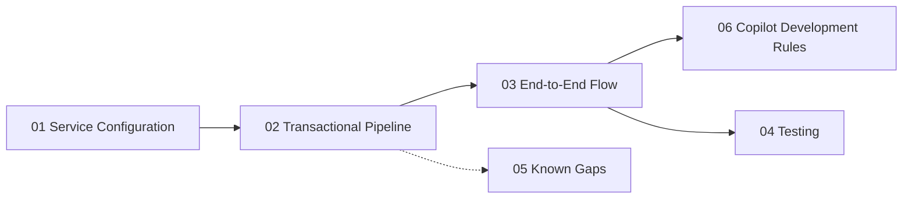

# Developer Guide

Practical guides for developers building services on the MiqaS platform. Each document focuses on **how to** implement features following established patterns, using the Accounts, Identity and Notifications services as real references.

For architecture decisions and pattern details see [Architecture Documentation](../architecture/README.md).

| Document | Description |
|----------|-------------|
| [Service Configuration](01-service-configuration.md) | Two-layer DI configuration, `AddMiqaMediator`, registration order, infrastructure components |
| [Transactional Pipeline](02-transactional-pipeline.md) | How the single-transaction model works, nested commands, precautions, common pitfalls |
| [End-to-End Flow](03-end-to-end-flow.md) | Complete `CreateCompany` flow from Accounts to Notifications across all patterns |
| [Testing](04-testing.md) | Test projects, fixtures, naming conventions, current coverage |
| [Known Gaps](05-known-gaps.md) | Current limitations and planned improvements |
| [Copilot Development Rules](06-copilot-development-rules.md) | Patterns, templates, and rules for AI-assisted feature development |

### Suggested reading order

