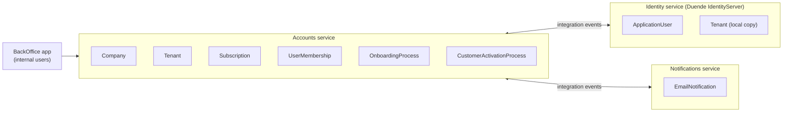
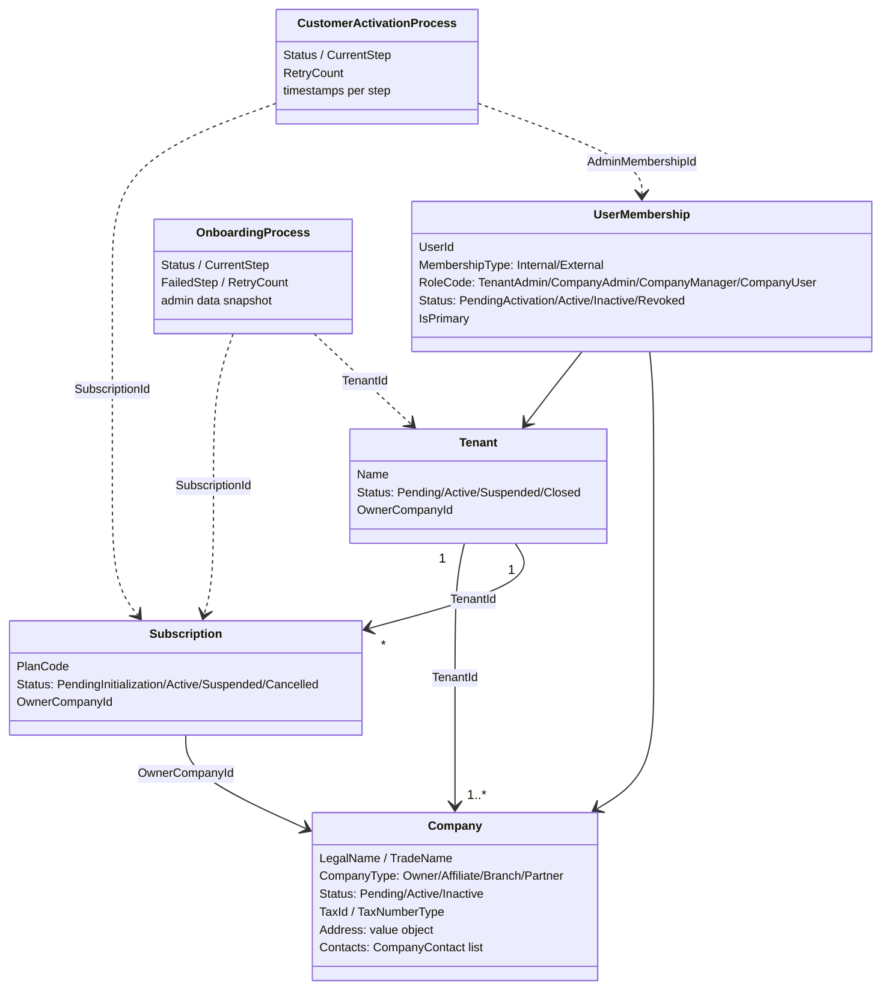
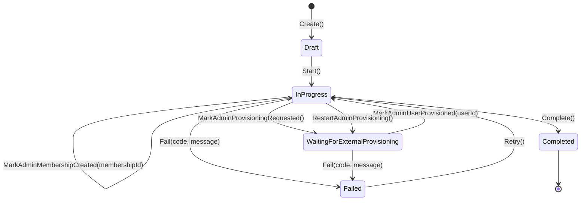
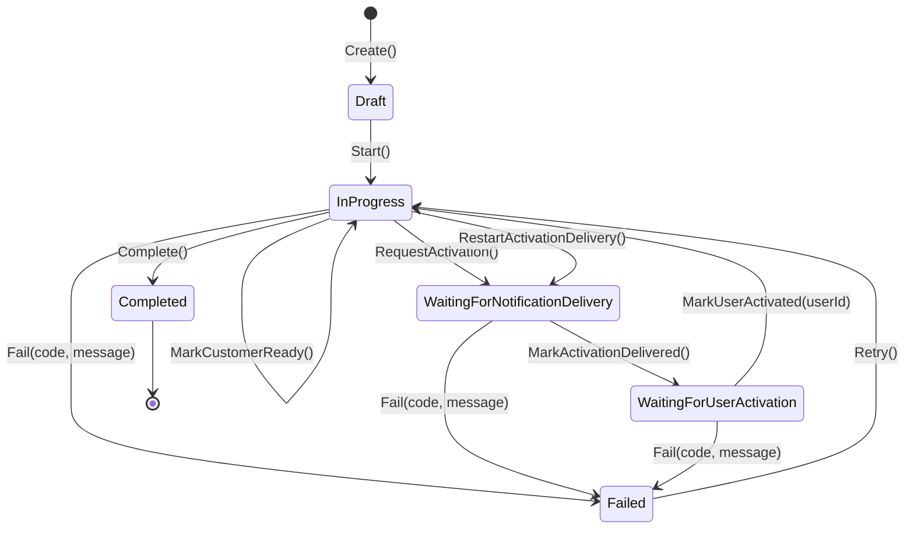

# Sample Domain

## Purpose

The services in this repository implement a small **sample domain** whose only goal is to exercise the building blocks (pipeline, domain events, outbox, idempotency, event bus, read models, telemetry) in a realistic, multi-service flow. It is intentionally narrow: it models how a new customer account is initialized in a multi-tenant B2B platform and how its first administrator gets activated.

The domain is a vehicle for the patterns, not a product specification. Only what is implemented in `src/` is described here.

---

## Bounded Contexts

| Service | Responsibility in the sample | Persistence |
|---|---|---|
| **Accounts** | Owns the customer structure (tenant, company, subscription, membership) and orchestrates onboarding and activation through two process aggregates | `SiriusDb`, schema `Accounts` |
| **Identity** | Stores users and a local copy of tenants; provisions the customer administrator and confirms its email | `IdentityDb` (`IdentityContext` + `IdentityLogsContext` for idempotency/outbox) |
| **Notifications** | Records and "sends" emails (the `EmailService` only logs — delivery is simulated) | `SiriusDb`, schema `Notifications` |

---

## Glossary

| Term | Meaning in the sample |
|---|---|
| **Tenant** | Isolation boundary that groups the companies of one customer |
| **Company** | Legal entity inside a tenant; the **owner company** is the one that holds the subscription |
| **Subscription** | Link between a tenant/owner company and a plan, identified by a plan code (`PlanCode`, free text) |
| **UserMembership** | Link between a user and a tenant/company with a role |
| **Internal user** | User of the BackOffice (roles `ProjectManager`, `BusinessAdmin`, `SupportAgent`, `PlatformAdmin`) |
| **External user** | Customer-side user; the onboarding creates one: the customer administrator |
| **Onboarding** | Process that creates tenant, subscription, owner company and requests the admin user from Identity |
| **Activation** | Process that sends the activation email and waits until the admin confirms it ("go-live") |

---

## Accounts Model

All aggregates derive from `Entity` (Guid identity generated in code, `CreatedAt`, `UpdatedAt`, `RowVersion`) and reference each other **by id**. Each one has its own repository (`ICompanyRepository`, `ITenantRepository`, ...) built on `Repository<T>`.

### Structural aggregates

| Aggregate | Factory | Raises | Notes |
|---|---|---|---|
| `Tenant` | `Tenant.Create(name, createdBy)` | `TenantCreatedDomainEvent` | `SetOwnerCompany`, `Activate`, `Suspend`, `Close` guard their transitions |
| `Subscription` | `Subscription.Create(tenantId, planCode, createdBy)` | `SubscriptionCreatedDomainEvent` | `Activate` requires an owner company |
| `Company` | `Company.Create(...)` (API `CreateCompany`) / `Company.CreateOwnerCompany(...)` (onboarding) | `CompanyCreatedDomainEvent` — only from `Create` | `TaxNumberType.Unknown` is rejected; `AddContact` avoids duplicates by email/phone |
| `UserMembership` | `UserMembership.CreateExternalAdminMembership(userId, tenantId, companyId)` | — | External, `TenantAdmin`, primary, `PendingActivation` |

The onboarding and activation flows create these aggregates in their initial status (`Pending`, `PendingInitialization`, `PendingActivation`); the `Activate`/`Suspend`/... methods are part of the model and covered by unit tests, but the sample flows do not call them.

Invariant violations throw `AccountDomainException`.

---

## Process Aggregates

The customer lifecycle is split into **two process aggregates** (state machines) that never call each other: they communicate only through events. Every transition is guarded by `EnsureStatus` / `EnsureStep`, so an out-of-order message results in an `AccountDomainException` instead of a corrupted state.

### OnboardingProcess

| Step (`OnboardingStep`) | Set by | Domain event |
|---|---|---|
| `None` | `Create()` | — |
| `SubscriptionCreated` | `MarkSubscriptionCreated()` | — |
| `TenantCreated` | `MarkTenantCreated()` | — |
| `OwnerCompanyCreated` | `MarkOwnerCompanyCreated(companyId)` | — |
| `AdminProvisioningRequested` | `MarkAdminProvisioningRequested()` (status → `WaitingForExternalProvisioning`) | `AdminProvisioningRequestedDomainEvent` |
| `AdminUserProvisioned` | `MarkAdminUserProvisioned(userId)` (status → `InProgress`) | — |
| `AdminMembershipCreated` | `MarkAdminMembershipCreated(membershipId)` | — |
| `Completed` | `Complete()` | — |

- `Fail(code, message)` stores `FailedStep = CurrentStep`, the error and `FailedAtUtc` (not allowed once completed).
- `Retry()` (only from `Failed`) clears the error, increments `RetryCount` and returns to `InProgress`.
- `RestartAdminProvisioning()` (step `AdminProvisioningRequested`) returns to `WaitingForExternalProvisioning` and **raises `AdminProvisioningRequestedDomainEvent` again**, which re-sends the request to Identity.
- The aggregate keeps a snapshot of the request (company legal name, plan code, admin email/name, tenant name) so later steps and read models do not need to query other aggregates.

### CustomerActivationProcess

| Step (`ActivationStep`) | Set by | Domain event |
|---|---|---|
| `None` | `Create(...)` | `CustomerActivationProcessStartedDomainEvent` |
| `ActivationRequested` | `RequestActivation()` (status → `WaitingForNotificationDelivery`) | `ActivationEmailRequestedDomainEvent` |
| `ActivationDelivered` | `MarkActivationDelivered()` (status → `WaitingForUserActivation`) | — |
| `UserActivated` | `MarkUserActivated(userId)` — must match `AdminUserId` (status → `InProgress`) | `CustomerAdminActivatedDomainEvent` |
| `CustomerReady` | `MarkCustomerReady()` | — |
| `Completed` | `Complete()` | `CustomerGoLiveDomainEvent` |

- `Create` requires subscription, tenant, owner company, admin user and admin membership ids — the activation can only start once onboarding has produced all of them.
- `Fail` stores `LastErrorCode` / `LastErrorMessage`; it does not change `CurrentStep`.
- `Retry()` (only from `Failed`) returns to `InProgress`; `RestartActivationDelivery()` (step `ActivationRequested`) returns to `WaitingForNotificationDelivery` without raising a new event.

---

## Domain Events

| Domain event | Raised by | Handler in Accounts | Result |
|---|---|---|---|
| `TenantCreatedDomainEvent` | `Tenant.Create` | `TenantCreatedDomainEventHandler` | Outbox: `TenantCreatedIntegrationEvent` |
| `CompanyCreatedDomainEvent` | `Company.Create` | `CompanyCreatedDomainEventHandler` | Outbox: `CompanyCreatedIntegrationEvent` |
| `AdminProvisioningRequestedDomainEvent` | `OnboardingProcess` | `AdminProvisioningRequestedDomainEventHandler` | Outbox: `CustomerAdminProvisioningRequestedIntegrationEvent` |
| `ActivationEmailRequestedDomainEvent` | `CustomerActivationProcess.RequestActivation` | `ActivationEmailRequestedDomainEventHandler` | Outbox: `ActivationEmailRequestedIntegrationEvent` (skipped if the admin email is empty) |
| `CustomerGoLiveDomainEvent` | `CustomerActivationProcess.Complete` | `CustomerGoLiveDomainEventHandler` | Outbox: `CustomerActivationCompletedIntegrationEvent` + `CustomerGoLiveIntegrationEvent` |
| `SubscriptionCreatedDomainEvent`, `CustomerActivationProcessStartedDomainEvent`, `CustomerAdminActivatedDomainEvent` | see above | — | Raised and dispatched, no handler |

Integration events are only ever produced by **domain event handlers** (never by command handlers), so they are written to the outbox inside the same transaction as the state change that caused them.

---

## Identity and Notifications Models

| Model | Service | Relevant behavior |
|---|---|---|
| `ApplicationUser : IdentityUser` | Identity | `CreateAsUnConfirmed(...)` creates an **external** user in `PendingActivation`; `Activate()` sets `Active`. Also `UserType` (`Internal`/`External`), `TenantId`, first/last name |
| `Tenant` (Identity) | Identity | Local copy of the Accounts tenant (`Tenant.Create(id, companyId, name)`) created when `TenantCreatedIntegrationEvent` arrives |
| `EmailNotification` | Notifications | `Create(to, subject, body, type, correlationId)` + `MarkSent()`; types used: `ActivationEmail`, `WelcomeOrganization`, `SalesNotification` |

Continue with the end-to-end flow in [Onboarding & Activation Workflow](02-onboarding-activation-workflow.md).
