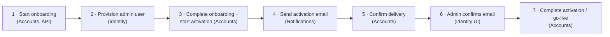
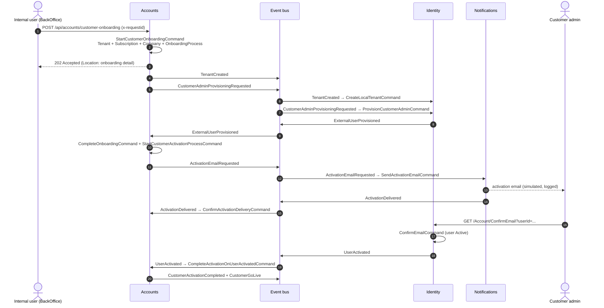
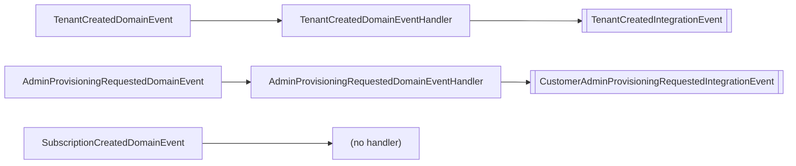
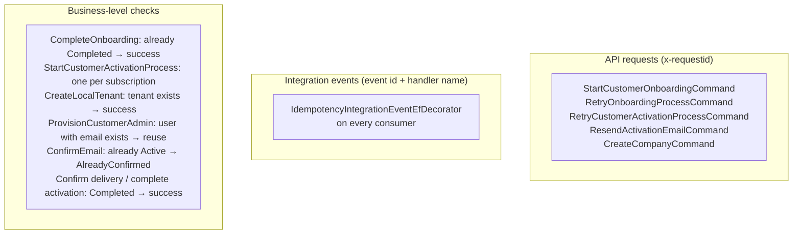
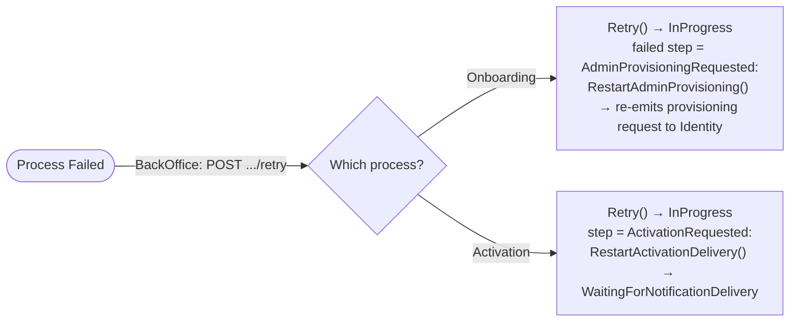

# Onboarding & Activation Workflow

## Overview

The sample workflow initializes a customer account and activates its first administrator. It spans the three services and is driven entirely by **commands, domain events and integration events** — there is no central orchestrator. Each step shows one or more building blocks in action.

| Phase | Process aggregate | Status after the phase |
|---|---|---|
| 1 | `OnboardingProcess` | `WaitingForExternalProvisioning` |
| 3 | `OnboardingProcess` → `CustomerActivationProcess` | onboarding `Completed`, activation `WaitingForNotificationDelivery` |
| 5 | `CustomerActivationProcess` | `WaitingForUserActivation` |
| 7 | `CustomerActivationProcess` | `Completed` |

---

## End-to-End Sequence

All arrows towards the bus are writes to the **transactional outbox** of the producing service; they are published after the corresponding transaction commits (inline, or by the `OutboxProcessor` for commands that run inside an integration event handler).

---

## Step by Step

### 1. Start onboarding (Accounts)

`StartCustomerOnboardingCommand : IdempotentCommand<bool>` is sent by the API with the `x-requestid` header as `RequestId`. In **one transaction** the handler:

1. Creates the `Tenant` (raises `TenantCreatedDomainEvent`) and the `Subscription` (raises `SubscriptionCreatedDomainEvent`).
2. Creates the owner `Company` with `Company.CreateOwnerCompany` and links it to tenant and subscription.
3. Creates the `OnboardingProcess` (correlation id = request id) and walks it through `Start → SubscriptionCreated → TenantCreated → OwnerCompanyCreated → AdminProvisioningRequested`, which raises `AdminProvisioningRequestedDomainEvent`.
4. Calls `SaveChangesAsync` once.

`DomainEventProcessorBehavior` then dispatches the events inside the same transaction:

Building blocks shown: idempotent command (`IdempotencyBehavior`), single-transaction pipeline, domain events inside the transaction, outbox written by domain event handlers, `ValidationBehavior` (`StartCustomerOnboardingCommandValidator`).

### 2. Provision the administrator (Identity)

Identity subscribes to two events, both handled by thin translators that send commands:

| Integration event | Command | Behavior |
|---|---|---|
| `TenantCreatedIntegrationEvent` | `CreateLocalTenantCommand` | Creates the local `Tenant` if it does not exist yet |
| `CustomerAdminProvisioningRequestedIntegrationEvent` | `ProvisionCustomerAdminCommand` | Ensures the tenant exists (creates it if this event arrived first), creates the admin as an unconfirmed external `ApplicationUser` unless a user with that email already exists, and writes `ExternalUserProvisionedIntegrationEvent` to the outbox |

The two events can arrive in any order; both commands are written to be safe in either order and on redelivery. User/tenant data is committed with `ResilientTransaction` on `IdentityContext`, while the outbox and idempotency entries live in `IdentityLogsContext` (see [Domain Events & Consistency](../architecture/03-domain-events-consistency.md#identity-two-contexts)).

### 3. Complete onboarding and start activation (Accounts)

`ExternalUserProvisionedIntegrationEventHandler` sends **two commands** within the transaction opened by the idempotency decorator:

1. `CompleteOnboardingCommand` — creates the admin `UserMembership` (`TenantAdmin`, external, primary) and moves the onboarding through `AdminUserProvisioned → AdminMembershipCreated → Completed`. If the process is already completed it returns the existing result (business-level idempotency).
2. `StartCustomerActivationProcessCommand : IdempotentCommand<bool>` (request id = onboarding process id) — if no activation exists for the subscription, creates `CustomerActivationProcess`, calls `Start()` and `RequestActivation()`, raising `ActivationEmailRequestedDomainEvent` → `ActivationEmailRequestedIntegrationEvent`.

This is the **hand-off** between the two process aggregates: the onboarding never references the activation; the integration event handler connects them.

### 4. Send the activation email (Notifications)

`ActivationEmailRequestedIntegrationEventHandler` → `SendActivationEmailCommand`:

- creates an `EmailNotification` of type `ActivationEmail` whose body contains the link `https://identity/Account/ConfirmEmail?userId={adminUserId}`,
- "sends" it through `IEmailService` (`EmailService` only logs `SIMULATED - Email sent ...`) and marks it as sent,
- writes `ActivationDeliveredIntegrationEvent` to the outbox.

### 5. Confirm delivery (Accounts)

`ActivationDeliveredIntegrationEventHandler` → `ConfirmActivationDeliveryCommand` → `MarkActivationDelivered()`; the activation moves to `WaitingForUserActivation`.

### 6. The administrator confirms the email (Identity)

The Razor page `/Account/ConfirmEmail?userId=...` sends `ConfirmEmailCommand`, which activates the user (`Status = Active`, `EmailConfirmed = true`) and writes `UserActivatedIntegrationEvent` to the outbox. Calling it again returns `AlreadyConfirmed` without publishing a new event.

### 7. Complete activation / go-live (Accounts)

`UserActivatedIntegrationEventHandler` → `CompleteActivationOnUserActivatedCommand` finds the activation by admin user id and calls `MarkUserActivated → MarkCustomerReady → Complete()`. `CustomerGoLiveDomainEvent` produces `CustomerActivationCompletedIntegrationEvent` and `CustomerGoLiveIntegrationEvent`, which mark the end of the sample flow (no service subscribes to them).

The same handler also increments the `accounts.activation.processes.completed` counter (`CustomerActivationDiagnostics`; `started` and `failed` are recorded by the other activation commands).

---

## Integration Events Catalog

| Integration event | Contract project | Producer (domain/command) | Consumer → command |
|---|---|---|---|
| `TenantCreatedIntegrationEvent` | `Contracts.Accounts` | Accounts — `TenantCreatedDomainEventHandler` | Identity → `CreateLocalTenantCommand` |
| `CustomerAdminProvisioningRequestedIntegrationEvent` | `Contracts.Accounts` | Accounts — `AdminProvisioningRequestedDomainEventHandler` | Identity → `ProvisionCustomerAdminCommand` |
| `CompanyCreatedIntegrationEvent` | `Contracts.Accounts` | Accounts — `CompanyCreatedDomainEventHandler` (only via `CreateCompany`) | Notifications → `SendCompanyWelcomeEmailsCommand` |
| `ActivationEmailRequestedIntegrationEvent` | `Contracts.Accounts` | Accounts — `ActivationEmailRequestedDomainEventHandler` | Notifications → `SendActivationEmailCommand` |
| `CustomerActivationCompletedIntegrationEvent` | `Contracts.Accounts` | Accounts — `CustomerGoLiveDomainEventHandler` | — |
| `CustomerGoLiveIntegrationEvent` | `Contracts.Accounts` | Accounts — `CustomerGoLiveDomainEventHandler` | — |
| `ExternalUserProvisionedIntegrationEvent` | `Contracts.Identity` | Identity — `ProvisionCustomerAdminCommandHandler` | Accounts → `CompleteOnboardingCommand` + `StartCustomerActivationProcessCommand` |
| `UserActivatedIntegrationEvent` | `Contracts.Identity` | Identity — `ConfirmEmailCommandHandler` | Accounts → `CompleteActivationOnUserActivatedCommand` |
| `ActivationDeliveredIntegrationEvent` | `Contracts.Notifications` | Notifications — `SendActivationEmailCommandHandler` | Accounts → `ConfirmActivationDeliveryCommand` |

In Identity and Notifications the integration event is written by the **command handler**, because these services have no aggregate raising domain events for these steps; in Accounts it is always written by a domain event handler.

---

## Idempotency at Every Step

The three layers are complementary: the platform guarantees each message or request is processed once per handler, and the business checks make re-execution after a **retry** (a new message with a new id) harmless.

---

## Failures and Retries

Command handlers that apply an external response to a process catch `AccountDomainException` (an invalid transition), mark the process as failed and return a `Conflict` result:

| Command | On invalid transition | Error code stored |
|---|---|---|
| `CompleteOnboardingCommand` | `OnboardingProcess.Fail(...)` | `IntegrationEventProcessingError` |
| `ConfirmActivationDeliveryCommand` | `CustomerActivationProcess.Fail(...)` | `ActivationDeliveredProcessingError` |
| `CompleteActivationOnUserActivatedCommand` | `CustomerActivationProcess.Fail(...)` | `UserActivatedProcessingError` |

Because the failure is returned as a `Result` (not thrown), the transaction commits the `Failed` state and the message is completed — the process is parked for a manual retry. Infrastructure exceptions, in contrast, roll back and the message is redelivered by the bus.

Retry commands are `IdempotentCommand<bool>` and only allowed from `Failed` (`409 Conflict` with code `RetryNotAllowed` otherwise).

---

## Design Decisions

**Choreography instead of a central processor.** Each transition is a small command reacting to one event, and each aggregate only knows its own state machine. A background "processor" polling the process table and switching on the current step was considered and rejected: it would duplicate the logic already expressed by handlers, still need the same integration events between services, and hide the steps that are now explicit (and individually traced) handlers.

**Two process aggregates instead of one.** Onboarding (structure + identity provisioning) and activation (invitation + confirmation) have different statuses, retries and failure points. Splitting them keeps each state machine small; the hand-off happens in one integration event handler.

**Process aggregates keep a data snapshot.** `OnboardingProcess` and `CustomerActivationProcess` store the plan code, company legal name and admin data, so domain event handlers and read models do not need to load other aggregates.

**Correlation.** The API request id is stored as `CorrelationId` in the onboarding, propagated to the activation (`StartCustomerActivationProcessCommand` uses the onboarding id as request id) and added to the logging scope of every command handler.

**UI polling.** The BackOffice detail pages poll the read API while a process is not in a final state (see [BackOffice API & UI](03-backoffice-api-ui.md)); no push channel is used.

---

## Simplifications in the Sample

These behaviors are deliberate shortcuts or current limitations of the example and are worth knowing when reading the code:

| Area | Behavior |
|---|---|
| Email delivery | `EmailService` only logs; there is no SMTP provider. |
| Activation link | The link carries only `userId` (no confirmation token) and points to the internal `https://identity` address. |
| Owner company event | `Company.CreateOwnerCompany` does not raise `CompanyCreatedDomainEvent`, so onboarding does not send welcome emails (only `CreateCompany` does). |
| Structural statuses | Tenant, subscription, company and membership stay in their initial status after go-live; their `Activate` methods are not called by the flow. |
| Resend activation | `ResendActivationEmailCommand` calls `RequestActivation()`, which is only valid in `InProgress` with step `None`; while the process is waiting it returns `409 ResendNotAllowed` even though the UI offers the action. |
| Activation retry | Retrying does not raise a new email request; after a failure at step `ActivationDelivered` the process returns to `InProgress` and cannot receive `UserActivated`. |
| Nested publishing | Events emitted by commands running inside integration event handlers are published by the `OutboxProcessor` (polling interval) rather than inline. |
