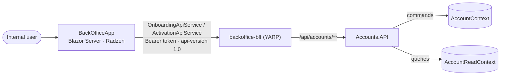
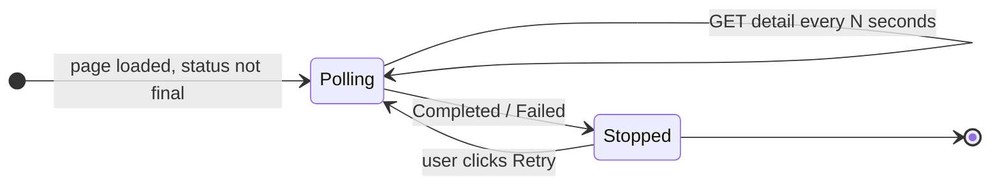

# BackOffice API & UI

## Overview

Internal users drive and monitor the sample workflow from the **BackOffice** (Blazor Server + Radzen). The BackOffice never talks to the services directly: it calls the Accounts API through the **BFF** (YARP), authenticated with the user's access token.



Commands go through the full pipeline (idempotency, transaction, validation, domain events, outbox); queries are served by query handlers over the read-only `AccountReadContext` (see [CQRS Read Model](../architecture/08-cqrs-read-model.md)).

---

## Accounts API

All endpoints are versioned (`api-version 1.0`) and require an authenticated user. Write endpoints require the `x-requestid` header (a non-empty GUID) used as the idempotency key.

### Customer onboarding — `api/accounts/customer-onboarding`

| Method | Route | Policy | Request → Response |
|---|---|---|---|
| `POST` | `/` | `Accounts.Onboarding.Write` | `StartOnboardingProcessRequest` → `202 Accepted` + `OnboardingProcessStartedResponse` (Location: detail) |
| `GET` | `/` | `Accounts.Onboarding.Read` | filters `status`, `companyLegalName`, `adminEmail`, `subscriptionPlanCode`, `page`, `pageSize` (≤ 100), `sortBy`, `sortDirection` → `OnboardingProcessListResponse` |
| `GET` | `/{id}` | `Accounts.Onboarding.Read` | → `OnboardingProcessDetailResponse` or `404` |
| `GET` | `/{id}/result` | `Accounts.Onboarding.Read` | → `OnboardingProcessResultResponse` (only when `Completed`, otherwise `400`) |
| `POST` | `/{id}/retry` | `Accounts.Onboarding.Retry` | `RetryOnboardingProcessRequest(reason?)` → `202 Accepted`, `404`, or `409 RetryNotAllowed` |

```json
// POST /api/accounts/customer-onboarding   (x-requestid: <guid>)
{
  "company": {
    "legalName": "Acme Corp S.L.",
    "tradeName": "Acme",
    "taxId": "B12345678",
    "taxNumberType": "Cif",
    "countryCode": "ES",
    "country": "Spain"
  },
  "subscription": { "subscriptionPlanCode": "STANDARD" },
  "adminUser": { "firstName": "John", "lastName": "Doe", "email": "admin@acme.test" }
}
```

The endpoint maps the request to `StartCustomerOnboardingCommand` (trade name defaults to the legal name, tax number type to `Vat`, tenant name to the legal name, `CreatedByInternalUserId` = current user) and, after the command succeeds, reads the created process with `GetOnboardingByRequestIdQuery` to build the `202` response.

### Customer activation — `api/accounts/customer-activation`

| Method | Route | Policy | Request → Response |
|---|---|---|---|
| `GET` | `/` | `Accounts.Activation.Read` | filters `status`, `companyLegalName`, `adminEmail`, paging and sorting → `CustomerActivationProcessListResponse` |
| `GET` | `/{id}` | `Accounts.Activation.Read` | → `CustomerActivationProcessDetailResponse` or `404` |
| `POST` | `/{id}/retry` | `Accounts.Activation.Retry` | `RetryActivationProcessRequest(reason?)` → `202 Accepted`, `404`, or `409 RetryNotAllowed` |
| `POST` | `/{id}/resend` | `Accounts.Activation.Resend` | → `202 Accepted`, `404`, or `409 ResendNotAllowed` |

### Companies — `api/accounts/companies`

| Method | Route | Request → Response |
|---|---|---|
| `PUT` | `/` | `CreateCompanyRequest` → `200 OK (true)` / `400` — raises `CompanyCreatedDomainEvent` (welcome emails in Notifications) |
| `GET` | `/{id}` | → `CompanyDetail` or `404` |
| `GET` | `/` | → `CompanySummary[]` |

These endpoints only require an authenticated user and are not used by the BackOffice UI; they are the minimal example walked through in [End-to-End Flow](../developer-guide/03-end-to-end-flow.md).

### Read models

Detail responses are designed for the UI, so the display logic lives in the query side (`OnboardingDisplayHelpers`, `ActivationDisplayHelpers`):

| Field | Content |
|---|---|
| `Status` / `StatusDisplayName`, `CurrentStep` / `CurrentStepDisplayName` | Raw enum values plus human-readable labels |
| `ProgressPercent` | Derived from the current step |
| `Steps` | Timeline of all steps with their state (completed, current, pending, failed) |
| `Summary`, `References` | Snapshot data (company, plan, admin email) and related ids (subscription, tenant, company, admin user, membership) |
| `LastError` | Error code, message, failed step and timestamp |
| `Actions` | Flags the UI uses to enable buttons: onboarding `CanRetry` / `CanRefresh` / `CanOpenCustomer`; activation `CanRetry` / `CanResend` / `IsCompleted` |

Errors use the common `ApiErrorResponse` contract (`code`, `message`, `traceId`, optional `errors` per field).

---

## Authorization

Policies are declared in `Accounts.API/Program.cs` with role requirements (`AccountsAuthorizationPolicies`):

| Policy | ProjectManager | BusinessAdmin | SupportAgent | PlatformAdmin |
|---|:---:|:---:|:---:|:---:|
| `Accounts.Onboarding.Write` | ✅ | ✅ | | ✅ |
| `Accounts.Onboarding.Read` | ✅ | ✅ | ✅ | ✅ |
| `Accounts.Onboarding.Retry` | ✅ | | ✅ | ✅ |
| `Accounts.Activation.Read` | ✅ | ✅ | ✅ | ✅ |
| `Accounts.Activation.Retry` | ✅ | | ✅ | ✅ |
| `Accounts.Activation.Resend` | ✅ | | ✅ | ✅ |

The matrix is covered by positive and negative functional tests (`BackOfficeOnboardingAuthorizationTests`, `BackOfficeActivationAuthorizationTests`), which use the `X-Test-Role` header of the test `AutoAuthorizeMiddleware`.

---

## BackOffice Pages

| Route | Page | What it shows / does |
|---|---|---|
| `/onboarding` | Onboarding list | Paged, filterable grid of onboarding processes |
| `/onboarding/start` | Start onboarding | Form for company, plan and admin user; sends `POST` with a new `x-requestid` and navigates to the detail |
| `/onboarding/{id}` | Onboarding detail | Status, progress, step timeline, last error; **Retry** when `CanRetry` |
| `/onboarding/{id}/result` | Onboarding result | Created subscription, tenant, owner company, admin user and membership |
| `/activation` | Activation list | Paged, filterable grid of activation processes |
| `/activation/{id}` | Activation detail | Status, progress, step timeline; **Retry** / **Resend** according to `Actions`, **Refresh** while not `Completed` / `Failed` |
| `/dashboard`, `/profile` | Shell pages | Template pages (placeholder dashboard cards, profile form); not part of the sample flow |

All pages require an authenticated user (`[Authorize]`); the API enforces the role policies.

### Polling

Detail pages refresh themselves while the process is not in a final state:



| Page | Polled statuses | Interval |
|---|---|---|
| Onboarding detail | `InProgress` (5 s), `WaitingForExternalProvisioning` (10 s) | adaptive |
| Activation detail | `InProgress` (5 s), `WaitingForNotificationDelivery` (10 s), `WaitingForUserActivation` (30 s) | adaptive |

The loop runs with a `CancellationTokenSource` that is cancelled when the component is disposed.

---

## Trying It Locally

1. Start the Aspire `AppHost` (SQL Server, Redis, Service Bus emulator and all services).
2. Open the BackOffice and sign in with a seeded internal user (`admin@example.com`, role `PlatformAdmin`; the password comes from the `Seed:DemoUsersPassword` setting of Identity).
3. Go to **Onboarding → Start**, submit the form and watch the detail page move to `Completed` (Identity provisioning may take one outbox polling cycle).
4. Open **Activation**: the process waits for user activation. The activation email is only logged by Notifications — copy the `userId` from the log (or from the onboarding result) and open `/Account/ConfirmEmail?userId={id}` on the Identity endpoint.
5. The activation detail moves to `Completed` (go-live).

The Aspire dashboard shows the whole flow as one distributed trace per step, plus the outbox, idempotency and handler metrics described in [Telemetry](../architecture/06-telemetry.md).
