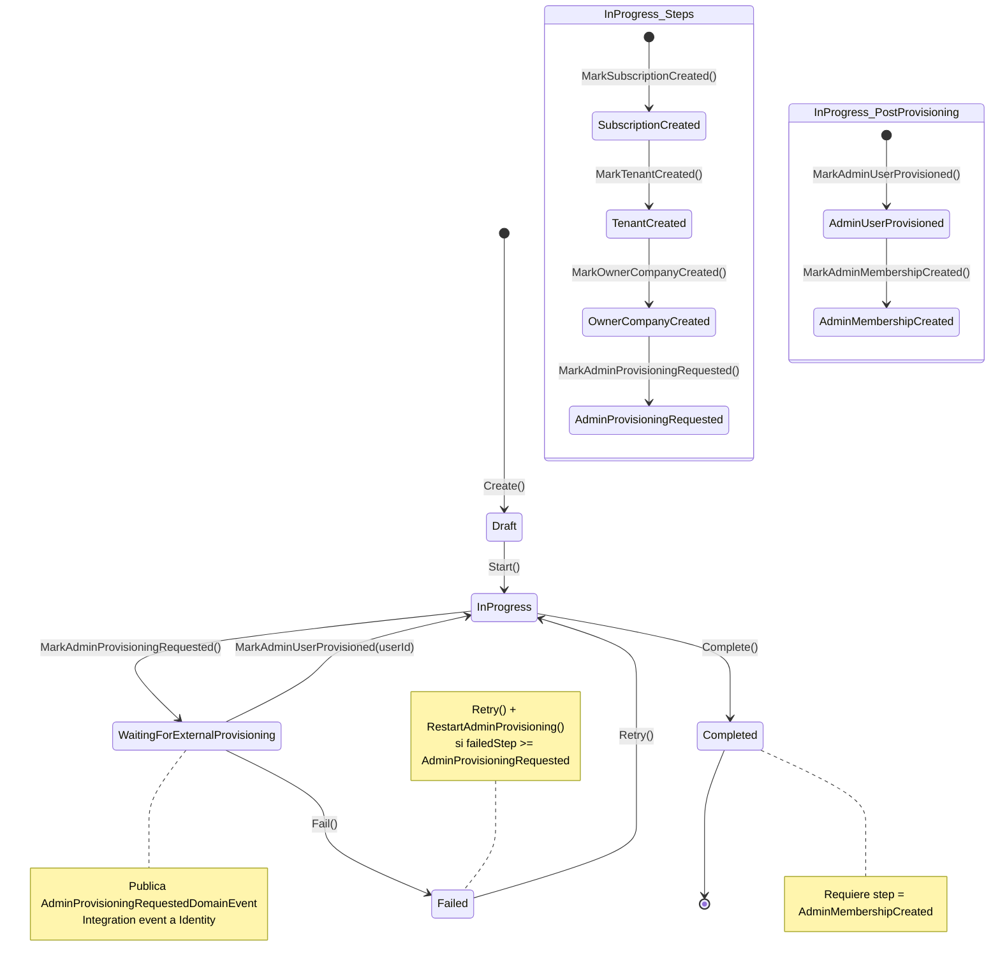
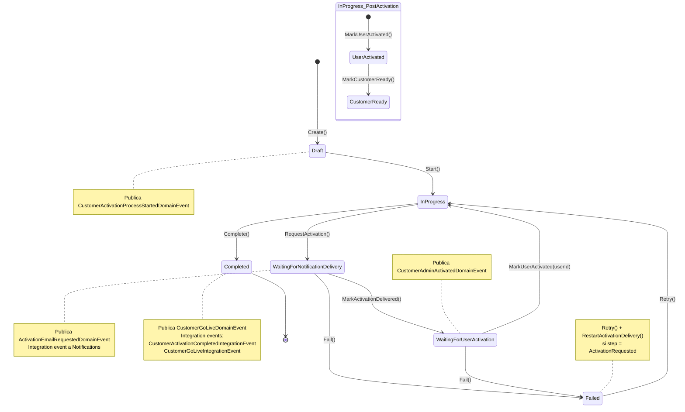
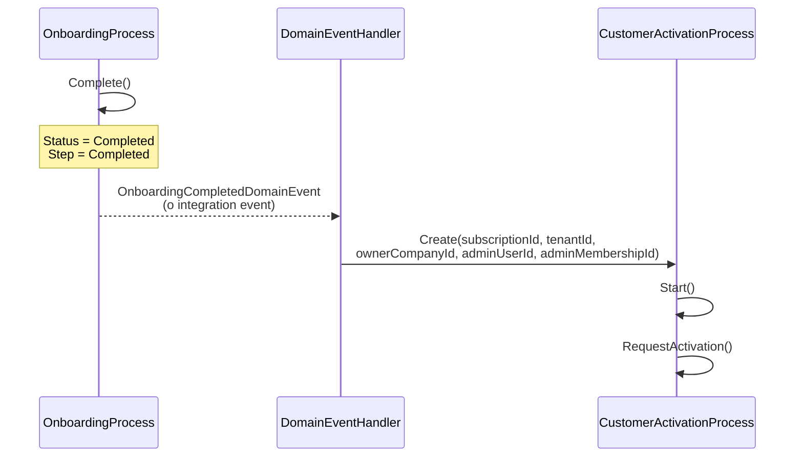

## Diagrama de estados — Onboarding + Activation

El proceso completo se implementa con **dos aggregates independientes** que se comunican mediante domain events e integration events:

1. **`OnboardingProcess`** — Crea la estructura base (Subscription, Tenant, Company) y provisiona el admin user via Identity.
2. **`CustomerActivationProcess`** — Se crea al completar el onboarding. Gestiona la invitación, activación del usuario y go-live.

---

## 1. OnboardingProcess

**Aggregate:** `Qlt.Services.Accounts.Domain.Models.OnboardingAggregate.OnboardingProcess`

### Estados (`OnboardingStatus`)

| Valor | Significado |
|-------|-------------|
| `Draft` | Proceso creado, aún no iniciado |
| `InProgress` | Creando estructura base o post-provisioning |
| `WaitingForExternalProvisioning` | Esperando respuesta de Identity |
| `Completed` | Estructura lista — handoff a Activation |
| `Failed` | Fallo reintentable |

### Steps (`OnboardingStep`)

| Valor | Transición |
|-------|-----------|
| `None` | Estado inicial |
| `SubscriptionCreated` | Subscription creada |
| `TenantCreated` | Tenant creado |
| `OwnerCompanyCreated` | Owner company creada |
| `AdminProvisioningRequested` | Provisioning solicitado a Identity |
| `AdminUserProvisioned` | Identity respondió con userId |
| `AdminMembershipCreated` | Membership del admin creada |
| `Completed` | Proceso finalizado |

### Retry

- `Retry()` → Resetea status a `InProgress`, incrementa `RetryCount`
- Si `FailedStep >= AdminProvisioningRequested` → se llama `RestartAdminProvisioning()` que vuelve a `WaitingForExternalProvisioning` y re-publica el domain event

---

## 2. CustomerActivationProcess

**Aggregate:** `Qlt.Services.Accounts.Domain.Models.CustomerActivationProcessAggregate.CustomerActivationProcess`

Se crea al completarse el onboarding (cuando `OnboardingProcess.Complete()` dispara el flujo de handoff).

### Estados (`ActivationStatus`)

| Valor | Significado |
|-------|-------------|
| `Draft` | Proceso creado |
| `InProgress` | Ejecutando pasos pre/post activación |
| `WaitingForNotificationDelivery` | Esperando confirmación de envío de invitación |
| `WaitingForUserActivation` | Invitación entregada, esperando acción del cliente |
| `Completed` | Customer operativo (go-live) |
| `Failed` | Fallo reintentable |

### Steps (`ActivationStep`)

| Valor | Transición |
|-------|-----------|
| `None` | Estado inicial |
| `ActivationRequested` | Invitación solicitada |
| `ActivationDelivered` | Invitación entregada al usuario |
| `UserActivated` | Usuario activó su cuenta |
| `CustomerReady` | Preparación final completada |
| `Completed` | Go-live |

### Retry

- `Retry()` → Resetea status a `InProgress`, incrementa `RetryCount`
- Si `Step == ActivationRequested` → se llama `RestartActivationDelivery()` que vuelve a `WaitingForNotificationDelivery`

---

## 3. Handoff entre procesos

---

## 4. Cómo leerlo

El proceso completo queda dividido en 5 macrofases repartidas entre dos aggregates:

1. **Preparación** → `OnboardingProcess.Draft`
2. **Construcción de estructura base** → `OnboardingProcess.InProgress` (Subscription, Tenant, OwnerCompany)
3. **Provisioning del admin** → `OnboardingProcess.WaitingForExternalProvisioning` (espera a Identity)
4. **Activación** → `CustomerActivationProcess` (invitación, entrega, activación del usuario, customer ready)
5. **Go-live** → `CustomerActivationProcess.Completed` (publica integration events para el resto del sistema)