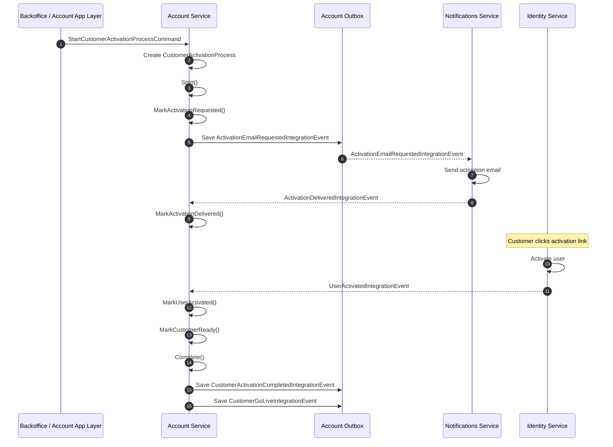

# 03.Implementation guide

# 1. Commands + Handlers (.NET, como guía)

## 1.1 Decisión de modelado recomendada

Para Epic 2, mi recomendación práctica es:

- **no reabrir `OnboardingProcess`**
- crear un nuevo agregado:
    - `CustomerActivationProcess`

Esto encaja mejor con la decisión de cierre de Epic 1, donde el onboarding ya terminó formalmente en `Completed` al crear la membership. Reabrirlo volvería a mezclar provisioning y activation.

---

## 1.2 Estado y pasos recomendados

```
namespaceQlt.Services.Accounts.Domain.Models.CustomerActivationProcesses;

publicenumActivationStatus
{
Draft=0,
InProgress=1,
WaitingForNotificationDelivery=2,
WaitingForUserActivation=3,
Completed=4,
Failed=5
}

publicenumActivationStep
{
None=0,
ActivationRequested=1,
ActivationDelivered=2,
UserActivated=3,
CustomerReady=4,
Completed=5
}
```

### Nota

Mantendría el modelo **dual Status + Step** porque ya os ha funcionado bien con `OnboardingProcess` y encaja con vuestro patrón de state machine explícita.

---

## 1.3 Aggregate root sugerido

No te lo doy como clase cerrada completa, sino como esqueleto suficientemente cercano a implementación.

```
usingQlt.Domain.SeedWork;
usingQlt.Services.Accounts.Domain.Events;

namespaceQlt.Services.Accounts.Domain.Models.CustomerActivationProcesses;

publicclassCustomerActivationProcess :Entity,IAggregateRoot
{
publicGuidSubscriptionId {get;privateset; }
publicGuidTenantId {get;privateset; }
publicGuidOwnerCompanyId {get;privateset; }
publicGuidAdminUserId {get;privateset; }
publicGuidAdminMembershipId {get;privateset; }

publicActivationStatusStatus {get;privateset; }
publicActivationStepCurrentStep {get;privateset; }

publicintRetryCount {get;privateset; }
publicstring?ErrorCode {get;privateset; }
publicstring?ErrorMessage {get;privateset; }

publicstring?CompanyLegalName {get;privateset; }
publicstring?SubscriptionPlanCode {get;privateset; }
publicstring?AdminEmail {get;privateset; }

publicGuidCorrelationId {get;privateset; }

publicDateTimeOffsetStartedAtUtc {get;privateset; }
publicDateTimeOffset?ActivationRequestedAtUtc {get;privateset; }
publicDateTimeOffset?ActivationDeliveredAtUtc {get;privateset; }
publicDateTimeOffset?UserActivatedAtUtc {get;privateset; }
publicDateTimeOffset?CompletedAtUtc {get;privateset; }
publicDateTimeOffset?LastRetryAtUtc {get;privateset; }

protectedCustomerActivationProcess() { }

publicstaticCustomerActivationProcessCreate(
GuidsubscriptionId,
GuidtenantId,
GuidownerCompanyId,
GuidadminUserId,
GuidadminMembershipId,
GuidcorrelationId,
string?companyLegalName,
string?subscriptionPlanCode,
string?adminEmail)
    {
if (subscriptionId==Guid.Empty)thrownewAccountDomainException("SubscriptionId is required.");
if (tenantId==Guid.Empty)thrownewAccountDomainException("TenantId is required.");
if (ownerCompanyId==Guid.Empty)thrownewAccountDomainException("OwnerCompanyId is required.");
if (adminUserId==Guid.Empty)thrownewAccountDomainException("AdminUserId is required.");
if (adminMembershipId==Guid.Empty)thrownewAccountDomainException("AdminMembershipId is required.");
if (correlationId==Guid.Empty)thrownewAccountDomainException("CorrelationId is required.");

varprocess=newCustomerActivationProcess
        {
SubscriptionId=subscriptionId,
TenantId=tenantId,
OwnerCompanyId=ownerCompanyId,
AdminUserId=adminUserId,
AdminMembershipId=adminMembershipId,
CorrelationId=correlationId,
CompanyLegalName=companyLegalName,
SubscriptionPlanCode=subscriptionPlanCode,
AdminEmail=adminEmail,
Status=ActivationStatus.Draft,
CurrentStep=ActivationStep.None,
StartedAtUtc=DateTimeOffset.UtcNow
        };

process.AddDomainEvent(newCustomerActivationProcessCreatedDomainEvent(process.Id));
returnprocess;
    }

publicvoidStart()
    {
EnsureStatus(ActivationStatus.Draft);
Status=ActivationStatus.InProgress;
    }

publicvoidMarkActivationRequested()
    {
EnsureStatus(ActivationStatus.InProgress);
EnsureStep(ActivationStep.None);

CurrentStep=ActivationStep.ActivationRequested;
Status=ActivationStatus.WaitingForNotificationDelivery;
ActivationRequestedAtUtc=DateTimeOffset.UtcNow;
    }

publicvoidMarkActivationDelivered()
    {
EnsureStatus(ActivationStatus.WaitingForNotificationDelivery);
EnsureStep(ActivationStep.ActivationRequested);

CurrentStep=ActivationStep.ActivationDelivered;
Status=ActivationStatus.WaitingForUserActivation;
ActivationDeliveredAtUtc=DateTimeOffset.UtcNow;
    }

publicvoidMarkUserActivated(GuiduserId)
    {
EnsureStatus(ActivationStatus.WaitingForUserActivation);
EnsureStep(ActivationStep.ActivationDelivered);

if (userId!=AdminUserId)
thrownewAccountDomainException("The activated user does not match the activation process admin user.");

CurrentStep=ActivationStep.UserActivated;
Status=ActivationStatus.InProgress;
UserActivatedAtUtc=DateTimeOffset.UtcNow;
    }

publicvoidMarkCustomerReady()
    {
EnsureStatus(ActivationStatus.InProgress);
EnsureStep(ActivationStep.UserActivated);

CurrentStep=ActivationStep.CustomerReady;
    }

publicvoidComplete()
    {
EnsureStatus(ActivationStatus.InProgress);
EnsureStep(ActivationStep.CustomerReady);

CurrentStep=ActivationStep.Completed;
Status=ActivationStatus.Completed;
CompletedAtUtc=DateTimeOffset.UtcNow;
    }

publicvoidFail(stringerrorCode,stringerrorMessage)
    {
if (Status==ActivationStatus.Completed)
thrownewAccountDomainException("A completed activation process cannot fail.");

Status=ActivationStatus.Failed;
ErrorCode=errorCode;
ErrorMessage=errorMessage;
    }

publicvoidRetry()
    {
EnsureStatus(ActivationStatus.Failed);

RetryCount++;
LastRetryAtUtc=DateTimeOffset.UtcNow;
ErrorCode=null;
ErrorMessage=null;

Status=ActivationStatus.InProgress;
    }

publicvoidRestartActivationDelivery()
    {
EnsureStatus(ActivationStatus.InProgress);
EnsureStep(ActivationStep.ActivationRequested);

Status=ActivationStatus.WaitingForNotificationDelivery;
    }

privatevoidEnsureStatus(ActivationStatusexpected)
    {
if (Status!=expected)
thrownewAccountDomainException($"Invalid activation status transition. Expected '{expected}' but was '{Status}'.");
    }

privatevoidEnsureStep(ActivationStepexpected)
    {
if (CurrentStep!=expected)
thrownewAccountDomainException($"Invalid activation step transition. Expected '{expected}' but was '{CurrentStep}'.");
    }
}
```

## Por qué así

- replica patrones que ya habéis consolidado con `OnboardingProcess`: transiciones explícitas, guards y retry sin reset ciego.
- deja margen a los desarrolladores para decidir si `CustomerReady` será automático o si se resolverá con una policy/service.

---

## 1.4 Repository contract sugerido

```
usingQlt.Domain.SeedWork;
usingQlt.Services.Accounts.Domain.Models.CustomerActivationProcesses;

namespaceQlt.Services.Accounts.Domain.Repositories;

publicinterfaceICustomerActivationProcessRepository :IRepository<CustomerActivationProcess>
{
CustomerActivationProcessAdd(CustomerActivationProcessprocess);
voidUpdate(CustomerActivationProcessprocess);

Task<CustomerActivationProcess?>GetAsync(Guidid);
Task<CustomerActivationProcess?>GetBySubscriptionIdAsync(GuidsubscriptionId);
Task<CustomerActivationProcess?>GetByAdminUserIdAsync(GuidadminUserId);
}
```

---

## 1.5 Commands recomendados

### A. StartCustomerActivationProcessCommand

Se dispara cuando Epic 1 ya ha dejado el customer provisionado.

```
usingSystem.Runtime.Serialization;
usingQlt.Platform.Application.Idempotency;

namespaceQlt.Services.Accounts.Application.Commands;

[DataContract]
publicrecordStartCustomerActivationProcessCommand :IdempotentCommand<bool>
{
    [DataMember]publicGuidSubscriptionId {get;init; }
    [DataMember]publicGuidTenantId {get;init; }
    [DataMember]publicGuidOwnerCompanyId {get;init; }
    [DataMember]publicGuidAdminUserId {get;init; }
    [DataMember]publicGuidAdminMembershipId {get;init; }
    [DataMember]publicstring?CompanyLegalName {get;init; }
    [DataMember]publicstring?SubscriptionPlanCode {get;init; }
    [DataMember]publicstring?AdminEmail {get;init; }

publicStartCustomerActivationProcessCommand() { }

publicStartCustomerActivationProcessCommand(
GuidsubscriptionId,
GuidtenantId,
GuidownerCompanyId,
GuidadminUserId,
GuidadminMembershipId,
string?companyLegalName,
string?subscriptionPlanCode,
string?adminEmail,
Guid?requestId=null) :base(requestId)
    {
SubscriptionId=subscriptionId;
TenantId=tenantId;
OwnerCompanyId=ownerCompanyId;
AdminUserId=adminUserId;
AdminMembershipId=adminMembershipId;
CompanyLegalName=companyLegalName;
SubscriptionPlanCode=subscriptionPlanCode;
AdminEmail=adminEmail;
    }

publicoverrideResult<bool>CreateResultForDuplicateRequest()
=>Result.Success(true);
}
```

### B. RetryCustomerActivationProcessCommand

```
[DataContract]
publicrecordRetryCustomerActivationProcessCommand :IdempotentCommand<bool>
{
    [DataMember]publicGuidActivationProcessId {get;init; }
    [DataMember]publicstring?Reason {get;init; }

publicRetryCustomerActivationProcessCommand() { }

publicRetryCustomerActivationProcessCommand(GuidactivationProcessId,string?reason,Guid?requestId=null)
        :base(requestId)
    {
ActivationProcessId=activationProcessId;
Reason=reason;
    }

publicoverrideResult<bool>CreateResultForDuplicateRequest()
=>Result.Success(true);
}
```

### C. ResendActivationEmailCommand

No necesariamente público desde día 1, pero útil.

```
[DataContract]
publicrecordResendActivationEmailCommand :IdempotentCommand<bool>
{
    [DataMember]publicGuidActivationProcessId {get;init; }

publicResendActivationEmailCommand() { }

publicResendActivationEmailCommand(GuidactivationProcessId,Guid?requestId=null)
        :base(requestId)
    {
ActivationProcessId=activationProcessId;
    }

publicoverrideResult<bool>CreateResultForDuplicateRequest()
=>Result.Success(true);
}
```

---

## 1.6 Validators sugeridos

```
usingFluentValidation;

namespaceQlt.Services.Accounts.Application.Validators;

publicclassStartCustomerActivationProcessCommandValidator :AbstractValidator<StartCustomerActivationProcessCommand>
{
publicStartCustomerActivationProcessCommandValidator()
    {
RuleFor(x=>x.SubscriptionId).NotEmpty();
RuleFor(x=>x.TenantId).NotEmpty();
RuleFor(x=>x.OwnerCompanyId).NotEmpty();
RuleFor(x=>x.AdminUserId).NotEmpty();
RuleFor(x=>x.AdminMembershipId).NotEmpty();
    }
}

publicclassRetryCustomerActivationProcessCommandValidator :AbstractValidator<RetryCustomerActivationProcessCommand>
{
publicRetryCustomerActivationProcessCommandValidator()
    {
RuleFor(x=>x.ActivationProcessId).NotEmpty();
RuleFor(x=>x.Reason).MaximumLength(500);
    }
}
```

---

## 1.7 Handlers sugeridos

### A. StartCustomerActivationProcessCommandHandler

```
usingMicrosoft.Extensions.Logging;
usingQlt.Services.Accounts.Domain.Models.CustomerActivationProcesses;
usingQlt.Services.Accounts.Domain.Repositories;
usingQlt.Platform.Results;

namespaceQlt.Services.Accounts.Application.Commands;

publicclassStartCustomerActivationProcessCommandHandler
    :ICommandHandler<StartCustomerActivationProcessCommand,bool>
{
privatereadonlyICustomerActivationProcessRepository_repository;
privatereadonlyILogger<StartCustomerActivationProcessCommandHandler>_logger;

publicStartCustomerActivationProcessCommandHandler(
ICustomerActivationProcessRepositoryrepository,
ILogger<StartCustomerActivationProcessCommandHandler>logger)
    {
_repository=repository;
_logger=logger;
    }

publicasyncTask<Result<bool>>Handle(StartCustomerActivationProcessCommandmessage,CancellationTokencancellationToken)
    {
usingvarscope=_logger.BeginScope(newDictionary<string,object>
        {
            ["CorrelationId"]=message.RequestId??Guid.Empty,
            ["SubscriptionId"]=message.SubscriptionId
        });

varexisting=await_repository.GetBySubscriptionIdAsync(message.SubscriptionId);
if (existingisnotnull)
        {
_logger.LogInformation("Activation process already exists for subscription {SubscriptionId}",message.SubscriptionId);
returnResult.Success(true);
        }

varprocess=CustomerActivationProcess.Create(
message.SubscriptionId,
message.TenantId,
message.OwnerCompanyId,
message.AdminUserId,
message.AdminMembershipId,
message.RequestId??Guid.NewGuid(),
message.CompanyLegalName,
message.SubscriptionPlanCode,
message.AdminEmail);

process.Start();
process.MarkActivationRequested();

_repository.Add(process);

varsaved=await_repository.UnitOfWork.SaveChangesAsync(cancellationToken);
returnsaved>0
?Result.Success(true)
            :Result.Failure<bool>(Error.BadRequest.WithMessage("Failed to start customer activation process."));
    }
}
```

### B. RetryCustomerActivationProcessCommandHandler

```
publicclassRetryCustomerActivationProcessCommandHandler
    :ICommandHandler<RetryCustomerActivationProcessCommand,bool>
{
privatereadonlyICustomerActivationProcessRepository_repository;
privatereadonlyILogger<RetryCustomerActivationProcessCommandHandler>_logger;

publicRetryCustomerActivationProcessCommandHandler(
ICustomerActivationProcessRepositoryrepository,
ILogger<RetryCustomerActivationProcessCommandHandler>logger)
    {
_repository=repository;
_logger=logger;
    }

publicasyncTask<Result<bool>>Handle(RetryCustomerActivationProcessCommandmessage,CancellationTokencancellationToken)
    {
varprocess=await_repository.GetAsync(message.ActivationProcessId);
if (processisnull)
        {
_logger.LogWarning("CustomerActivationProcess {ActivationProcessId} not found",message.ActivationProcessId);
returnResult.Failure<bool>(Error.NotFound.WithMessage("Activation process not found."));
        }

usingvarscope=_logger.BeginScope(newDictionary<string,object>
        {
            ["CorrelationId"]=process.CorrelationId,
            ["ActivationProcessId"]=process.Id
        });

try
        {
process.Retry();

// Guía: reenganchar al punto correcto según step actual
if (process.CurrentStep==ActivationStep.ActivationRequested)
            {
process.RestartActivationDelivery();
            }

_repository.Update(process);

varsaved=await_repository.UnitOfWork.SaveChangesAsync(cancellationToken);
returnsaved>0
?Result.Success(true)
                :Result.Failure<bool>(Error.BadRequest.WithMessage("Failed to retry activation process."));
        }
catch (AccountDomainExceptionex)
        {
_logger.LogWarning(ex,"Retry not allowed for activation process {ActivationProcessId}",process.Id);
returnResult.Failure<bool>(Error.Conflict.WithMessage(ex.Message));
        }
    }
}
```

### C. Domain event handler que publica el email request al outbox

Siguiendo vuestro patrón: el command modifica el aggregate; el domain event handler mete el integration event en el outbox.

```
usingQlt.Services.Accounts.Domain.Events;
usingQlt.Services.Accounts.Contracts.IntegrationEvents;
usingQlt.Platform.Messaging.Outbox;

namespaceQlt.Services.Accounts.Application.DomainEventHandlers;

publicclassActivationEmailRequestedDomainEventHandler
    :IDomainEventHandler<ActivationEmailRequestedDomainEvent>
{
privatereadonlyICustomerActivationProcessRepository_repository;
privatereadonlyIEventBusOutboxService_outboxService;

publicActivationEmailRequestedDomainEventHandler(
ICustomerActivationProcessRepositoryrepository,
IEventBusOutboxServiceoutboxService)
    {
_repository=repository;
_outboxService=outboxService;
    }

publicasyncTaskHandle(ActivationEmailRequestedDomainEventnotification,CancellationTokencancellationToken)
    {
varprocess=await_repository.GetAsync(notification.ProcessId);
if (processisnull)
return;

await_outboxService.AddAndSaveEventAsync(
newActivationEmailRequestedIntegrationEvent(
process.Id,
process.SubscriptionId,
process.TenantId,
process.OwnerCompanyId,
process.AdminUserId,
process.AdminEmail??string.Empty,
process.CompanyLegalName,
process.SubscriptionPlanCode,
process.CorrelationId));
    }
}
```

---

## 1.8 Integration event handlers sugeridos

### A. ActivationDeliveredIntegrationEventHandler (Account)

```
usingMicrosoft.Extensions.Logging;
usingQlt.Services.Accounts.Contracts.IntegrationEvents;
usingQlt.Services.Accounts.Domain.Repositories;

namespaceQlt.Services.Accounts.Infrastructure.IntegrationEventHandlers;

publicclassActivationDeliveredIntegrationEventHandler
    :IIntegrationEventHandler<ActivationDeliveredIntegrationEvent>
{
privatereadonlyICustomerActivationProcessRepository_repository;
privatereadonlyILogger<ActivationDeliveredIntegrationEventHandler>_logger;

publicActivationDeliveredIntegrationEventHandler(
ICustomerActivationProcessRepositoryrepository,
ILogger<ActivationDeliveredIntegrationEventHandler>logger)
    {
_repository=repository;
_logger=logger;
    }

publicasyncTaskHandle(ActivationDeliveredIntegrationEvent@event)
    {
varprocess=await_repository.GetAsync(@event.ActivationProcessId);
if (processisnull)
        {
_logger.LogWarning("Activation process {ActivationProcessId} not found",@event.ActivationProcessId);
return;
        }

usingvarscope=_logger.BeginScope(newDictionary<string,object>
        {
            ["CorrelationId"]=process.CorrelationId,
            ["ActivationProcessId"]=process.Id
        });

if (process.Status==ActivationStatus.Completed)
        {
_logger.LogInformation("ActivationDelivered ignored because process is already completed.");
return;
        }

try
        {
process.MarkActivationDelivered();
_repository.Update(process);
await_repository.UnitOfWork.SaveChangesAsync();
        }
catch (AccountDomainExceptionex)
        {
process.Fail("IntegrationEventProcessingError",ex.Message);
_repository.Update(process);
await_repository.UnitOfWork.SaveChangesAsync();

_logger.LogWarning(ex,"Activation delivery processing failed for activation process {ActivationProcessId}",process.Id);
        }
    }
}
```

### B. UserActivatedIntegrationEventHandler (Account)

```
publicclassUserActivatedIntegrationEventHandler
    :IIntegrationEventHandler<UserActivatedIntegrationEvent>
{
privatereadonlyICustomerActivationProcessRepository_repository;
privatereadonlyILogger<UserActivatedIntegrationEventHandler>_logger;

publicUserActivatedIntegrationEventHandler(
ICustomerActivationProcessRepositoryrepository,
ILogger<UserActivatedIntegrationEventHandler>logger)
    {
_repository=repository;
_logger=logger;
    }

publicasyncTaskHandle(UserActivatedIntegrationEvent@event)
    {
varprocess=await_repository.GetByAdminUserIdAsync(@event.UserId);
if (processisnull)
        {
_logger.LogWarning("Activation process not found for admin user {UserId}",@event.UserId);
return;
        }

usingvarscope=_logger.BeginScope(newDictionary<string,object>
        {
            ["CorrelationId"]=process.CorrelationId,
            ["ActivationProcessId"]=process.Id
        });

if (process.Status==ActivationStatus.Completed)
        {
_logger.LogInformation("UserActivated ignored because activation process is already completed.");
return;
        }

try
        {
process.MarkUserActivated(@event.UserId);

// Guía: V1 puede resolver readiness automáticamente
process.MarkCustomerReady();
process.Complete();

_repository.Update(process);
await_repository.UnitOfWork.SaveChangesAsync();
        }
catch (AccountDomainExceptionex)
        {
process.Fail("IntegrationEventProcessingError",ex.Message);
_repository.Update(process);
await_repository.UnitOfWork.SaveChangesAsync();

_logger.LogWarning(ex,"User activation processing failed for activation process {ActivationProcessId}",process.Id);
        }
    }
}
```

---

## 1.9 Identity-side guía mínima

El desarrollador de Identity no necesita mucha imposición aquí; la pieza importante es **emitir el evento** cuando el usuario completa activación.

```
publicclassApplicationUser :IdentityUser<Guid>
{
publicUserTypeUserType {get;privateset; }
publicUserStatusStatus {get;privateset; }

publicvoidActivate()
    {
if (Status==UserStatus.Active)return;
Status=UserStatus.Active;

// Según vuestra base actual:
// - domain event
// o
// - application service que publique al outbox
    }
}
```

Mi recomendación es que Identity publique `UserActivatedIntegrationEvent` desde el punto donde hoy ya considera al usuario realmente activo, no desde un punto artificial intermedio.

---

# 2. Event Contracts finales

Siguiendo la regla del documento de desarrollo: contratos en proyecto `Contracts`, sin mezclar dominio ni comandos.

## 2.1 Account.Contracts

```
usingQlt.Platform.Messaging.IntegrationEvents;

namespaceQlt.Services.Accounts.Contracts.IntegrationEvents;

publicrecordActivationEmailRequestedIntegrationEvent(
GuidActivationProcessId,
GuidSubscriptionId,
GuidTenantId,
GuidOwnerCompanyId,
GuidAdminUserId,
stringAdminEmail,
string?CompanyLegalName,
string?SubscriptionPlanCode,
GuidCorrelationId) :IntegrationEvent;
```

```
usingQlt.Platform.Messaging.IntegrationEvents;

namespaceQlt.Services.Accounts.Contracts.IntegrationEvents;

publicrecordCustomerActivationCompletedIntegrationEvent(
GuidActivationProcessId,
GuidSubscriptionId,
GuidTenantId,
GuidOwnerCompanyId,
GuidAdminUserId,
GuidAdminMembershipId,
GuidCorrelationId) :IntegrationEvent;
```

```
usingQlt.Platform.Messaging.IntegrationEvents;

namespaceQlt.Services.Accounts.Contracts.IntegrationEvents;

publicrecordCustomerGoLiveIntegrationEvent(
GuidActivationProcessId,
GuidSubscriptionId,
GuidTenantId,
GuidCorrelationId) :IntegrationEvent;
```

## 2.2 Notifications.Contracts

```
usingQlt.Platform.Messaging.IntegrationEvents;

namespaceQlt.Services.Notifications.Contracts.IntegrationEvents;

publicrecordActivationDeliveredIntegrationEvent(
GuidActivationProcessId,
GuidUserId,
stringEmail,
DateTimeOffsetDeliveredAtUtc,
GuidCorrelationId) :IntegrationEvent;
```

Opcionalmente:

```
publicrecordActivationDeliveryFailedIntegrationEvent(
GuidActivationProcessId,
GuidUserId,
stringEmail,
stringErrorCode,
stringErrorMessage,
GuidCorrelationId) :IntegrationEvent;
```

## 2.3 Identity.Contracts

```
usingQlt.Platform.Messaging.IntegrationEvents;

namespaceQlt.Infrastructure.Identity.Contracts.IntegrationEvents;

publicrecordUserActivatedIntegrationEvent(
GuidUserId,
stringEmail,
Guid?TenantId,
DateTimeOffsetActivatedAtUtc,
GuidCorrelationId) :IntegrationEvent;
```

## Notas de contrato

- mantendría `CorrelationId` en todos, porque ya os ha dado mucho valor en Epic 1 closure.
- no metería payloads gigantes; solo lo necesario para el consumidor.
- dejaría `TenantId` nullable en Identity event solo si el punto de emisión no siempre lo tiene; si lo tiene siempre, mejor requerido.

---

# 3. Diagrama de secuencia end-to-end

Te lo doy en formato textual y en Mermaid, para que lo podáis mover a documentación técnica.

## 3.1 Secuencia conceptual

1. **Account** detecta que el provisioning de Epic 1 ha terminado.
2. Ejecuta `StartCustomerActivationProcessCommand`.
3. Se crea `CustomerActivationProcess`.
4. El aggregate pasa a:
    - `InProgress`
    - `ActivationRequested`
    - `WaitingForNotificationDelivery`
5. Un domain event handler publica `ActivationEmailRequestedIntegrationEvent`.
6. **Notifications** consume el evento y envía el email.
7. **Notifications** publica `ActivationDeliveredIntegrationEvent`.
8. **Account** recibe el evento y marca:
    - `ActivationDelivered`
    - `WaitingForUserActivation`
9. El usuario hace clic y completa la activación.
10. **Identity** marca el usuario como activo y publica `UserActivatedIntegrationEvent`.
11. **Account** recibe el evento y marca:
- `UserActivated`
- `CustomerReady`
- `Completed`
1. **Account** publica:
- `CustomerActivationCompletedIntegrationEvent`
- opcionalmente `CustomerGoLiveIntegrationEvent`

## 3.2 Mermaid



---

# 4. Recomendaciones de implementación

## Lo que sí haría

- mismo patrón que Epic 1:
    - command idempotente
    - aggregate con guards
    - domain event handler → outbox
    - integration handlers idempotentes
    - observabilidad con `CorrelationId`
- snapshots mínimos en el agregado para listados/read models, igual que hicisteis en onboarding backoffice.

## Lo que no forzaría aún

- endpoint público de start si va a ser puramente automático
- `CustomerReady` manual por backoffice si todavía no hay requisitos reales
- SignalR ni tiempo real; el polling y los read models ya os funcionaron bien.

## Lo que sí dejaría preparado

- `ActivationDeliveryFailedIntegrationEvent`
- `ResendActivationEmailCommand`
- queries/read models tipo backoffice
- authorization policies equivalentes a las del onboarding, si vais a exponer UI operativa.

---

# 5. Siguiente partición natural del backlog técnico

Con esto, yo dividiría la implementación en cuatro bloques:

1. **Account Domain + Infrastructure**
    - aggregate
    - repository
    - config EF
    - migration
    - start command
    - retry command
    - integration handlers
2. **Contracts**
    - Accounts.Contracts
    - Notifications.Contracts
    - Identity.Contracts
3. **Notifications**
    - activation email handler
    - template
    - publish delivered/failure event
4. **Identity**
    - publish `UserActivatedIntegrationEvent`